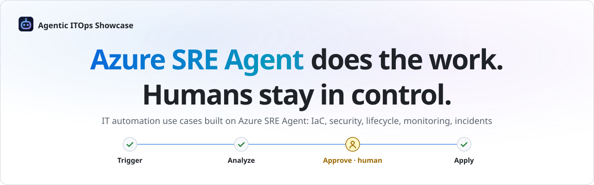

# Agentic ITOps Showcase: AI Agents for IT Operations

<picture>
  <source media="(prefers-color-scheme: dark)" srcset="docs/assets/banner-dark.svg">
  
</picture>

**[Visit the site →](https://rbrunois.github.io/agentic-itops-showcase/)**

[](https://github.com/rbrunois/agentic-itops-showcase/actions/workflows/validate-repository.yml)
[](LICENSE)

## Repository

Agentic ITOps Showcase is a collection of AI-powered IT automation use cases that demonstrate how organizations can use agents to streamline operations, accelerate incident resolution, reduce manual work, and deliver measurable business value across cloud and infrastructure environments.

> [!IMPORTANT]
> This is a community demonstration repository. It is not an official Microsoft product, is provided as-is without support or warranty, and is not intended for production use without your own security, compliance, and operational review. All organizations, people, identifiers, and data in examples are fictional (Contoso).

### Use cases

| # | Use Case | What it does | Value | Owner |
| --- | --- | --- | --- | --- |
| 01 | [AVM TF Synchronizer](Tools/avm-tf-synchronizer/README.md) | Monitors AVM changes, triages diffs, detects Terraform gaps, validates synthetic Contoso controls, and prepares review-only artifacts in a PR | Demonstrates a guarded AVM-to-internal-module assessment with internal security controls without automatically applying a patch | [Zahir Mosaib](https://github.com/zahirm) |
| 02 | [Architecture Writer](Tools/architecture-writer/README.md) | Discovers scoped Azure state read-only and produces evidence-labeled architecture documentation, diagrams, validation, and reviewed drift updates | Keeps architecture baselines current while gating GitHub sync and optional IaC behind human approval | [Romain Brunois](https://github.com/rbrunois) |
| 03 | [Azure Vending Machine](Tools/azure-vending-machine/README.md) | Bilingual subscription-vending intake with governed derivation, ServiceNow approval, and reviewed `azure.yml` pull requests | Limits the agent to request orchestration while humans and deterministic pipelines control Azure changes | [Romain Brunois](https://github.com/rbrunois) |
| 04 | [Azure Fleet Security & Patch Remediation](Tools/azure-fleet-security-remediation/README.md) | Unifies security posture and patch remediation across Azure, on-premises, AWS, and Google Cloud machines through Azure Arc, Defender for Cloud, and Update Manager | Provides one governed multicloud operating model with centralized evidence, targeted diagnosis, guest-level verification, and human-approved remediation | [Romain Brunois](https://github.com/rbrunois) |
| 05 | [Azure Incident Investigator (Interactive)](Tools/azure-incident-investigator/README.md) | Investigates Azure application incidents strictly read-only, correlating architecture docs, telemetry, logs, metrics, resource health, and deployment history to pinpoint root cause | Delivers defensible, evidence-first RCA reporting without operational risk, keeping remediation in human hands | [Patrick Cayer](https://github.com/pcayerMS), [Zahir Mosaib](https://github.com/zahirm) |
| 06 | [Azure SRE Incident Response (Reactive)](Tools/azure-sre-incident-response/README.md) | Runs a sample app, injects an explicitly approved demo fault, supports evidence-based SRE Agent investigation, and restores captured baseline traffic | Demonstrates application incident response with guarded operator actions and verified recovery; agent onboarding is separate | [Julien Nephtali](https://github.com/jnephtali-msft) |
| 07 | [Azure Retirement Readiness](Tools/azure-retirement-readiness/README.md) | Builds an evidence-based retirement dashboard from Azure inventory, lifecycle documentation, Service Health coverage, and direct subscription ownership, then can refresh it on a controlled schedule | Gives service owners a prioritized migration plan and communication-ready context while keeping Azure discovery read-only and changes human-approved | [Romain Brunois](https://github.com/rbrunois) |
| 08 | [Microsoft Fabric monitoring](Tools/microsoft-fabric-monitoring/README.md) | Monitors Microsoft Fabric capacities, workspaces, items, and CU consumption through Azure SRE Agent, a bilingual Live Report, and optional historical Power BI analytics | Provides proactive, read-only operational visibility and guided investigation while keeping every write action behind explicit approval and audit controls | [Franck Mercier](https://github.com/franmer2) |
| 09 | [Azure SRE Network Troubleshooting](Tools/azure-sre-network-troubleshooting/README.md) | Correlates VNet Flow Logs, Traffic Analytics, NSGs, and independent application health with Azure SRE Agent; optional additive Connection Monitor | Distinguishes network-policy denial from application failure with evidence-labeled investigation and separately human-approved fault, restoration, and cleanup operations | [Ifeoma Aniagolu](https://github.com/Ifyagolu) |
| 10 | [Azure VM Lifecycle Transition](Tools/azure-vm-lifecycle-transition/README.md) | Finds VMs and scale sets on End of Life VM size series with Azure SRE Agent, proposes a target family for each with evidence, checks quota, zone availability, and Azure Policy, and reports drift every week | Turns VM size retirements into a per-VM plan that stays current, with read-only analysis and approval-gated pilot resizes | [Aldo Andrade](https://github.com/andrade-aldo) |

### Use case types

| Type | Use cases | What you get |
| --- | --- | --- |
| Runnable demo | 01, 05, 06, 08, 09, 10 | Scripts, infrastructure as code, sample apps, or reports you can run in a dedicated environment |
| Design or guidance package | 02, 03, 04, 07 | Agent instructions, procedures, templates, diagrams, and illustrative outputs to adapt to your environment |

> [!WARNING]
> Use cases 05, 06, and 09 deploy billable Azure resources and include deliberate, human-approved fault injection. Use case 08 requires an existing Microsoft Fabric capacity and Azure SRE Agent. The demo lab for use case 10 deploys billable VMs and an Azure SRE Agent. Use a dedicated, non-production subscription and follow each package's cleanup steps.

## Getting started

Pick a use case from the table and read its `README.md` first: each one documents its audience, prerequisites, procedure, safety model, expected output, and limitations.

## Design principles

- **Read-only by default.** Discovery and investigation use least-privilege, read-only access.
- **Evidence first.** Outputs separate observed facts, inferences, and proposals.
- **Humans approve changes.** Agents prepare proposals; humans and deterministic pipelines apply them.
- **Synthetic data only.** Examples never contain real customer data, credentials, or production identifiers.

## Repository structure

```text
.
|-- Tools/<use-case>/README.md   # One folder per use case
|-- .github/                     # Validation workflows and contribution templates
|-- CHANGELOG.md
|-- CONTRIBUTING.md
|-- SECURITY.md
`-- LICENSE
```

## Contributing

Contributions are welcome. Read [CONTRIBUTING.md](CONTRIBUTING.md) and the [code of conduct](CODE_OF_CONDUCT.md) before opening an issue or pull request.

## Security

Do not report vulnerabilities in public issues. See [SECURITY.md](SECURITY.md).

## License

Released under the [MIT License](LICENSE). Microsoft, Azure, Microsoft Fabric, Power BI, and other product names are trademarks of their respective owners; their use here does not imply endorsement.
