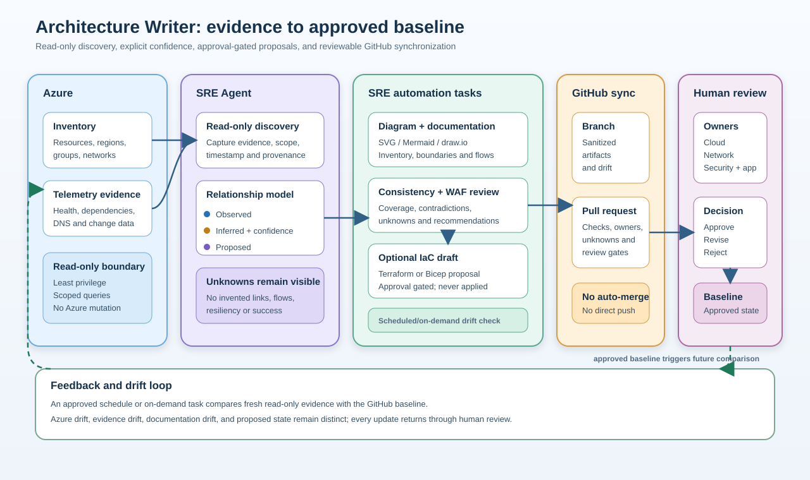

# Architecture Writer

**Status:** Operational guidance

> [!IMPORTANT]
> This package is **guidance and templates only**. It contains no executable
> code, scripts, or GitHub Actions workflow. An agent or operator follows the
> procedure below using tools already configured in their environment.

**Who it is for:** cloud architects, platform engineers, and SRE teams who need
current, evidence-backed Azure architecture documentation and diagrams.

Architecture Writer turns read-only Azure evidence into a current architecture
report, editable diagram, validation findings, and a reviewable GitHub update.
It addresses slow manual diagramming, documentation drift, late Well-Architected
Framework (WAF) review, and the handoff gap between architecture and optional
infrastructure-as-code drafting.



In summary: read-only Azure discovery feeds an agent-built model of resources,
boundaries, and relationships labeled observed, inferred, or proposed; that
model drives the report, diagram, validation, and WAF review. After human
approval, the artifacts are proposed to GitHub as a pull request, and the
human-merged result becomes the baseline for the next drift check.

## Capabilities

The package assumes capabilities for Azure resource inventory, diagram
authoring, repository reads, and GitHub source control. These are descriptive
capability labels, not guaranteed Azure SRE Agent or GitHub tool names. Map them
to the actual least-privilege connector, command, MCP tool, or renderer
configured in the target environment.

## Purpose

Turn a scoped Azure environment or proposed design into an evidence-backed,
reviewable architecture package. Keep observed facts, inferred relationships,
and proposed improvements distinct so diagrams remain useful without presenting
assumptions as deployed reality.

## Value

- Creates one evidence trail across inventory, relationships, diagrams, WAF
  observations, recommendations, and change history.
- Distinguishes deployed facts from inferred relationships and proposed state.
- Supports post-deployment documentation, architecture reviews, disaster
  recovery analysis, and scheduled drift updates.
- Keeps Azure mutation, IaC execution, GitHub merge, and baseline approval under
  explicit human control.

## When to use

| Use case | Result |
| --- | --- |
| Post-deployment documentation | Inventory, boundaries, flows, unknowns, and editable diagram |
| Architecture review | Consistency findings and evidence-backed WAF observations |
| Disaster recovery view | Regional placement, replication and failover evidence, gaps, and readiness questions |
| Drift update | Difference between fresh read-only discovery and the approved GitHub baseline |
| Proposed design | Clearly labeled target-state diagram with an optional approved IaC draft |

Use Architecture Writer to document an existing Azure workload, refresh a
regional or service diagram, prepare a WAF review, compare current inventory
with an approved baseline, or draft Terraform/Bicep only after explicit
approval.

Do not use it to mutate Azure, infer undocumented connectivity as fact, apply
infrastructure code, merge pull requests, or bypass architecture and security
review.

## Quick start prompts

```text
Document the Contoso payments workload in resource group rg-contoso-payments-prod.
Use read-only discovery, label inferred relationships, and produce Markdown plus SVG.

Compare the current Azure inventory with the approved architecture baseline.
Explain drift and prepare a GitHub branch update, but do not merge it.

Review this proposed multi-region architecture against all five WAF pillars.
Keep the design proposed and do not draft IaC until I approve.
```

## Prerequisites

- A defined scope: tenant or subscription boundary, resource groups, regions,
  workload, environments, and exclusions.
- A target audience and purpose, such as operations, architecture review,
  disaster recovery, audit, or onboarding.
- Read-only Azure inventory access through configured Azure Resource Graph,
  Azure CLI, or equivalent capabilities.
- Optional read-only telemetry, DNS, network topology, deployment metadata, and
  repository access when those sources are in scope.
- A configured diagram capability for SVG, Mermaid, or draw.io output.
- An approved GitHub repository and branch policy for optional synchronization.
- For Azure SRE Agent, the dedicated
  [agent instructions](sre-agent-assets/sre-agent-instructions.md), with this
  README, [WORKFLOW.md](WORKFLOW.md), and the report template uploaded as
  knowledge.

Do not claim support for an unconfigured tool, connector, or output format.

## Procedure

1. **Define scope and audience.** Record the environment, purpose, owners, data
   sensitivity, expected detail, output formats, repository target, freshness
   timestamp, and exclusions.
2. **Discover Azure read-only.** Query only in-scope resources and collect the
   minimum evidence needed for identity, type, region, resource group, parent,
   network attachment, dependencies, resiliency, and lifecycle. Record
   provenance without credentials.
3. **Normalize the evidence.** Build stable resource and relationship records:
   - **Observed:** directly returned by an authoritative source.
   - **Inferred:** derived from configuration or correlated evidence, with
     confidence and rationale.
   - **Proposed:** a recommendation or target-state change, never current state.
4. **Model boundaries and flows.** Group subscriptions, resource groups,
   regions, virtual networks, subnets, and service boundaries. Add directional
   application, management, DNS, replication, failover, and data flows only
   when supported. Mark unknown endpoints or direction explicitly.
5. **Generate the package.** Produce the Markdown report and an editable diagram
   supported by the environment. Use SVG or Mermaid by default, draw.io when
   configured, and PNG only when a renderer is available. Preserve an editable
   source.
6. **Validate consistency.** Check inventory coverage, duplicate nodes, dangling
   relationships, directionality, placement, report/diagram agreement, source
   freshness, and unresolved unknowns.
7. **Review WAF explicitly.** Assess reliability, security, cost optimization,
   operational excellence, and performance efficiency only from available
   evidence. Avoid scoring when evidence is insufficient.
8. **Offer optional IaC drafting.** After explicit approval, create a separate
   Terraform or Bicep draft. Label it unvalidated until formatting, policy,
   static validation, security, and owner review complete. Never run plan or
   apply here.
9. **Synchronize through review.** After approval, create or update a dedicated
   branch and pull request containing sanitized artifacts, drift, unknowns, and
   validation results. Never push directly to a protected baseline or merge
   automatically. The commands below are an example for a local clone with the
   Git and GitHub CLIs; agent platforms with their own GitHub connector should
   perform the equivalent branch, commit, push, and pull-request steps (this
   part is tool-specific guidance). Run from the root of the documentation
   repository, after copying the sanitized artifacts into an agreed folder such
   as `docs/architecture/contoso-payments/`:

   ```powershell
   git switch -c architecture/contoso-payments-2026-08-28
   git add docs/architecture/contoso-payments/
   git diff --cached --check
   git commit -m "docs: refresh Contoso Payments architecture (evidence 2026-08-28T17:00:00Z)"
   git push -u origin architecture/contoso-payments-2026-08-28
   gh pr create --draft --base main `
     --title "Architecture refresh: Contoso Payments (2026-08-28)" `
     --body-file docs/architecture/contoso-payments/validation-report.md
   ```

   Review the staged files before committing, and leave the pull request for
   human review; never merge it from this procedure.
10. **Establish the baseline.** After an external human-approved merge, record
    accepted inventory and source metadata. A scheduled or on-demand task may
    repeat read-only discovery and propose another reviewed update.

See [WORKFLOW.md](WORKFLOW.md) for the full lifecycle and failure handling.

## Safety and approvals

- Use least-privilege, read-only Azure and repository access for discovery.
- Do not include tokens, keys, connection strings, private endpoints, public IP
  addresses, subscription IDs, tenant IDs, or sensitive tags unless explicitly
  required, approved, and safely redacted.
- Never fabricate a resource, relationship, traffic direction, redundancy
  claim, recovery capability, or successful validation.
- Clearly label observed, inferred, proposed, stale, unavailable, and
  conflicting information.
- Treat diagrams and model-generated recommendations as review artifacts, not
  authoritative deployment state.
- Require explicit approval before drafting IaC or synchronizing to GitHub.
- Never mutate Azure, execute remediation, deploy Terraform/Bicep, push to a
  protected branch, approve a control, or merge a pull request.
- Stop and report when scope, identity, evidence provenance, or data sensitivity
  is ambiguous.

## Expected output

| Artifact | Required content |
| --- | --- |
| Architecture report | Scope, audience, evidence timestamp, inventory, boundaries, relationships, flows, unknowns, validation, WAF review, recommendations, and change history |
| Editable diagram | SVG, Mermaid, or draw.io source supported by configured tools, with a legend and evidence-state labels |
| Validation report | Coverage, consistency checks, conflicts, stale evidence, unsupported claims, and review gates |
| Source metadata | Sanitized provenance, discovery timestamp, scope, model/schema version, and baseline identifier |
| Optional PNG | Rendered preview only when a renderer is configured; never the sole source |
| Optional IaC draft | Separate, explicitly approved proposal that is not planned, applied, or deployed |

Use the [architecture report template](templates/architecture-report.md) as the
output contract.

## Sample output

```text
Architecture: Contoso Payments - production
Evidence captured: 2026-08-28T17:00:00Z

Observed
- 12 Azure resources across Canada Central and Canada East.
- app-prod-001 uses subnet snet-app in vnet-prod-hub.

Inferred
- API-to-database flow, confidence: medium.
  Rationale: private endpoint configuration is present; application telemetry
  was not available to confirm runtime traffic.

Unknown
- DNS forwarding path from the spoke network.
- Tested recovery time for the secondary region.

Validation
- Diagram nodes: 12/12 inventoried resources represented.
- One inferred relationship requires network-owner review.

Proposed
- Add an evidence-backed failover runbook before assigning a DR readiness status.
- Open a reviewed GitHub update only after owner approval.
```

All names and counts above are synthetic examples.

## Worked example

The [Azure disaster recovery architecture snapshot](examples/azure-dr-architecture-diagram/azure-dr-architecture.md)
shows complementary outputs produced for one example environment:

- [Detailed architecture documentation](examples/azure-dr-architecture-diagram/azure-dr-architecture.md)
- [Interactive HTML diagram](examples/azure-dr-architecture-diagram/azure-dr-diagram.html)
- [Additional HTML architecture view (AI/ML landing zone)](examples/azure-dr-architecture-diagram/azure-architecture-example.html)
- [Static PNG diagram](examples/azure-dr-architecture-diagram/dr-diagram-final.png) (rendered from the interactive HTML diagram)

All identifiers in the example (subscription IDs, resource and resource group
names, hostnames, public IP addresses, and administrator names) are synthetic.
The all-zero subscription ID `00000000-0000-0000-0000-000000000000` is a
synthetic placeholder, not a real subscription. Treat the example as an
illustrative point-in-time snapshot, not current Azure state. The example
footers attribute the output to "the configured architecture agent"; they do
not imply endorsement by any specific product.

## Accepted exceptions

- A conceptual architecture without Azure discovery is accepted when every node
  and relationship is labeled **proposed**, not observed.
- A partial inventory is accepted when scope, omitted sources, coverage, and
  impact on conclusions are explicit.
- Mermaid-only or SVG-only output is accepted when draw.io or PNG rendering is
  unavailable.
- Missing telemetry is accepted when runtime flows remain unknown or inferred
  rather than asserted.
- GitHub sync and IaC may be omitted entirely.

## Limitations

- This package provides guidance, a template, an example SVG, and a static
  worked example; it does not implement Azure discovery or a diagram renderer.
- Missing telemetry, DNS, network, or application evidence limits relationship
  and traffic-flow confidence.
- It does not mutate Azure, deploy IaC, create an executable scheduled workflow,
  or merge GitHub changes.

## Cleanup

Not applicable for Azure resources: the procedure is read-only and deploys
nothing. Remove local generated artifacts (reports, diagrams, exported
inventory, and source metadata) and any working branches according to your
process, for example:

```powershell
git switch main
git branch -D architecture/contoso-payments-2026-08-28        # local branch
git push origin --delete architecture/contoso-payments-2026-08-28  # only if the PR was abandoned
```

Delete exported inventory or telemetry files from local or agent workspaces
once the reviewed artifacts are committed or discarded.

## References

- [Architecture lifecycle](WORKFLOW.md)
- [Azure SRE Agent instructions](sre-agent-assets/sre-agent-instructions.md)
- [Architecture report template](templates/architecture-report.md)
- [Workflow SVG](assets/architecture-writer-workflow.svg)
- [Worked example](examples/azure-dr-architecture-diagram/azure-dr-architecture.md)
- [Azure Well-Architected Framework](https://learn.microsoft.com/azure/well-architected/)
- [Azure Resource Graph documentation](https://learn.microsoft.com/azure/governance/resource-graph/)
