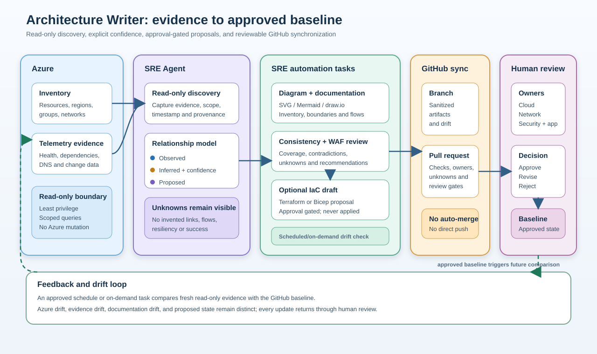

# Architecture Writer workflow

The lifecycle connects Azure evidence, reasoning by the configured architecture
agent (labeled "SRE Agent" in the diagram; for example, Azure SRE Agent), SRE
automation tasks, and GitHub synchronization without turning documentation into
an unreviewed control plane.

## 1. Azure discovery

An on-demand request or approved schedule starts read-only discovery. The task
records scope, query provenance, timestamp, and source availability before
collecting inventory, hierarchy, network attachments, telemetry references, and
other relationship evidence.

Discovery must not change Azure. A failed query, inaccessible subscription,
throttled source, or stale response becomes an explicit coverage gap rather than
an empty-success result.

## 2. Agent model

The configured architecture agent normalizes evidence into resources, boundaries, and directional
relationships. Each record is labeled:

- **Observed** when an authoritative source directly supports it.
- **Inferred** when evidence suggests it; confidence and rationale are required.
- **Proposed** when it belongs to a recommendation or target state.

The model drives both documentation and the diagram so they can be checked for
consistency. Unknowns stay visible.

## 3. SRE automation tasks

The operational task sequence is:

1. Discover scoped Azure state.
2. Compare it with the last approved source metadata and relationship model.
3. Classify additions, removals, configuration changes, and evidence changes.
4. Refresh the report and editable diagram.
5. Run coverage, relationship, boundary, flow, and WAF checks.
6. Stop for approval before optional IaC drafting or GitHub synchronization.

A schedule is a trigger for read-only discovery and drift detection only. It is
not authorization to remediate, deploy, push, or merge.

## 4. GitHub synchronization

After approval, synchronization writes sanitized documentation artifacts to a
dedicated branch and opens or updates a pull request. The pull request should
include:

- discovery timestamp and scope;
- observed drift from the current baseline;
- inferred or disputed relationships;
- validation and WAF findings;
- unknowns and unavailable evidence;
- optional IaC in a clearly separated draft directory;
- reviewers and approval gates.

No executable GitHub Actions workflow is supplied by this package. Teams may map
the lifecycle to their approved SRE automation platform, scheduled tasks, and
source-control controls.

## 5. Human review and baseline

Cloud, network, security, application, and service owners review the parts they
own. Review confirms that the diagram and report match evidence, sensitive data
is absent, recommendations are correctly labeled, and optional IaC is safe to
continue validating.

Only an external, authorized human process may merge the pull request. The
merged artifacts become the approved baseline; a merge does not prove Azure
changed or that optional IaC was deployed.

## 6. Drift feedback loop

The next scheduled or on-demand task discovers Azure again and compares source
metadata and normalized records with the baseline. It should distinguish:

- **Azure drift:** observed Azure state changed.
- **Evidence drift:** a source became available, stale, or contradictory.
- **Documentation drift:** the report or diagram no longer matches its model.
- **Proposed change:** an approved design has not yet been observed in Azure.

The loop returns to Azure discovery after review. It never closes by applying
the proposed change automatically.

## Failure handling

| Failure | Required behavior |
| --- | --- |
| Authorization or scope failure | Stop the affected discovery, report uncovered scope, and do not infer absence |
| Partial or throttled inventory | Mark the snapshot incomplete and block completeness claims |
| Conflicting evidence | Preserve both sources, identify freshness, and request owner review |
| Unsupported renderer | Keep the editable text/diagram source and omit PNG |
| Validation mismatch | Block GitHub synchronization until report and diagram agree |
| Sensitive data detected | Remove it from artifacts and require security review |
| GitHub branch or PR failure | Preserve local artifacts and report failure; do not push to another branch silently |
| IaC validation failure | Keep IaC as a rejected draft and do not plan or apply |
