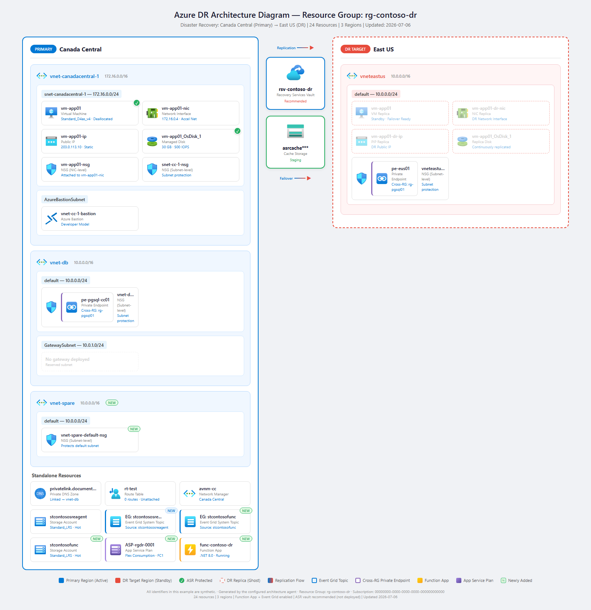

# Azure DR Architecture — Resource Group: rg-contoso-dr

> Disaster Recovery perspective: **Canada Central** (Primary) → **East US** (DR Target)
> Subscription: `00000000-0000-0000-0000-000000000000` (synthetic placeholder) | **24 Resources** | 3 Regions

> [!NOTE]
> All identifiers in this example are synthetic. Subscription IDs, resource
> names, resource group names, hostnames, public IP addresses (RFC 5737
> documentation ranges), and MAC addresses were replaced with placeholders. The
> sample illustrates Architecture Writer output and does not describe a real
> environment.

---

## Architecture Diagram



---

## Primary Region: Canada Central (21 resources)

### VNet: vnet-canadacentral-1 (172.16.0.0/16)

| Resource | Type | Details |
|----------|------|---------|
| **vm-app01** | Virtual Machine | Standard_D4as_v4 · Ubuntu 24.04 LTS · **Deallocated** |
| **vm-app01-nic** | Network Interface | 172.16.0.4 · MAC: 00-00-5E-00-53-01 |
| **vm-app01-ip** | Public IP | 203.0.113.10 · Static · Standard/Regional |
| **vm-app01_OsDisk_1** | Managed Disk | 30 GB · Standard_LRS · 500 IOPS · 60 MBps |
| **vm-app01-nsg** | NSG (NIC-level) | Attached to vm-app01-nic · 0 custom rules |
| **snet-cc-1-nsg** | NSG (Subnet-level) | Protects snet-canadacentral-1 · 0 custom rules |
| **vnet-cc-1-bastion** | Azure Bastion | Developer SKU · 2 scale units |

### VNet: vnet-db (10.0.0.0/16)

| Resource | Type | Details |
|----------|------|---------|
| **vnet-db-default-nsg** | NSG (Subnet-level) | Protects default subnet · 0 custom rules |
| **pe-pgsql-cc01** | Private Endpoint | Cross-RG (rg-pgsql01) · vnet-db/default |
| GatewaySubnet | Reserved | 10.0.1.0/24 — No gateway deployed |

### VNet: vnet-spare (10.0.0.0/16)

| Resource | Type | Details |
|----------|------|-------|
| **vnet-spare-default-nsg** | NSG (Subnet-level) | Protects default subnet · 0 custom rules · **NEW** |
| default | Subnet | 10.0.0.0/24 — No workloads deployed |

> ⚠️ Same address space (10.0.0.0/16) as vnet-db and vneteastus — peering impossible without re-addressing.

### Standalone Resources

| Resource | Type | Details |
|----------|------|---------|
| **stcontososreagent** | Storage Account | Standard_LRS · Hot · TLS 1.2 |
| **EG: stcontososreagent** | Event Grid System Topic | Source: stcontososreagent · **NEW** |
| **EG: stcontosofunc** | Event Grid System Topic | Source: stcontosofunc · **NEW** |
| **privatelink.documents.azure.com** | Private DNS Zone | VNet Link → vnet-db · 1 record set |
| **rt-test** | Route Table | 0 routes · Unattached |
| **avnm-cc** | Network Manager | Connectivity, SecurityAdmin, Routing |
| **stcontosofunc** | Storage Account | Standard_LRS · Hot · TLS 1.2 · **NEW** |
| **ASP-rgdr-0001** | App Service Plan | Flex Consumption (FC1) · Dynamic · **NEW** |
| **func-contoso-dr** | Function App | .NET 8.0 isolated · Linux · Running · **NEW** |

---

## DR Target Region: East US (2 resources)

### VNet: vneteastus (10.0.0.0/16)

| Resource | Type | Details |
|----------|------|---------|
| **pe-eus01** | Private Endpoint | Cross-RG (rg-pgsql01) · vneteastus/default |
| **vneteastus-nsg** | NSG (Subnet-level) | Protects default subnet · 0 custom rules |

---

## Storage Account: stcontososreagent

| Property | Value |
|----------|-------|
| SKU | Standard_LRS |
| Access Tier | Hot |
| Location | Canada Central |
| TLS | TLS 1.2 minimum |
| Shared Key Access | **Disabled** |
| Public Blob Access | **Disabled** |
| HTTPS Only | Yes |
| Encryption | Microsoft-managed key |
| Public Network | Enabled |
| Created | 2026-05-25 |

## Event Grid System Topic

| Property | Value |
|----------|-------|
| Name | stcontososreagent-00000000-0000-0000-0000-000000000001 |
| Source | stcontososreagent (Storage Account) |
| Topic Type | Microsoft.Storage.StorageAccounts |
| Location | Canada Central |
| Provisioning State | Succeeded |

## VNet: vnet-spare

| Property | Value |
|----------|-------|
| Name | vnet-spare |
| Address Space | 10.0.0.0/16 |
| Location | Canada Central |
| Subnets | default (10.0.0.0/24) |
| NSG | vnet-spare-default-nsg-canadacentral (Subnet-level, 0 custom rules) — **NEW** |
| Peerings | None |
| DDoS Protection | Disabled |
| Encryption | Disabled (AllowUnencrypted) |
| Default Outbound Access | Disabled |
| Provisioning State | Succeeded |

## Event Grid System Topic: stcontosofunc (NEW)

| Property | Value |
|----------|-------|
| Name | stcontosofunc-00000000-0000-0000-0000-000000000002 |
| Source | stcontosofunc (Storage Account) |
| Topic Type | Microsoft.Storage.StorageAccounts |
| Location | Canada Central |
| Provisioning State | Succeeded |

## Function App: func-contoso-dr (NEW)

| Property | Value |
|----------|-------|
| Name | func-contoso-dr |
| Kind | functionapp,linux |
| Runtime | dotnet-isolated 8.0 |
| SKU | Flex Consumption |
| State | Running |
| HTTPS Only | Yes |
| Default Hostname | func-contoso-dr-example.canadacentral-01.azurewebsites.net |
| App Service Plan | ASP-rgdr-0001 (FC1) |
| Deployment Storage | stcontosofunc (blob container) |
| Max Instance Count | 100 |
| Instance Memory | 2048 MB |
| Public Network | Enabled |
| Created | 2026-06-22 |

## Storage Account: stcontosofunc (NEW)

| Property | Value |
|----------|-------|
| SKU | Standard_LRS |
| Access Tier | Hot |
| Location | Canada Central |
| TLS | TLS 1.2 minimum |
| Shared Key Access | **Disabled** |
| Public Blob Access | **Disabled** |
| HTTPS Only | Yes |
| Encryption | Microsoft-managed key |
| Public Network | Enabled |
| Purpose | Deployment storage for Function App func-contoso-dr |
| Created | 2026-06-22 |

---

## Network Topology

```
Canada Central                           Global                        East US
┌─────────────────────────────────┐  ┌──────────────────────┐  ┌───────────────────────┐
│ vnet-canadacentral-1            │  │ Private DNS Zone     │  │ vneteastus            │
│ 172.16.0.0/16                   │  │ privatelink.         │  │ 10.0.0.0/16           │
│ ┌─────────────────────────────┐ │  │ documents.azure.com  │  │ ┌───────────────────┐ │
│ │ snet-canadacentral-1        │ │  │     │                │  │ │ default           │ │
│ │ ┌──────┐ ┌────────┐ ┌────┐ │ │  │     │ VNet Link      │  │ │ ┌───────────────┐ │ │
│ │ │ VM   │→│ NIC    │→│PIP │ │ │  │     ↓                │  │ │ │ PE: pe-eus01  │ │ │
│ │ │app01 │ │nic     │ │.10 │ │ │  │  vnet-db ◄───────────│──│─│─│ (cross-RG)    │ │ │
│ │ └──┬───┘ └────────┘ └────┘ │ │  └──────────────────────┘  │ │ └───────────────┘ │ │
│ │    │ OS Disk (30GB)         │ │                             │ │ NSG: eastus-nsg   │ │
│ │ NSG: vm-app01-nsg (NIC)    │ │                             │ └───────────────────┘ │
│ │ NSG: snet-cc-1-nsg (Subnet)│ │                             └───────────────────────┘
│ └─────────────────────────────┘ │
│ Bastion: Developer SKU          │    stcontososreagent
│                                 │    ┌─────────────────┐
├─────────────────────────────────┤    │ Standard_LRS    │    EG System Topic linked
│ vnet-db  10.0.0.0/16            │    │ Hot │ TLS 1.2   │
│ ┌─────────────────────────────┐ │    └─────────────────┘    Function App: func-contoso-dr (.NET 8.0)
│ │ default  10.0.0.0/24        │ │    ┌─────────────────┐    ┌─────────────────┐
│ │ PE: pe-pgsql-cc01 (cross-RG)│ │    │ stcontosofunc   │    │ ASP-rgdr-0001   │
│ │ NSG: vnet-db-default-nsg    │ │    │ (deploy storage) │    │ Flex Consumption│
│ ├─────────────────────────────┤ │    └─────────────────┘    └─────────────────┘
│ │ GatewaySubnet 10.0.1.0/24  │ │    Network Manager: avnm-cc
│ │ (Reserved, empty)           │ │    (Connectivity, SecurityAdmin, Routing)
│ │                             │ │    Route Table: rt-test (unattached, 0 routes)
│ └─────────────────────────────┘ │
├─────────────────────────────────┤
│ vnet-spare  10.0.0.0/16         │    ⚠️ Same address space as vnet-db
│ ┌─────────────────────────────┐ │       and vneteastus — no peering
│ │ default  10.0.0.0/24        │ │       possible without re-addressing
│ │ NSG (NEW):                  │ │
│ │  vnet-spare-default-nsg     │ │
│ │ (no workloads deployed)     │ │
│ └─────────────────────────────┘ │
└─────────────────────────────────┘
```

---

## Private DNS Connection Flow

```
Cosmos DB (external)
       │
       ▼
┌──────────────────────────────────┐
│ Private DNS Zone:                │
│ privatelink.documents.azure.com  │
│ Record Sets: 1                   │
└──────────┬───────────────────────┘
           │ VNet Link: link-vnet-db01
           │ (Registration: Disabled)
           ▼
┌──────────────────────────────────┐
│ VNet: vnet-db (10.0.0.0/16)     │
│ └─ Subnet: default              │
│    └─ PE: pe-pgsql-cc01          │
│       (cross-RG: rg-pgsql01)     │
└──────────────────────────────────┘
```

---

## DR Readiness Assessment

| Check | Status | Notes |
|-------|--------|-------|
| Network foundation in DR | ✅ Ready | vneteastus deployed with NSG |
| Private endpoint in DR | ✅ Ready | pe-eus01 in vneteastus/default |
| Storage geo-replication | ⚠️ Changed | Downgraded from RA-GRS to LRS (no geo-replication) |
| VNet peering (Primary ↔ DR) | ⚠️ Missing | vnet-db & vneteastus share 10.0.0.0/16 — overlap blocks peering |
| ASR Vault | ⚠️ Not deployed | No Recovery Services Vault in subscription |
| VM replica in DR | ⚠️ Missing | No standby VM in East US |
| Address space conflict | ⚠️ Risk | vnet-db (10.0.0.0/16) = vneteastus (10.0.0.0/16) = vnet-spare (10.0.0.0/16) |

### Recommendations

1. **Resolve address space overlap** — Re-address vneteastus, vnet-db, or vnet-spare before enabling VNet peering (three VNets share 10.0.0.0/16)
2. **Deploy ASR Vault** — Create a Recovery Services Vault for VM replication
3. **Enable VM replication** — Protect vm-app01 with ASR to East US
4. **Start the VM** — vm-app01 is currently deallocated, cannot be ASR-replicated while stopped
5. **Add NSG rules** — All NSGs have 0 custom rules; consider adding security rules

---

## Key Observations

- **Verified (2026-07-06):** All 24 resources unchanged for 1 week (Run #11)
- **New resource detected (2026-06-29):** NSG `vnet-spare-default-nsg-canadacentral` (subnet-level for vnet-spare/default, 0 custom rules) — resource count 23→24
- **Verified (2026-06-29):** Previous 23 resources unchanged, 1 new resource added
- **New resources detected (2026-06-23):** VNet `vnet-spare` (10.0.0.0/16, empty, Canada Central), Event Grid System Topic for `stcontosofunc` — resource count 21→23
- **Verified (2026-06-23):** Previous 21 resources unchanged, 2 new resources added
- **New resources detected (2026-06-22):** Function App `func-contoso-dr` (.NET 8.0 isolated, Flex Consumption), App Service Plan `ASP-rgdr-0001` (FC1), Storage Account `stcontosofunc` (deployment storage) — resource count 18→21
- **Verified (2026-06-22):** Previous 18 resources unchanged (4 consecutive weeks stable), 3 new resources added
- **SKU change detected (2026-06-01):** Storage account `stcontososreagent` downgraded from RA-GRS to Standard_LRS
- **New resource detected (2026-06-01):** Event Grid System Topic linked to `stcontososreagent`
- VM `vm-app01` remains **deallocated** since last check
- All NSGs have **0 custom rules** — relying on default deny inbound
- Route table `rt-test` is **unattached** with 0 routes
- GatewaySubnet in vnet-db is **reserved but empty** — no VPN/ER gateway deployed
- Cross-RG private endpoints from RG `rg-pgsql01` land in both primary and DR VNets

---

*Generated by the configured architecture agent · Subscription: 00000000-0000-0000-0000-000000000000 (synthetic placeholder) · 24 resources · 2026-07-06*
