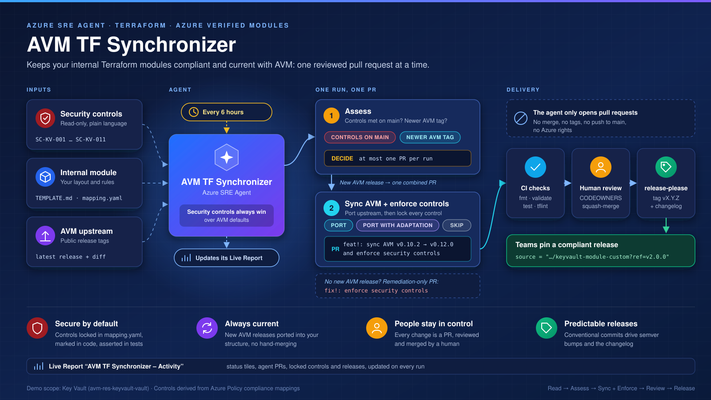
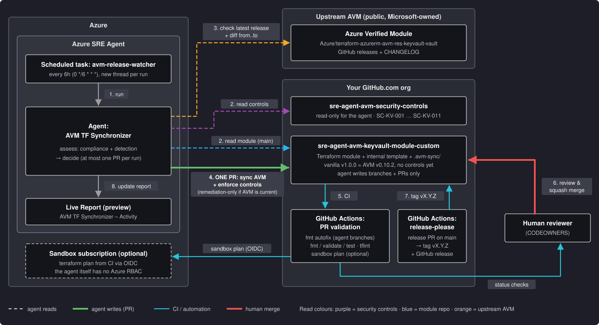

# 🤖 AVM TF Synchronizer: Keep Internal Terraform Modules Compliant and in Sync with AVM



| | |
|---|---|
| 🎯 **What it is** | An [Azure SRE Agent](https://learn.microsoft.com/azure/sre-agent/) that maintains internal Terraform modules forked from AVM |
| 🛡️ **What it does** | Ports new AVM releases into your module **and** enforces your security controls on the result, in the same PR |
| 🔀 **How it delivers** | At most **one pull request per run**. CI validates it; a **human** reviews and merges |
| 🏷️ **How teams consume it** | Pin the module to a release tag (`?ref=v2.0.0`) created by release-please |
| 🔑 **Permissions** | Read controls; write branches and PRs on the module repo. No merge, no tags, no Azure rights |
| 🧪 **Demo scope** | Key Vault (`avm-res-keyvault-vault`). Backup: AI Services / Azure OpenAI |
| ✅ **Status** | Module on vanilla `v1.0.0` (AVM `v0.10.2`, no controls enforced). Next run: one PR that syncs AVM `v0.10.2 → v0.12.0` and enforces the controls |

---

## 📑 Contents

1. [💡 Why this exists](#-why-this-exists)
2. [🧬 How it works](#-how-it-works)
3. [📂 What's in this workspace](#-whats-in-this-workspace)
4. [🗺️ The two repositories](#️-the-two-repositories)
5. [🚀 Setup](#-setup)
6. [▶️ Usage](#️-usage)
7. [🏷️ Consuming the module](#️-consuming-the-module)
8. [🚦 Guardrails](#-guardrails)
9. [⚠️ Known limitations](#️-known-limitations)
10. [📚 Further reading](#-further-reading)

---

## 💡 Why this exists

Many teams fork AVM modules into internal modules with their own structure, naming and tags, and with settings that satisfy their security controls. Once forked, the module drifts:

- AVM ships new features, fixes and provider bumps that never reach the fork.
- Porting them by hand is slow, and it's easy to undo a security setting by accident.

**AVM TF Synchronizer** automates both jobs. It reads your controls and your module template, fixes what isn't compliant, and ports upstream changes into your structure. A security control **always wins** over an AVM default.

---

## 🧬 How it works



A scheduled task runs the agent every 6 hours. Each run **assesses first, then opens at most one PR**:

| Step | What the agent does | Output |
|---|---|---|
| 1️⃣ **COMPLIANCE** | Checks the module on `main` against every applicable control: compliant, non-compliant or not applicable | Assessment |
| 2️⃣ **DETECTION** | Compares `last_synced_tag` in `.avm-sync/manifest.yaml` with the latest AVM release (AVM repos can't send webhooks) | Assessment |
| 3️⃣ **DECIDE** | Newer AVM release → **SYNC**. Otherwise, if non-compliant → **REMEDIATE**. Opens nothing while an agent PR is open | At most one PR |
| 🔄 **SYNC** | Diffs the two AVM tags, decides **PORT**, **PORT-WITH-ADAPTATION** or **SKIP** per change, applies it with `mapping.yaml` and `TEMPLATE.md`, then enforces every control on the result | PR `<feat\|fix>[!]: sync AVM <from> → <to>[ and enforce security controls]` |
| 🛠️ **REMEDIATE** | Only when AVM has nothing new: hard-codes compliant values, removes or constrains inputs that could weaken them, records them as `locked`, adds one test per control | PR `fix!: enforce security controls` |
| 4️⃣ **LIVE REPORT** | Creates or updates the [Live Report](https://learn.microsoft.com/azure/sre-agent/live-reports) "AVM TF Synchronizer – Activity": agent PRs, enforced controls, sync status, releases | Live Report |
| 🔎 **PARITY** *(on request)* | Read-only check that the module on `main` matches AVM at `last_synced_tag`, apart from adapted and excluded items | Report |

> [!IMPORTANT]
> When AVM has a new release, the upgrade and the security fixes land in **one PR**. While any agent PR is open, the agent opens nothing new, so PRs never conflict.

The agent never merges, tags or releases. After a human squash-merges a PR, **release-please** reads the conventional-commit title (`!` = breaking) and opens a release PR. Merging that creates the tag.

---

## 📂 What's in this workspace

```text
avm-tf-synchronizer/
├── README.md                                  ← this file
├── assets/                                    ← diagrams used in this README
├── sre-agent-assets/
│   ├── sre-agent-instructions.md              ← instructions to paste into the agent
│   └── test-prompts.md                        ← test prompts and demo runbook
├── github-assets/
│   ├── github-integration-setup.md            ← identities, repo settings, workflows, checklist
│   └── github-app-fmt-bot-setup-short.md      ← tf-fmt-bot GitHub App setup
└── demo/
    ├── sre-agent-avm-security-controls/       ← seed for the controls repo
    └── sre-agent-avm-keyvault-module-custom/  ← seed for the Key Vault module repo
```

| Path | What it contains | When you need it |
|---|---|---|
| 🖼️ [`assets/`](./assets/) | `avm-sync-workflow-marketing.svg` and `avm-sync-architecture.svg` | Presentations and this README |
| 🤖 [`sre-agent-instructions.md`](./sre-agent-assets/sre-agent-instructions.md) | Agent role, repo list, rules, Terraform style and PR title/body rules | [Setup](#-setup), step 3 |
| 🧪 [`test-prompts.md`](./sre-agent-assets/test-prompts.md) | The three test prompts and the two-step demo (remediation, then AVM sync) | [Setup](#-setup), step 4 and demos |
| 🐙 [`github-integration-setup.md`](./github-assets/github-integration-setup.md) | Identities and permissions, required repo files, PR and release lifecycle, repo settings, CI checks | Preparing GitHub |
| 🧹 [`github-app-fmt-bot-setup-short.md`](./github-assets/github-app-fmt-bot-setup-short.md) | Create and install the `tf-fmt-bot` App used by the fmt autofix job | Optional fmt autofix |
| 📜 [`demo/sre-agent-avm-security-controls/`](./demo/sre-agent-avm-security-controls/) | `controls/key-vault.md` with controls `SC-KV-001` to `SC-KV-011` | Seed the controls repo |
| 🧩 [`demo/sre-agent-avm-keyvault-module-custom/`](./demo/sre-agent-avm-keyvault-module-custom/) | Vanilla Key Vault module (`v1.0.0`, from AVM `v0.10.2`): `*.tf`, `tests/`, `examples/`, `TEMPLATE.md`, `.avm-sync/`, CI and release-please workflows | Seed the module repo |

> [!NOTE]
> The demo module enforces **no** security controls on purpose. Its defaults are permissive so the agent has something to remediate.

---

## 🗺️ The two repositories

The agent works across two GitHub repos, plus the public AVM repo. Create them from the `demo/` folders.

| Repo | Role | Key files | Agent access |
|---|---|---|---|
| 📜 `sre-agent-avm-security-controls` | Source of truth for security controls | `controls/key-vault.md` | Read |
| 🧩 `sre-agent-avm-keyvault-module-custom` | The internal module that the agent maintains | `*.tf`, `TEMPLATE.md`, `.avm-sync/manifest.yaml`, `.avm-sync/mapping.yaml`, `.avm-sync/exclusions.yaml` | Write branches and PRs |
| 🌐 `Azure/terraform-azurerm-avm-res-keyvault-vault` | Upstream AVM module | Releases and tags | Read (public) |

The `.avm-sync/` files drive the agent:

| File | Purpose |
|---|---|
| `manifest.yaml` | `upstream_repo` and `last_synced_tag` (the AVM release the module matches) |
| `mapping.yaml` | Upstream → internal file and variable names, `locked` control values, naming and tag conventions |
| `exclusions.yaml` | Upstream content that is always skipped (telemetry, submodules, AVM tooling) |

See [github-integration-setup.md](./github-assets/github-integration-setup.md#-repositories) for the full file list.

---

## 🚀 Setup

> [!WARNING]
> **Placeholder names.** This workspace uses **`contoso`** as a test GitHub org (owner of both repos) and **`@User1`** as the human in the loop (CODEOWNERS reviewer who squash-merges PRs). Replace them with your actual org and GitHub user **before** you paste the agent instructions, push the demo repos or schedule the task. Otherwise the agent can't find the repos and PRs get no reviewer.

### 🔁 Where to replace `contoso` and `@User1`

**Agent instructions**: [sre-agent-instructions.md](./sre-agent-assets/sre-agent-instructions.md), pasted into the agent in [step 3](#3️⃣-create-the-agent):

| Line | Text to change |
|---|---|
| 6 | `Security controls (read-only): contoso/sre-agent-avm-security-controls` |
| 7 | `Module: contoso/sre-agent-avm-keyvault-module-custom` |
| 123 | Live Report target: `contoso/sre-agent-avm-keyvault-module-custom.` |

**Agent prompts and scheduled task**:

| File | Lines | Text to change |
|---|---|---|
| [README.md](./README.md) (this file) | 190, 193, 203, 216, 233 | `contoso/...` in [step 4](#4️⃣-check-the-agent-with-test-prompts) test prompts, [step 5](#5️⃣-schedule-it) scheduled task instructions and [Usage](#️-usage) prompts |
| [test-prompts.md](./sre-agent-assets/test-prompts.md) | 7, 8, 31, 44, 47, 54, 75 | `contoso/...` in repo links, the scheduled task prompt and test prompts |

**GitHub setup and demo repos**:

| File | Lines | Text to change |
|---|---|---|
| [CODEOWNERS](./demo/sre-agent-avm-keyvault-module-custom/.github/CODEOWNERS) | 1 | `* @User1` (must be a real user with write access, or PRs get no required reviewer) |
| [demo module README.md](./demo/sre-agent-avm-keyvault-module-custom/README.md) | 5, 11 | Controls repo link and the module `source` URL |
| [github-integration-setup.md](./github-assets/github-integration-setup.md) | 7, 8, 51, 80, 153, 215 | Repo names, `@User1` reviewer, `R=` shell variables |
| [github-app-fmt-bot-setup-short.md](./github-assets/github-app-fmt-bot-setup-short.md) | 15, 19 | App install target and `REPO=` shell variable |

> [!NOTE]
> The diagrams in [`assets/`](./assets/) also show `@User1`. They're illustrative only and don't need changing.

### 1️⃣ Prerequisites

- An **Azure SRE Agent** instance.
- Both repos on GitHub, with the module repo set to **squash merge only, using the PR title** as the commit message.
- Module repo: **Settings → Actions → General → "Allow GitHub Actions to create and approve pull requests"** (needed by release-please).
- *(Optional)* A GitHub App for the fmt autofix job: see [github-app-fmt-bot-setup-short.md](./github-assets/github-app-fmt-bot-setup-short.md).
- *(Optional)* A sandbox subscription with GitHub OIDC for `terraform plan`: set `AZURE_CLIENT_ID`, `AZURE_TENANT_ID` and `AZURE_SUBSCRIPTION_ID` as repo variables.

### 2️⃣ Connect the agent to GitHub (PAT Token Config)

| Repo | Access |
|---|---|
| `sre-agent-avm-security-controls` | Read |
| `sre-agent-avm-keyvault-module-custom` | `contents: write`, `pull_requests: write` |
| AVM upstream (public) | Read |

Grant **no** admin rights, no branch-protection bypass and no Azure RBAC.

> [!WARNING]
> A fine-grained PAT applies the same permissions to every repo it covers. To keep the controls repo read-only, use two PATs or a GitHub App. See [Identities and permissions](./github-assets/github-integration-setup.md#-identities-and-permissions).

### 3️⃣ Create the agent

1. In the SRE Agent portal, create an agent named **AVM TF Synchronizer**.
2. Replace `contoso` with your org on lines 6, 7 and 123 of [sre-agent-instructions.md](./sre-agent-assets/sre-agent-instructions.md) (see [Where to replace](#-where-to-replace-contoso-and-user1)).
3. Paste the content of [sre-agent-instructions.md](./sre-agent-assets/sre-agent-instructions.md) into its instructions.

> [!TIP]
> The instructions include Terraform style rules and PR title/body rules that fix the problems found on the first agent PR. Always use the latest version.

### 4️⃣ Check the agent with test prompts

Run these in agent chat before scheduling anything:

| # | Prompt | Expected on vanilla `v1.0.0` |
|---|---|---|
| 1 | `List the files in contoso/sre-agent-avm-security-controls and contoso/sre-agent-avm-keyvault-module-custom.` | Both repos listed |
| 2 | `What is the latest release of Azure/terraform-azurerm-avm-res-keyvault-vault?` | `v0.12.0` |
| 3 | `Run COMPLIANCE only and report, without opening a PR.` | Most controls non-compliant; `SC-KV-006`/`010` not applicable |
| 4 | `Run PARITY for contoso/sre-agent-avm-keyvault-module-custom.` | At parity with `v0.10.2` |

### 5️⃣ Schedule it

Create a scheduled task `avm-release-watcher`:

| Setting | Value |
|---|---|
| Agent | **AVM TF Synchronizer** |
| Schedule | `0 */6 * * *` |
| Instructions | `Run COMPLIANCE, DETECTION, DECIDE and LIVE REPORT for contoso/sre-agent-avm-keyvault-module-custom.` |
| Message grouping | New thread per run |
| Autonomy | **Review** during the pilot, then **Autonomous** |

---

## ▶️ Usage

### 🔄 Run the agent (on demand)

In agent chat, use the same prompt as the scheduled task:

```text
Run COMPLIANCE, DETECTION, DECIDE and LIVE REPORT for contoso/sre-agent-avm-keyvault-module-custom.
```

On the vanilla module, the agent finds most controls non-compliant and AVM `v0.12.0` available, and opens **one** PR: `feat!: sync AVM v0.10.2 → v0.12.0 and enforce security controls`. Review it:

- [ ] Title is exactly as above, with no `[Generated by SRE Agent]` prefix.
- [ ] Body is clean Markdown (no literal `\n`) with a **Changes** table and a **Security controls** table (status on `main` and on the branch).
- [ ] Every upstream change has a decision: **PORTED**, **PORTED with adaptation** or **SKIPPED** (with the control ID).
- [ ] No applicable control is left non-compliant; every new lock is in `mapping.yaml` and has a test.
- [ ] `last_synced_tag` is updated; `CHANGELOG.md` and version files are untouched.
- [ ] The body ends with a `BREAKING CHANGE:` footer, and CI is green.

Squash-merge it, then merge the release-please PR to create `v2.0.0`. Run the prompt again: expected result **no action**.

### 🔎 Check parity with AVM

```text
Run PARITY for contoso/sre-agent-avm-keyvault-module-custom.
```

Read-only. Lists every upstream item as present, adapted, excluded or MISSING, and ends with a verdict.

### 🏁 Version bump rules

| Highest change type | Bump |
|---|---|
| Breaking (removed/renamed/locked input or output, changed default, new minimum Terraform or provider version) | major |
| New feature | minor |
| Fix, provider minor/patch, docs | patch |
| Everything skipped | none (only `last_synced_tag` changes) |

> [!NOTE]
> The full demo runbook, with expected results for each step, is in [test-prompts.md](./sre-agent-assets/test-prompts.md).

---

## 🚦 Guardrails

| Layer | What it does |
|---|---|
| 🔐 Least privilege | The agent can open PRs only. It can't merge, tag, push to `main` or touch Azure |
| 📜 Agent instructions | Controls beat AVM; follow `TEMPLATE.md` and `mapping.yaml`; never edit workflows, `CHANGELOG.md` or versions; draft PR when unsure |
| 🛡️ Compliance on every PR | SYNC re-checks every control on its own branch before opening the PR, so a sync can't bring non-compliant code into `main` |
| 🔒 Locked values | Recorded in `mapping.yaml`, marked in the resource code, asserted in tests |
| 🧹 fmt autofix | Runs `terraform fmt` on `remediation/*` and `avm-sync/*` branches and pushes a fix commit |
| 🚦 CI checks | `terraform fmt -check`, `validate`, `terraform test`, `tflint`, sandbox `plan` (once OIDC is configured) |
| 👤 Human review | A person reviews and squash-merges every PR |
| 🏷️ release-please | Creates tags and changelog from the merged PR title; the agent never does |

---

## ⚠️ Known limitations

- **Polling, not events.** AVM repos can't send webhooks, so a new AVM release is picked up on the next scheduled run (up to 6 hours later).
- **One module in the demo.** Only Key Vault is wired up. Each extra module needs its own repo, `.avm-sync/` files and controls file.
- **The PR still needs a human.** The agent can mis-classify an upstream change. Review every decision in the sync PR before merging.
- **fmt autofix needs a GitHub App.** Pushes made with `GITHUB_TOKEN` don't trigger new workflow runs, so the formatted commit wouldn't be validated without the App.

