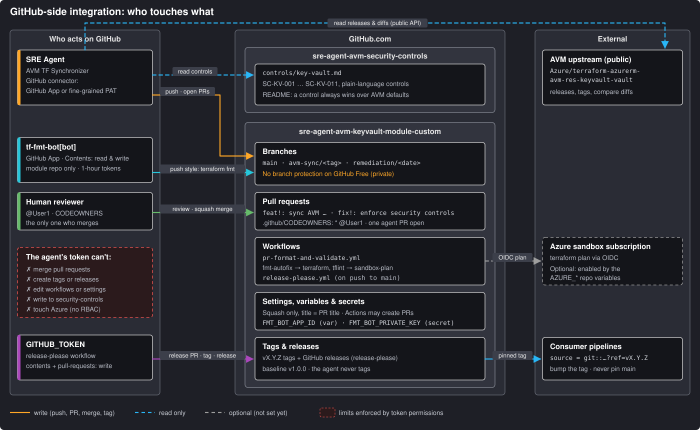
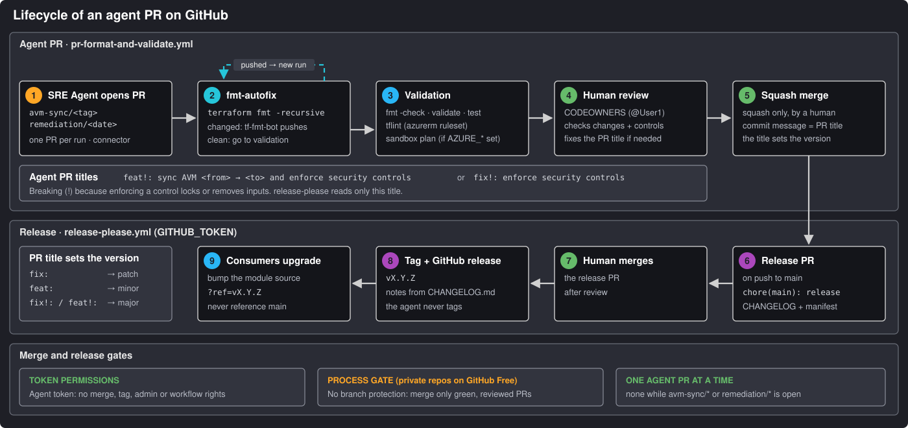

# 🐙 GitHub-side integration and setup

> How the Azure SRE Agent **AVM TF Synchronizer** works with GitHub to keep an internal Terraform module compliant with security controls and in sync with Azure Verified Modules (AVM). Related: [README](../README.md) · [tf-fmt-bot quick setup](./github-app-fmt-bot-setup-short.md)

| | |
|---|---|
| 📦 **Repos** | `contoso/sre-agent-avm-security-controls` (agent reads) · `contoso/sre-agent-avm-keyvault-module-custom` (agent writes branches and PRs). Both private, GitHub Free |
| 🔐 **Identities** | SRE Agent GitHub connector · `tf-fmt-bot` GitHub App · `GITHUB_TOKEN` (release-please) · human reviewer `@User1` |
| ⚙️ **Workflows** | `pr-format-and-validate.yml` (format fix + checks) · `release-please.yml` (versions, tags, releases) |
| 🔀 **Agent PRs** | One PR per run at most: `avm-sync/<tag>` (sync + controls) or `remediation/<date>` (controls only) |
| 🏷️ **Releases** | `vX.Y.Z` tags created by release-please from the squash-merged PR title. Consumers pin a tag |
| 👤 **Human gate** | Only a human merges. The agent can't merge, tag or release. Branch protection isn't available on this plan |

---

## 📑 Contents

1. [🗺️ Overview](#️-overview)
2. [🔐 Identities and permissions](#-identities-and-permissions)
3. [📦 Repositories](#-repositories)
4. [🔄 PR and release lifecycle](#-pr-and-release-lifecycle)
5. [⚙️ Repository settings](#️-repository-settings)
6. [🚦 Workflows and checks](#-workflows-and-checks)
7. [🔑 Secrets and variables](#-secrets-and-variables)
8. [🛡️ Guardrails and the branch protection limit](#️-guardrails-and-the-branch-protection-limit)
9. [🩺 Troubleshooting](#-troubleshooting)
10. [✅ Setup checklist](#-setup-checklist)

---

## 🗺️ Overview



Four identities act on GitHub, each with only the access its job needs:

- 🤖 The **SRE Agent** reads the controls repo and the public AVM repo. It pushes branches and opens PRs on the module repo.
- 🧹 **`tf-fmt-bot`** runs `terraform fmt` on the agent's branches and pushes the fix.
- 👤 A **human** reviews and squash merges.
- ⚙️ **release-please** (`GITHUB_TOKEN`) turns merged PRs into release PRs, tags and GitHub releases.

---

## 🔐 Identities and permissions

| Identity | Type | Scope | Permissions | Used for |
|---|---|---|---|---|
| 🤖 **SRE Agent** | GitHub connector: GitHub App (preferred) or fine-grained PAT | Both repos | Controls repo: Contents read · Module repo: Contents R/W, Pull requests R/W · Metadata read | Read controls, push `avm-sync/*` and `remediation/*` branches, open PRs, list open PRs, read releases for the Live Report |
| 🧹 **`tf-fmt-bot[bot]`** | GitHub App (`FMT_BOT_APP_ID`) | Module repo only | Contents R/W | `terraform fmt autofix` job: push a `style: terraform fmt` commit |
| ⚙️ **`GITHUB_TOKEN`** | Built-in Actions token | Module repo | `contents: write`, `pull-requests: write` (in `release-please.yml`) | Release PRs, tags and GitHub releases |
| 👤 **`@User1`** | Human (CODEOWNERS) | Both repos | Admin | Review, squash merge, merge release PRs, manage settings |
| ☁️ **Azure OIDC** (optional) | Federated credential | Sandbox subscription | `id-token: write` in `sandbox-plan` | `terraform plan` on `examples/default` |

The agent has no Azure RBAC. It reads upstream AVM (`Azure/terraform-azurerm-avm-res-keyvault-vault`) through the public API, so that repo needs no permission.

> [!IMPORTANT]
> The agent's token must have **no** admin, merge bypass, workflow or tag rights. If you use a PAT instead of an App, keep the controls repo read-only.

---

## 📦 Repositories

### 📜 `sre-agent-avm-security-controls`

| Path | Required? | Purpose |
|---|:---:|---|
| `controls/key-vault.md` | ✅ | `SC-KV-001` … `SC-KV-011` in plain language, based on the Azure Policy Key Vault compliance mappings |
| `README.md` | ⚪ | States the rule: a control always wins over AVM defaults |

The agent only reads this repo. It needs no workflows, secrets or variables.

### 🧩 `sre-agent-avm-keyvault-module-custom`

The Terraform files follow the internal template: a flat layout with prefixed files (`resource.<area>.tf`, `variables.<area>.tf`), described in `TEMPLATE.md`. The GitHub-specific files are:

| Path | Required? | Purpose |
|---|:---:|---|
| `.github/workflows/pr-format-and-validate.yml` | ✅ | Formats agent branches and runs the PR checks |
| `.github/workflows/release-please.yml` | ✅ | Opens release PRs; creates tags and releases |
| `.github/CODEOWNERS` | ⚪ | `* @User1`: requests the owner's review on every PR |
| `.github/pull_request_template.md` | ⚪ | PR layout for humans. The agent follows the layout in its own instructions |
| `release-please-config.json` | ✅ | `release-type: terraform-module`, `include-component-in-tag: false` (tags are `vX.Y.Z`) |
| `.release-please-manifest.json` | ✅ | Current version. Only release-please changes it |
| `CHANGELOG.md` | ✅ | Written by release-please. The agent never edits it |
| `.avm-sync/` | ✅ | The agent's sync state and rules (next table) |

#### 🗂️ `.avm-sync/` folder

| File | Required? | Key fields | Used in | Updated by |
|---|:---:|---|---|---|
| `manifest.yaml` | ✅ | `upstream_repo`, `last_synced_tag` (now `v0.10.2`) | DETECTION compares it with the latest AVM release; SYNC uses it as the `from` tag | The agent, in every sync PR |
| `mapping.yaml` | ✅ | Upstream file/variable → internal file/variable. Enforced controls add `{internal, locked: true, value, control: SC-KV-xxx}` | SYNC places ported code and keeps every locked value; PARITY compares with it | The agent, when it ports, renames or locks |
| `exclusions.yaml` | ✅ | Items never ported: telemetry, inlined submodules, AVM tooling | SYNC always SKIPs these | Humans |

> [!TIP]
> Without `exclusions.yaml` every sync would try to bring back AVM telemetry, the `modules/` submodules and AVM tooling, and the reviewer would have to reject them by hand.

---

## 🔄 PR and release lifecycle



| Step | Who | What happens |
|:---:|---|---|
| 1 | 🤖 Agent | Pushes `avm-sync/<tag>` or `remediation/<date>` and opens one PR with a conventional-commit title |
| 2 | 🧹 `tf-fmt-bot` | Runs `terraform fmt -recursive`. If files changed, pushes `style: terraform fmt`, which starts a new run |
| 3 | ⚙️ Actions | `terraform fmt -check` / `init` / `validate` / `test`, `tflint`, and `sandbox-plan` when Azure OIDC is set |
| 4 | 👤 Reviewer | Checks the "Changes" and "Security controls" tables and the PR title |
| 5 | 👤 Reviewer | Squash merges. The PR title becomes the commit on `main` |
| 6 | ⚙️ release-please | Opens or updates `chore(main): release X.Y.Z` |
| 7 | 👤 Reviewer | Merges the release PR |
| 8 | ⚙️ release-please | Creates tag `vX.Y.Z` and a GitHub release from `CHANGELOG.md` |
| 9 | 📦 Consumers | Bump `?ref=vX.Y.Z` in their module source |

### 🏷️ PR titles and versions

The agent opens at most one PR per run and none while an `avm-sync/*` or `remediation/*` PR is open.

| Case | Branch | Title |
|---|---|---|
| Newer AVM release (sync + enforce controls) | `avm-sync/<tag>` | `feat!: sync AVM <from> → <to> and enforce security controls` |
| No newer AVM release, module non-compliant | `remediation/<YYYY-MM-DD>` | `fix!: enforce security controls` |

| Title prefix | Bump | Example |
|---|---|---|
| `fix:` | patch | `v1.0.0` → `v1.0.1` |
| `feat:` | minor | `v1.0.0` → `v1.1.0` |
| `fix!:` / `feat!:` | major | `v1.0.0` → `v2.0.0` |

Enforcing a control locks or removes inputs, so these PRs are breaking (`!`) and carry a `BREAKING CHANGE:` footer. A sync that locks nothing drops the ` and enforce security controls` suffix and uses `feat:` or `fix:`, with `!` if AVM itself is breaking.

> [!WARNING]
> release-please reads only the squash commit title, never the PR body. A title that isn't an exact conventional commit (for example with a prefix before `feat!:`) produces no release. Check the title before merging.

---

## ⚙️ Repository settings

All on `sre-agent-avm-keyvault-module-custom`.

| Area | Where | Value | Required? |
|---|---|---|:---:|
| 🔀 Merge buttons | **Settings → General → Pull Requests** | ☑ Squash merging, default commit message **Pull request title** · ☐ Merge commits · ☐ Rebase merging | ✅ |
| 🌿 Head branches | Same page | ☐ Automatically delete head branches | ⚪ |
| 🤖 Workflow permissions | **Settings → Actions → General** | Read repository contents · ☑ **Allow GitHub Actions to create and approve pull requests** | ✅ |
| 📥 App installation | **Settings → GitHub Apps** (repo) or your account's installed Apps | `tf-fmt-bot` on this repo only | ✅ |
| 🏷️ Baseline tag | **Releases** | `v1.0.0` on `main` (the release-please starting point) | ✅ |

Check or apply with a `gh` login that has admin rights (not the agent's token):

```bash
R=contoso/sre-agent-avm-keyvault-module-custom

# Check
gh api repos/$R --jq '{allow_squash_merge, allow_merge_commit, allow_rebase_merge, squash_merge_commit_title, delete_branch_on_merge}'
gh api repos/$R/actions/permissions/workflow

# Apply
gh api -X PATCH repos/$R -F allow_squash_merge=true -F allow_merge_commit=false \
  -F allow_rebase_merge=false -f squash_merge_commit_title=PR_TITLE -f squash_merge_commit_message=PR_BODY \
  -F delete_branch_on_merge=false
gh api -X PUT repos/$R/actions/permissions/workflow \
  -f default_workflow_permissions=read -F can_approve_pull_request_reviews=true
```

---

## 🚦 Workflows and checks

### 🧪 `pr-format-and-validate.yml`

Runs on `pull_request` to `main` and on `workflow_dispatch`.

| Job (check name) | Runs when | Token | Should be required? |
|---|---|---|:---:|
| `terraform fmt autofix` | Same-repo PR from `remediation/*` or `avm-sync/*` | `tf-fmt-bot` App token | ❌ |
| `terraform fmt / validate / test` | Always, except in the run where the autofix pushed | `GITHUB_TOKEN` (read) | ✅ |
| `tflint` (azurerm ruleset) | Same as above | `GITHUB_TOKEN` (read) | ✅ |
| `sandbox plan (examples/default)` | After `terraform`, only if `AZURE_CLIENT_ID` is set | Azure OIDC | ✅ when configured |

Every `hashicorp/setup-terraform@v3` step pins the same range:

```yaml
- uses: hashicorp/setup-terraform@v3
  with:
    terraform_version: "^1.11" # node-semver: >=1.11.0 <2.0.0
    terraform_wrapper: false
```

> [!NOTE]
> Validation still runs when the autofix fails or is skipped. GitHub counts a **skipped** required check as **passed**, so skipping validation would let an unvalidated PR merge.

### 🏷️ `release-please.yml`

On `push` to `main`, `googleapis/release-please-action@v4` reads `release-please-config.json` and `.release-please-manifest.json`, opens or updates `chore(main): release X.Y.Z`, and, when that PR is merged, creates tag `vX.Y.Z` and the GitHub release. It owns `CHANGELOG.md` and `.release-please-manifest.json`.

---

## 🔑 Secrets and variables

**Settings → Secrets and variables → Actions** on the module repo:

| Name | Kind | Value | Required? |
|---|---|---|:---:|
| `FMT_BOT_APP_ID` | Variable | App ID of `tf-fmt-bot` | ✅ |
| `FMT_BOT_PRIVATE_KEY` | Secret | Full `.pem` private key of `tf-fmt-bot` | ✅ |
| `AZURE_CLIENT_ID` | Variable | Client ID with a federated credential for this repo | ⚪ enables `sandbox-plan` |
| `AZURE_TENANT_ID` | Variable | Tenant ID | ⚪ |
| `AZURE_SUBSCRIPTION_ID` | Variable | Sandbox subscription ID | ⚪ |

The `AZURE_*` variables aren't set yet, so `sandbox-plan` is skipped. Creating the App and its key: [github-app-fmt-bot-setup-short.md](./github-app-fmt-bot-setup-short.md).

```bash
R=contoso/sre-agent-avm-keyvault-module-custom
gh variable list -R $R
gh secret list -R $R
```

---

## 🛡️ Guardrails and the branch protection limit

| Guardrail | Enforced by | Status |
|---|---|:---:|
| Agent can't merge, tag, release, edit settings or workflows | Connector token permissions | ✅ |
| Agent opens at most one PR and none while one is open | Agent instructions (DECIDE) | ✅ |
| `tf-fmt-bot` has Contents only, on one repo, 1-hour tokens | App permissions | ✅ |
| One conventional commit per PR | Squash-only merging with the PR title | ✅ |
| Owner review requested on every PR | `.github/CODEOWNERS` | ✅ (requested, not enforced) |
| Required checks and approval on `main` | Branch protection or ruleset | ❌ Not available |
| Only release-please creates `v*` tags | Tag ruleset | ❌ Not available |

> [!WARNING]
> Branch protection and rulesets aren't available for private repos on GitHub Free. GitHub answers *"Upgrade to GitHub Pro or make this repository public"*. The human gate therefore relies on process: merge only PRs with green checks after review. The agent's token can't merge, so the agent can't bypass that gate. On a paid plan or a public repo, require `terraform fmt / validate / test` and `tflint` (not the autofix), one CODEOWNERS approval, no bypass, and add a `v*` tag ruleset.

---

## 🩺 Troubleshooting

| Symptom | Likely cause | Fix |
|---|---|---|
| Release workflow fails: *GitHub Actions is not permitted to create or approve pull requests* | Workflow permission off | Turn on **Allow GitHub Actions to create and approve pull requests** |
| Merged PR produced no release PR | Squash title isn't an exact conventional commit, or merge/rebase commit used | Keep squash-only with PR title; fix titles before merging |
| `terraform init` fails: module needs Terraform `>= 1.11` but CI installed 1.9.x | `terraform_version` written as `~> 1.9`. setup-terraform reads it as node-semver, where `~> 1.9` means `>=1.9.0 <1.10.0` | Use `terraform_version: "^1.11"` (`>=1.11.0 <2.0.0`) |
| `terraform fmt autofix` skipped on an agent PR | Branch isn't `remediation/*` / `avm-sync/*`, or PR is from a fork | Expected; validation still runs |
| Autofix fails on `create-github-app-token` | App not installed, wrong App ID, or partial key | Check the App installation, `FMT_BOT_APP_ID` and the full PEM key in `FMT_BOT_PRIVATE_KEY` |
| Bot pushed, but no new run started | Push made with `GITHUB_TOKEN` | `actions/checkout` must use the App token |
| `sandbox-plan` never runs | `AZURE_CLIENT_ID` not set | Expected until the Azure variables are added |
| Agent opened no PR | An agent PR is already open, or main is compliant and in sync | Expected; merge or close the open PR |

---

## ✅ Setup checklist

- [ ] 📦 Create both private repos; add `controls/key-vault.md` to the controls repo and the internal module with `.avm-sync/` to the module repo
- [ ] 🏷️ Tag the baseline `v1.0.0` on `main`
- [ ] 🔐 Configure the SRE Agent GitHub connector: controls repo read-only; module repo Contents and Pull requests R/W; nothing else
- [ ] 🧹 Create and install `tf-fmt-bot`; set `FMT_BOT_APP_ID` (variable) and `FMT_BOT_PRIVATE_KEY` (secret)
- [ ] ⚙️ Add both workflows, `release-please-config.json`, `.release-please-manifest.json`, `CODEOWNERS` and the PR template to `main`
- [ ] 🔀 Squash merging only with the PR title; allow Actions to create and approve PRs
- [ ] ☁️ Optional: add the `AZURE_*` variables and an OIDC federated credential for `sandbox-plan`
- [ ] 🚦 On a paid plan or public repo: branch protection on `main` and a `v*` tag ruleset
