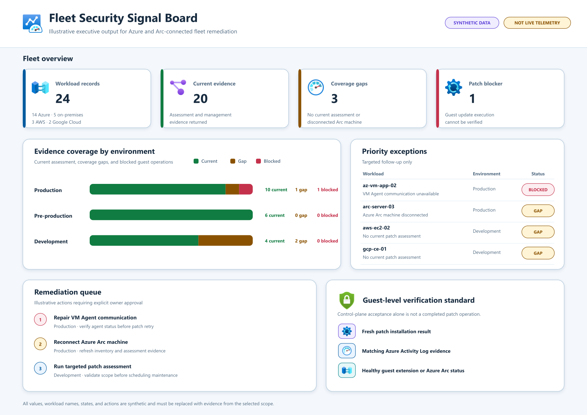

# Azure Fleet Security & Patch Remediation

**Status:** Operational guidance — documentation, prompt template, and diagram
sources; no executable automation

## What it is

Azure Fleet Security & Patch Remediation performs a cost-efficient, evidence-led
assessment of Azure virtual machines and Azure Arc-enabled machines across
Azure, on-premises, AWS, and Google Cloud environments. It turns inventory,
Defender posture, patch assessment, patch installation, and Azure Update Manager
evidence into a prioritized remediation proposal while keeping all state-changing
actions behind explicit human approval.

## Who it is for

- Cloud operations and SRE teams running Azure SRE Agent or another assistant
  with read-only Azure access.
- Security and patch-management owners responsible for Defender for Cloud and
  Azure Update Manager coverage.
- Infrastructure teams managing on-premises, AWS, or Google Cloud servers
  through Azure Arc.

## Hybrid and multicloud architecture

[](assets/azure-fleet-remediation-architecture.svg)

The architecture separates the Azure SRE Agent, Azure management plane,
Arc-connected hybrid estate, service-owner approval, and evidence outputs.
Azure Arc is the federation boundary for machines outside Azure; it does not
imply unmanaged direct access to on-premises, AWS, or Google Cloud workloads.
Cloud and environment scopes remain independently approved and governed by their
own maintenance windows and policy.

The editable source is
[`build_architecture_diagram.py`](assets/build_architecture_diagram.py). The
agent reads platform and guest evidence first, asks the service owner to approve
any state-changing action, and uses Azure Update Manager and Azure Arc for
approved patch execution. Guest-level results flow back through the Azure
platform for verification; control-plane acceptance alone is not completion
proof.

## Capabilities

The package assumes capabilities for Azure Resource Graph, Azure Activity Log,
Defender for Cloud, Azure Update Manager, Azure VM and Arc guest update status,
and optional report authoring. These are descriptive capability labels, not
guaranteed Azure SRE Agent or Azure CLI tool names. Map them to the configured
least-privilege connectors and commands in the target environment. The scope can
be partitioned by cloud, environment, maintenance window, ownership, and
Arc-connection state.

## Purpose

Create one operational view of an Azure and Arc-connected fleet that answers four questions:

1. Which Azure VMs and Arc-enabled machines are in scope across cloud and environment boundaries?
2. Which workloads have current patch, reboot, Defender, and management evidence?
3. Which findings require targeted remediation rather than another broad scan?
4. Which state-changing actions are safe to propose for explicit approval?

The tool separates observed evidence, evidence gaps, inferred relationships, and
proposed remediation. It does not treat an empty query as proof of health and
does not treat control-plane acceptance as proof of guest patch execution.

## Value

- Reduces broad, repetitive Azure queries by starting with compact fleet-level
  Resource Graph inventory and grouping queries.
- Identifies management coverage gaps before scheduling patch jobs across an
  unknown fleet.
- Prevents duplicate remediation by requiring identity validation for similarly
  named VM and Arc records.
- Uses Azure Update Manager guest evidence, not only control-plane status, to
  distinguish successful patching from failed or incomplete operations.
- Produces an approval-ready remediation plan with expected impact, verification,
  and a safe-stop path for every proposed change.
- Creates concise executive and detailed operational outputs without exposing
  secrets, customer identifiers, or raw telemetry.

## Illustrative demonstration narrative

> [!NOTE]
> This section is a historical, illustrative narrative of an earlier
> demonstration, retold with synthetic names and data. The repository does not
> contain the demonstration environment, its raw evidence, or its outputs, so
> the outcomes below are not reproducible evidence. Treat them as an example of
> what the procedure is designed to produce, and verify any result against your
> own scope.

In that demonstration, the method was walked through the full
evidence-to-remediation loop for a small mixed Azure VM and Arc fleet:

- Azure VM and Arc records were discovered, including an Arc connectivity issue
  and workloads without returned patch telemetry.
- Defender for Servers Plan 2 was confirmed at subscription scope, and
  fleet-level security findings were summarized without treating every finding
  as a patch issue.
- An Azure Update Manager maintenance configuration for security updates with an
  `IfRequired` reboot policy was created and validated.
- A completed `applyUpdates` control-plane resource was distinguished from a
  real guest patch operation by requiring fresh `patchInstallationResults`,
  Activity Log, and update-extension evidence.
- Successful Arc patching and completed reboot evidence were confirmed, while a
  VM Agent communication failure that blocked a separate VM patch operation was
  isolated.
- Two static, evidence-timestamped dashboards were produced (a synthetic
  example of the first is shown under
  [Illustrative dashboard example](#illustrative-dashboard-example)):
  - **Fleet Security Signal Board:** executive fleet overview of security,
    patch, management, and evidence coverage signals.
  - **Fleet Remediation Ledger:** detailed operational view of workload
    exceptions, actions, verification evidence, and unresolved blockers.

The intended value is a repeatable, lower-cost operating model: broad discovery
once, targeted diagnosis only where needed, and remediation only after review.

## When to use

| Use case | Result |
| --- | --- |
| Monthly fleet security review | VM and Arc inventory, telemetry coverage, Defender posture, patch status, and prioritized gaps |
| Update Manager readiness review | Assignment, maintenance-window, agent, and patch-result evidence before scheduling remediation |
| Patch failure investigation | Targeted guest, extension, and Activity Log evidence with root-cause candidates and safe next actions |
| Compliance evidence refresh | Timestamped assessment and remediation proposal with explicit data-quality limitations |
| Fleet remediation planning | Human-approved batches grouped by operating system, management state, risk, and maintenance policy |

Use this tool for read-only fleet assessment, remediation planning, and approved
patch orchestration. Do not use it to automatically patch every workload,
reboot unmanaged servers, disable security controls, or make compliance claims
from incomplete evidence.

## Quick start prompts

```text
Assess all Azure VMs and Arc-enabled servers in my subscription. Start with
Resource Graph, identify patch coverage gaps, and propose only the smallest safe
remediation actions. Do not patch or reboot anything yet.

Review Azure Update Manager readiness for the entire fleet. Identify missing
assignments, stale assessments, failed guest update operations, disconnected Arc
machines, and the evidence needed before scheduling maintenance.

Investigate failed patching on a specific VM. Correlate patch installation
results, Activity Log, guest agent status, and extension state. Explain what
must be repaired before retrying.
```

Use the [global assessment and remediation prompt](templates/global-assessment-and-remediation-prompt.md)
for a reusable, detailed request contract.

## Prerequisites

- A subscription or explicit resource scope and any exclusions.
- Read-only access to Azure Resource Graph, Defender for Cloud, Azure Update
  Manager, and Azure Activity Log for the selected scope.
- Optional read-only guest update-extension state for diagnosing failed patching.
- A defined approval owner for patch installation, reboot, configuration changes,
  and security-control changes.
- A maintenance policy that specifies patch classifications, reboot behavior,
  and whether optional driver updates are in scope.
- Only to regenerate the diagrams: Python 3.10 or later (the generators use the
  standard library only) and Node.js with `npx` for `sharp-cli`; see
  [Regenerating the diagrams](#regenerating-the-diagrams).
- For Azure SRE Agent, the dedicated
  [agent instructions](sre-agent-assets/sre-agent-instructions.md), with the
  prompt template and your maintenance policy uploaded as knowledge.

Do not begin a fleet-wide remediation run if resource identity, ownership,
maintenance policy, or approval authority is ambiguous.

## Procedure

1. **Define scope and policy.** Record subscription, resource groups,
   environments, exclusions, owners, maintenance window, update classifications,
   reboot policy, and evidence timestamp.
2. **Discover fleet inventory read-only.** Query `Microsoft.Compute/virtualMachines`
   and `Microsoft.HybridCompute/machines` once through Azure Resource Graph. Record
   resource ID, type, location, operating system, connection state, and identity
   fields available from each provider.
3. **Normalize identity.** Flag same-named, related, or possibly duplicated VM and
   Arc records. Do not merge or patch them as one workload until identity evidence
   supports that conclusion.
4. **Collect compact fleet evidence.** Query patch assessment results, patch
   installation results, Update Manager configurations and assignments, and
   Defender findings in grouped queries. Preserve data-source freshness and scope.
5. **Classify coverage.** Mark each workload as observed healthy, patching,
   failed, disconnected, stale, no-result-returned, or unknown. A missing result
   is a coverage gap, not a healthy state.
6. **Investigate only exceptions.** For failed or ambiguous workloads, gather
   targeted Activity Log entries plus VM Agent, Arc connection, outbound
   connectivity, or update-extension state. Do not scan logs fleet-wide by
   default.
7. **Build the remediation proposal.** For each proposed action, include target,
   evidence timestamp, risk, expected availability impact, change method,
   verification signal, rollback or safe-stop path, and owner approval required.
8. **Apply only approved changes.** Use Azure Update Manager for scheduled or
   immediate patching. Use resource-specific guest patch operations and preserve
   the approved reboot setting. Exclude drivers and optional updates unless the
   policy explicitly includes them.
9. **Verify guest execution.** Require a fresh patch installation result. Correlate
   it with Activity Log and, when available, guest update-extension status. Do not
   accept a successful control-plane request alone as a successful guest update.
10. **Publish a bounded summary.** Report inventory totals, evidence coverage,
    exceptions, completed actions, unresolved blockers, and the next approval gate.

## Safety and approvals

- Discovery, assessment, reporting, and proposal generation are read-only by
  default.
- Require explicit approval before patch installation, reboot, VM Agent repair,
  extension deployment, Update Manager assignment, maintenance-window changes,
  Defender changes, or role assignments.
- Never target a subscription, resource group, wildcard, or unresolved identity
  for a destructive or state-changing action.
- Prefer targeted, reversible changes and record a verification method before
  execution.
- Treat `Microsoft.Maintenance/applyUpdates/default` as control-plane evidence
  only. Confirm guest execution from `patchInstallationResults` and other
  workload-level evidence.
- Do not commit subscription IDs, tenant IDs, hostnames, private endpoints,
  public IP addresses, credentials, tokens, raw logs, or customer data to GitHub.
- Stop and request owner review when evidence conflicts, source freshness is
  inadequate, or identity is unresolved.

## Expected output

| Artifact | Required content |
| --- | --- |
| Fleet inventory | VM and Arc records, cloud and environment scope, identity ambiguity, operating system, management state, and coverage status |
| Security and patch matrix | Latest Defender, assessment, installation, reboot, and Update Manager evidence per workload |
| Exception list | Failed patch operations, disconnected Arc machines, stale telemetry, missing coverage, and high-risk findings |
| Remediation plan | Targeted action, owner, risk, impact, verification, rollback or safe-stop path, and approval gate |
| Cost-efficiency summary | Grouped queries used, targeted follow-up queries, and unnecessary scans intentionally avoided |
| Optional dashboard snapshot | Timestamped executive overview and detailed remediation view, clearly labeled as static if live data is unavailable |

### Illustrative dashboard example

[](assets/fleet-security-signal-board-example.svg)

This preview illustrates the expected executive dashboard shape. All values,
workload names, states, and actions are synthetic; replace them with evidence
from the selected scope. The editable source is
[`build_dashboard_example.py`](assets/build_dashboard_example.py).

## Sample output

```text
Fleet scope: 18 Azure VM records, 4 Arc machine records
Evidence timestamp: 2026-09-11T15:30:00Z

Coverage
- 15 workloads have a current patch assessment.
- 3 workloads have no returned patch assessment and require onboarding validation.
- 1 Arc machine is disconnected.

Exceptions
- vm-app-02: guest patch operation failed; VM Agent status communication is unavailable.
- arc-db-01: security update installed successfully; reboot completed.

Proposed actions requiring approval
1. Repair the VM Agent communication path on vm-app-02, then re-run the targeted assessment.
2. Assign the three unassessed workloads to the approved maintenance policy after assessment succeeds.
3. Reconnect arc-db-02 and refresh patch evidence before scheduling maintenance.

Verification
- Fresh patch installation result for each approved operation.
- Matching Activity Log entry and extension status for failed or ambiguous outcomes.
```

All names, counts, and timestamps above are synthetic.

## Regenerating the diagrams

Both SVG files are generated; edit the Python sources, not the SVG output. The
PNG previews are rendered at 1.25× the SVG width. From the repository root:

```powershell
python Tools\azure-fleet-security-remediation\assets\build_architecture_diagram.py
python Tools\azure-fleet-security-remediation\assets\build_dashboard_example.py
npx --yes sharp-cli@6.0.0 --input "Tools/azure-fleet-security-remediation/assets/azure-fleet-remediation-architecture.svg" --output "Tools/azure-fleet-security-remediation/assets" --format png resize 1800
npx --yes sharp-cli@6.0.0 --input "Tools/azure-fleet-security-remediation/assets/fleet-security-signal-board-example.svg" --output "Tools/azure-fleet-security-remediation/assets" --format png resize 1800
```

Icons are embedded as base64, so regenerate from a checkout whose icon files
use LF line endings; CRLF conversion changes the embedded data. Icon sources
and terms are listed in [`assets/icons/ATTRIBUTION.md`](assets/icons/ATTRIBUTION.md).

## Accepted exceptions

- Partial fleet discovery is accepted when inaccessible scopes, missing sources,
  and the effect on conclusions are explicit.
- A static dashboard is accepted when the report runtime cannot query Azure
  Resource Graph or Azure Update Manager at view time.
- Update Manager assignment review may be limited to discovered configurations
  when assignment resources are not returned by the available inventory source.
- Defender findings may be summarized by assessment group when per-workload
  correlation is unavailable; label this limitation clearly.
- Patch deployment can be omitted entirely; this tool remains useful as a
  read-only assessment and approval-planning workflow.

## Limitations

- This package documents a reusable operating method; it does not include an
  executable Azure automation script, a scheduled job, or an agent manifest.
  Use the [agent instructions](sre-agent-assets/sre-agent-instructions.md) and
  the prompt template to configure the agent.
- Azure Resource Graph and control-plane status can be delayed or incomplete;
  guest-level patch evidence remains the completion standard.
- Some Arc and VM identity fields differ by provider. Matching names alone does
  not prove a shared machine.
- Security findings may include subscription-wide issues outside the current VM
  and Arc remediation scope.

## Cleanup

This package deploys no resources: it contains documentation, a prompt
template, and diagram sources only. To revert locally regenerated diagrams, run
`git restore Tools/azure-fleet-security-remediation/assets` from the repository
root.

Live remediation is performed outside this repository by an operator using
their own Azure Update Manager, Azure Arc, and change-management tooling. Any
pre-change snapshots or restore points, rollback of installed updates, removal
of maintenance configurations or assignments created for a run, and reboot
recovery follow the operator's approved change and rollback process, not this
package.

## References

- [Global assessment and remediation prompt](templates/global-assessment-and-remediation-prompt.md)
- [Azure SRE Agent instructions](sre-agent-assets/sre-agent-instructions.md)
- [Repository contribution guidance](../../CONTRIBUTING.md)
- [Azure Resource Graph documentation](https://learn.microsoft.com/azure/governance/resource-graph/)
- [Azure Update Manager documentation](https://learn.microsoft.com/azure/update-manager/)
- [Microsoft Defender for Cloud documentation](https://learn.microsoft.com/azure/defender-for-cloud/)
- [Azure Activity Log documentation](https://learn.microsoft.com/azure/azure-monitor/essentials/activity-log)
