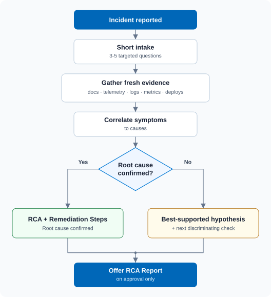

# Azure Incident Investigator

**An SRE agent that investigates Azure incidents, follows the evidence, suggests remediations, and provides a root cause analysis (RCA).**

A custom AI agent that troubleshoots incidents in Azure applications and infrastructure the way a senior SRE would: methodically, evidence-first, and without changing your environment. It correlates architecture docs, telemetry, logs, metrics, health events, deployment history, and other failure points to pinpoint the root cause, then hands your team a clear, defensible report with remediation steps for a human to carry out.

> [!TIP]
> **Want to see it work end to end?** The optional
> [demo lab](demo/iis-app-azure-vm/README.md) deploys a synthetic legacy
> IIS + SQL Server app on Azure VMs and injects a realistic incident for the
> agent to investigate. It is billable and intentionally insecure — read
> [Safety and approvals](#safety-and-approvals) and [Cost](#cost) first.

---

## Why it exists

When production breaks at 2 a.m., the risky part isn't the outage; it's the panicked, unverified changes made while chasing it. The **Azure Incident Investigator** removes that risk. It does the hard investigative work (reading, correlating, reasoning across evidence) and stops exactly where human judgment should take over: at remediation.

You get the root cause. Your engineers keep the keys.

---

## What makes it different

| Principle | What it means for you |
|---|---|
| **Read-only investigation** | Investigates with read-only operations only. With the recommended Reader-level access it cannot deploy, restart, scale, fail over, roll back, rotate, delete, or edit anything. |
| **Evidence over assumption** | Distinguishes confirmed facts, correlated evidence, hypotheses, and unknowns — and never sells correlation as causation. |
| **Fresh every time** | Starts each investigation from scratch. No stale conclusions, no cached assumptions about your topology or config. |
| **Persistent to a conclusion** | Doesn't stop at the first obstacle. Exhausts every in-scope, read-only source before halting — and tells you precisely what's blocking it if it must. |
| **Injection-resistant** | Treats logs and documents as evidence, not instructions. Ignores embedded attempts to change its rules or leak data. |
| **Secret-safe** | Redacts tokens, connection strings, and sensitive payloads in every output. |

---

## What it does

- **Investigates** incidents across architecture documentation, Azure telemetry, logs, metrics, resource health, and deployment history.
- **Correlates** symptoms to causes with exact UTC timestamps, resource names, status/error codes, and correlation IDs.
- **Reports** findings in a consistent, decision-ready format — with confidence levels and explicit uncertainty.
- **Separates** read-only next steps from remediation options, assigning fixes to the responsible human team.
- **Drafts** an executive RCA report on request — only after the full resolution is delivered, and only with your approval before anything is sent.

## What it will not do

- Make remediation changes on your behalf without your explicit request and confirmation.
- Restart, scale, fail over, or otherwise change Azure resources while investigating.
- Claim a log source was checked when it wasn't.
- Present a guess as a fact.

---

## Who it's for

- **On-call engineers** who need a fast, trustworthy second set of eyes.
- **SRE and platform teams** standardizing incident investigation and RCA quality.
- **Engineering leaders** who want defensible, auditable root-cause reporting without operational risk.

---

## Status

| Component | Status |
|---|---|
| [Agent instructions](sre-agent-assets/sre-agent-instructions.md) | Ready to use. A read-only investigation package: custom instructions you load into an agent host such as Azure SRE Agent. It deploys nothing by itself. |
| [Demo lab](demo/iis-app-azure-vm/README.md) (`demo/iis-app-azure-vm`) | Optional, for isolated demos and rehearsals only. Creates **billable** Azure resources and is **intentionally insecure** by design. Not for production. |

---

## Prerequisites

- Access to an agent host that accepts custom instructions, such as
  [Azure SRE Agent](https://learn.microsoft.com/azure/sre-agent/overview).
- **Read-only Azure access** for the identity the agent uses, scoped to the
  affected resources: **Reader** on the subscription or resource groups, and
  **Log Analytics Reader** (or **Monitoring Reader**) on the relevant
  workspaces and Application Insights resources. No write role is needed or
  recommended.
- Architecture documentation for the application under investigation
  (optional but strongly recommended).

The optional demo lab has its own prerequisites (PowerShell 7, Azure CLI,
Contributor on a dedicated lab subscription) — see the
[lab README](demo/iis-app-azure-vm/README.md#prerequisites).

### Cost

- **Investigation package:** no resources are deployed. Costs are whatever your
  agent host charges (for example, Azure SRE Agent usage) plus the Log Analytics
  queries the agent runs.
- **Demo lab:** billable while it exists. Main cost drivers:
  - Azure Bastion Standard runs 24/7 (~$175/month) and cannot be auto-stopped.
  - Six Windows VMs (one SQL Server VM per environment); nightly auto-shutdown
    at 22:00 Eastern time deallocates them, but the lab still totals roughly
    **$880/month** with VMs on ~14 hours/day.
  - Premium SSD OS disks bill even when VMs are deallocated (~$36/month).
  - Key Vault and Log Analytics ingestion/retention.

  Estimates are rough; see [Known cost gotchas](demo/iis-app-azure-vm/README.md#known-cost-gotchas),
  check the [Azure pricing calculator](https://azure.microsoft.com/pricing/calculator/)
  for your region, set a budget alert, and run [Cleanup](#cleanup) when you
  are done.

---

## Getting started

1. Load the agent using [sre-agent-instructions.md](sre-agent-assets/sre-agent-instructions.md).
2. Kick off an investigation by describing:
   - The application and affected Azure resources
   - Symptoms and business impact
   - The incident time window (with time zone)
3. Answer the short intake questions, then let the agent work.
4. Review the structured report — and request the executive RCA email if you need one.

### Example prompt

> _"`app1.contoso.com` is serving pages but every data tab is blank — no error banner. Started around 14:10 UTC today, production only. We had no deployments today. Investigate."_

The agent gathers fresh evidence, traces the silent failure to its source, and returns a structured RCA — without making any changes.

---

## How an investigation flows



---

## Safety and approvals

- **Investigation is read-only.** Grant the agent only read roles (see
  [Prerequisites](#prerequisites)). It treats any operation it is unsure about
  as a change and does not perform it while investigating.
- **Remediation is suggested, not executed.** Fixes appear as owner-assigned
  recommendations, separated from read-only next steps. A human reviews the
  evidence, approves the change, and carries it out through your normal change
  process. The [agent instructions](sre-agent-assets/sre-agent-instructions.md)
  only allow the agent to act on an explicit user request after confirming the
  action and target — and with read-only access it cannot do so anyway. Keep it
  that way unless your organization has deliberately approved agent-executed
  changes.
- **Validate before acting.** Conclusions are AI-generated; an engineer must
  confirm the evidence before any remediation is applied.
- **Outbound reports need approval.** The executive RCA email is sent only after
  your explicit approval; otherwise you get a draft.
- **The demo lab is insecure by design.** It deploys anonymous HTTP, a
  plaintext SQL connection string, WinRM opened inside the lab VNets, an
  over-privileged `svc-oncall` incident account, and plaintext lab passwords in
  a local, gitignored `secrets/` folder. Deploy it only in a dedicated,
  disposable subscription with no production connectivity, keep it private
  (Bastion access only), never reuse its patterns or credentials, and tear it
  down when you are done. See the
  [lab README warning](demo/iis-app-azure-vm/README.md) and the
  [application architecture](demo/iis-app-azure-vm/app-architecture/ContosoGlobalHR-Architecture.md).
- **Triggering the lab incident is disruptive by design.** `Trigger-Incident.ps1`
  stops SQL Server in the chosen lab environment; use `-Check` for a read-only
  preview and `Reset-Lab.ps1` to restore service.

---

## The report you get

Every investigation lands in a consistent, skimmable format:

- **Status** — investigating, inconclusive, likely cause, or root cause confirmed
- **Impact** — affected users, services, regions, duration
- **Time window** — UTC start/end used for the investigation
- **Top finding** — one bullet, with confidence level
- **Evidence** — ordered bullets linking symptoms to the finding
- **Timeline** — key events in UTC
- **Sources checked** — each source and its result
- **Coverage gaps** — inaccessible, disabled, sampled, delayed, or expired telemetry
- **Competing hypotheses** — alternatives and the evidence for/against each
- **Recommended next steps** — read-only first; remediation clearly separated and owner-assigned

### Expected output

A structured report in the format described in [The report you get](#the-report-you-get):
status, impact, UTC time window, top finding with confidence, evidence,
timeline, sources checked, coverage gaps, competing hypotheses, and
read-only next steps separated from owner-assigned remediation options.

### Sample output

A shortened, synthetic report for the [example prompt](#example-prompt) against
the demo lab (all names, times, and values are fictitious):

```text
Status:      Root cause confirmed
Impact:      Contoso Global HR (app1.contoso.com), PRD only. All data pages
             render empty; no error shown to users. Ongoing since 14:10 UTC.
Time window: 13:40–14:40 UTC (today)

Top finding (high confidence):
  MSSQLSERVER on PRD-SRVSQL01 was stopped at 14:09:52 UTC by local account
  svc-oncall. The web tier swallows SQL exceptions, so pages load without data.

Evidence:
  1. Event 7036 (Service Control Manager), PRD-SRVSQL01, 14:09:52 UTC:
     "The SQL Server (MSSQLSERVER) service entered the stopped state."
  2. Event 4624 logon (svc-oncall) at 14:09:31 UTC, then Event 4688 process
     creation: powershell.exe ... Stop-Service MSSQLSERVER (redacted args).
  3. App heartbeat on PRD-SRVIIS01: Event 1001 (healthy) every 60 s until
     14:09 UTC; Event 1002 (DB unreachable) from 14:10 UTC onward.
  4. NPRD-SRVSQL01: MSSQLSERVER running; NPRD heartbeat healthy throughout.

Sources checked: Event table (System, Application, Security) — OK;
  Perf — OK, no CPU/memory/disk anomaly; Activity log — no deployments;
  Resource Health — VMs available.
Coverage gaps: IIS access logs are not collected in this workspace.
Competing hypotheses: network/DNS failure — rejected (heartbeat error is a
  refused connection; NPRD resolution and VM health normal).

Recommended next steps:
  Read-only: confirm with the on-call team why svc-oncall ran Stop-Service
  on the PRD host.
  Remediation (owner: Database operations, human-executed): start
  MSSQLSERVER on PRD-SRVSQL01 and confirm heartbeat Event 1001 resumes.
```

---

## Try it with the demo lab (optional)

[`demo/iis-app-azure-vm`](demo/iis-app-azure-vm/README.md) deploys a synthetic
legacy IIS + SQL Server application (Contoso Global HR) on Azure VMs, in
PRD and NPRD environments, and injects a "SQL Server stopped on the wrong
host" incident for the agent to investigate. The lab README is the
operational guide; this table maps each step to it.

> [!WARNING]
> The lab is **intentionally insecure** (anonymous HTTP, plaintext SQL
> credentials) and creates **billable** resources (Azure Bastion Standard runs
> 24/7; roughly $880/month with VMs on ~14h/day). Use a dedicated, isolated
> subscription, set a budget alert, and tear it down after the demo.

| Step | Where |
|---|---|
| Prerequisites and cost | [Lab README — Prerequisites](demo/iis-app-azure-vm/README.md#prerequisites) |
| Deploy (`Deploy-Lab.ps1`, preview with `-WhatIf`) | [Lab README — Deploy](demo/iis-app-azure-vm/README.md#deploy) |
| Run the incident scenario | [Lab README — Running the demo](demo/iis-app-azure-vm/README.md#running-the-demo) and the [demo script](demo/iis-app-azure-vm/docs/demo-script.md) |
| Agent runbooks, KQL library, report templates | [docs/sre-agent](demo/iis-app-azure-vm/docs/sre-agent/README.md) |
| Teardown and cleanup (`Teardown-Lab.ps1`) | [Cleanup](#cleanup) and [Lab README — Teardown](demo/iis-app-azure-vm/README.md#teardown) |

---

## Limitations

- The agent reasons only over sources its identity can read; missing RBAC,
  disabled diagnostic settings, sampling, or expired retention appear as
  coverage gaps rather than findings.
- Conclusions are AI-generated and must be validated by an engineer before any
  remediation is applied.
- The demo lab does not deploy or configure the SRE Agent itself; agent
  onboarding, permissions, and alert integration are done separately.
- The demo lab collects Windows event logs and performance counters only; IIS
  log files stay on the web VMs.

---

## Cleanup

The investigation package deploys nothing, so there are no Azure resources to
delete for it. If you deployed the demo lab, tear it down from the lab folder
using the same `config/lab.config.jsonc` you deployed with:

```powershell
cd Tools\azure-incident-investigator\demo\iis-app-azure-vm
pwsh ./scripts/Teardown-Lab.ps1          # lists the 3 resource groups, prompts for 'yes'
# pwsh ./scripts/Teardown-Lab.ps1 -Force # skips the prompt (use with care)
```

The script deletes the `PRD-`, `NPRD-`, and `SHARED-` resource groups for the
configured `rgBaseName` with `--no-wait`. It does not touch the SRE Agent or an
existing workspace referenced by `existingLawResourceId`. When the deletes
finish:

```powershell
# Billing stops only once no lab resource group remains (expect no output)
az group list --query "[?contains(name,'SREAgent-IISappAzureVM')].name" -o tsv

# Remove the plaintext lab passwords
Remove-Item -Recurse -Force ./secrets

# Optional: purge the soft-deleted Key Vault (kv-sre-<suffix>)
az keyvault purge --name <kv-name>
```

Then remove the agent-side configuration you created for this package or the
lab:

- Remove the investigator instructions, runbooks, KQL library, and templates
  from the agent's knowledge, or delete the agent if it was created only for
  the demo.
- Remove the agent identity's role assignments on the lab resource groups and
  Log Analytics workspace (assignments scoped to deleted groups go with them).
- Delete any alert rules, action groups, or incident-platform connections you
  added to route lab incidents to the agent.
- If the lab used an existing workspace (`existingLawResourceId`), lab data
  remains there until retention expires.

See [Lab README — Teardown](demo/iis-app-azure-vm/README.md#teardown).

---

## References

- [Agent instructions](sre-agent-assets/sre-agent-instructions.md)
- [Demo lab README](demo/iis-app-azure-vm/README.md) and
  [demo script](demo/iis-app-azure-vm/docs/demo-script.md)
- [SRE Agent knowledge for the lab](demo/iis-app-azure-vm/docs/sre-agent/README.md):
  [KQL library](demo/iis-app-azure-vm/docs/sre-agent/kql-library.md),
  [incident report template](demo/iis-app-azure-vm/docs/sre-agent/templates/incident-report.md),
  [RCA report template](demo/iis-app-azure-vm/docs/sre-agent/templates/rca-report.md)
- [Contoso Global HR application architecture](demo/iis-app-azure-vm/app-architecture/ContosoGlobalHR-Architecture.md)
- [Azure SRE Agent overview](https://learn.microsoft.com/azure/sre-agent/overview)
- [Azure pricing calculator](https://azure.microsoft.com/pricing/calculator/)
