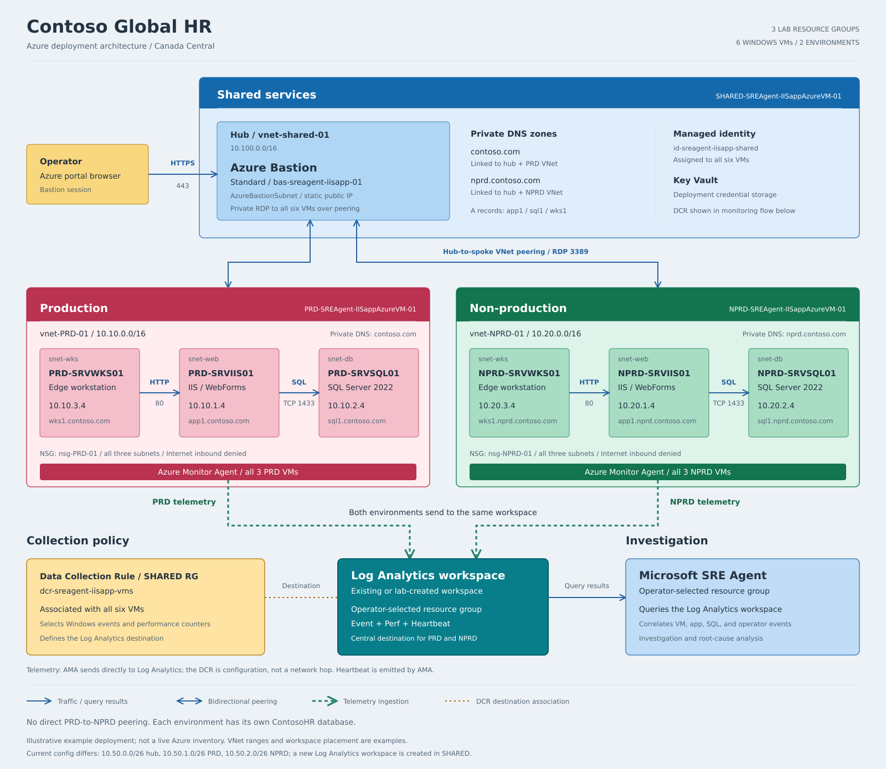
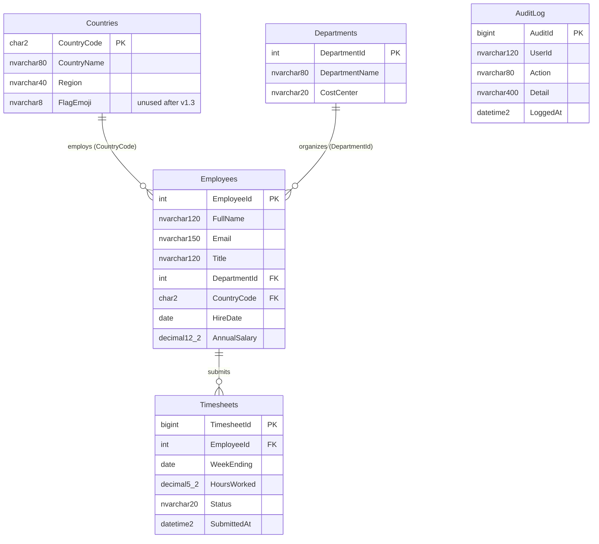
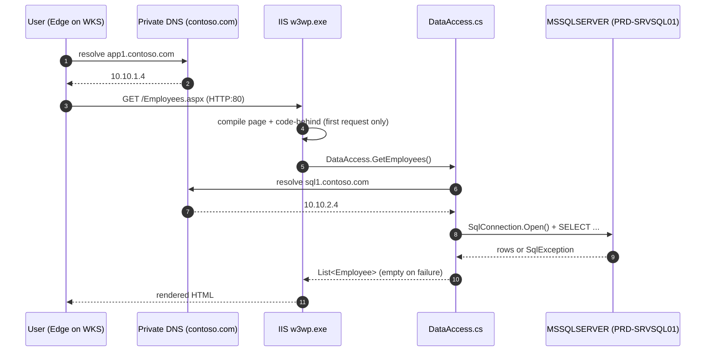

# Contoso Global HR — Application Architecture

> [!WARNING]
> **Isolated lab only — not for production.** Contoso Global HR is an
> intentionally insecure, synthetic legacy application: anonymous access, HTTP
> without TLS, SQL authentication with a plaintext connection string, and
> exceptions swallowed by design. Deploy it only in a dedicated, disposable
> lab subscription, never expose it publicly, and never reuse its patterns or
> credentials in real workloads.

> **Scope:** this document describes the **HR application itself** (the ASP.NET
> WebForms portal + its SQL Server backing store). The Azure infrastructure
> that hosts it — VMs, VNets, DNS, Bastion — is documented in the top-level
> [`README.md`](../README.md) and [`docs/demo-script.md`](../docs/demo-script.md).

## Azure deployment diagram

The diagram below shows the lab's hub-and-spoke infrastructure,
resource-group boundaries, application flows, private DNS relationships,
Bastion access, and monitoring path to the SRE Agent.



[Open the standalone SVG](ContosoGlobalHR-Azure-Deployment.svg)

---

## 1. Purpose

The Contoso Global HR portal is a small internal web application used
throughout the demo as the *thing that quietly fails* when the on-call admin
stops the wrong SQL service. It is intentionally engineered as a **legacy
line-of-business app** — old stack, minimal error handling, no observability
of its own — so that the SRE Agent's root-cause work is credible and
representative of what enterprise fleets actually look like.

The app is deployed identically to two environments (PRD and NPRD) so the
"admin confused the environments" scenario is realistic. Both instances read
from and write to an isolated per-environment SQL database.

## 2. Technology stack

| Layer | Technology | Notes |
|---|---|---|
| Runtime | **.NET Framework 4.8**, ASP.NET **WebForms** | No-build model — compiles on first request |
| UI | **Bootstrap 5.3.2 + Bootstrap Icons 1.11.1** from CDN | AdminLTE-like sidebar layout |
| Data access | `System.Data.SqlClient` | Direct `SqlConnection` / `SqlCommand` — no ORM |
| Database | **SQL Server 2022 Developer** (Azure Marketplace image) | Mixed-mode auth, TCP 1433, SQL login |
| Web server | **IIS 10** on Windows Server 2022, `DefaultAppPool` (v4.0) | Runs on port 80, HTTP only |
| Auth (app) | None. Anonymous access. | Intentional — real intranet apps often skip AuthN behind a VPN |
| Auth (SQL) | SQL Server login (`hrapp`) with `db_datareader` + `db_datawriter` | Password in `Web.config` |
| Compilation model | Single-file `.aspx` pages + `App_Code/` compiled on demand | No `.csproj`, no MSBuild, no publish step |

The stack is deliberately **not modern**: no dependency injection, no MVC, no
Razor, no `appsettings.json`, no health checks, no structured logs, no OpenTelemetry.

## 3. Project layout

```
app/ContosoGlobalHR/
├── Web.config                     # connection string + ASP.NET config
├── Site.Master                    # master page (sidebar, header, env badge)
├── Default.aspx                   # Dashboard (tile counters)
├── Employees.aspx                 # GridView of employees
├── Departments.aspx               # GridView of departments + headcount
├── Countries.aspx                 # Cards per country (Global Presence)
├── Timesheets.aspx                # Recent submissions
├── Reports.aspx                   # DropDown-driven ad-hoc reports
└── App_Code/
    └── DataAccess.cs              # Static data-access helpers + POCOs
```

**No `.csproj`, no `bin/`.** The ASP.NET runtime compiles the `.aspx` pages
into a dynamic assembly on first request. `App_Code/*.cs` is auto-compiled
into a separate top-level assembly, referenced implicitly by all pages.

## 4. Data model



- **`AuditLog`** is not linked to `Employees` — it's a free-form activity
  log. Populated by the `Start-ActivityGenerator.ps1` scheduled task (every
  60 s) so that during a demo the DB always shows continuous write activity.
- Seed data: **4 countries, 10 departments, 100 employees, 4 timesheets per
  employee** — deterministic so PRD and NPRD look identical.

Schema and seed live in [`sql/01-schema.sql`](../sql/01-schema.sql),
[`sql/02-seed.sql`](../sql/02-seed.sql), [`sql/03-logins.sql`](../sql/03-logins.sql).

## 5. Runtime request flow



**Every hop uses DNS** — the app never talks to an IP directly. That's how
we make DNS + private-zone segmentation a first-class part of the story.

## 6. The silent-failure pattern

Every method in `App_Code/DataAccess.cs` follows this shape:

```csharp
public static List<Employee> GetEmployees()
{
    var list = new List<Employee>();
    try {
        using (var c = Open())
        using (var cmd = new SqlCommand("SELECT ... FROM dbo.Employees ...", c))
        using (var r = cmd.ExecuteReader())
            while (r.Read()) list.Add(new Employee { ... });
    } catch { /* silent */ }
    return list;
}
```

The `catch { /* silent */ }` returns an **empty list** on ANY exception:

| Failure mode | User sees |
|---|---|
| SQL service stopped | Page + chrome render; grid says "No data available" |
| Wrong password | Same |
| Connection timeout | Same, after ~5 s (`Connect Timeout=5`) |
| Table missing / schema mismatch | Same |
| Deadlock | Same |

The counter methods (`GetEmployeeCount`, etc.) return `0` on failure. The
Dashboard tiles all show `0` — no red banner, no error message.

**This is the intentional anti-pattern the SRE Agent has to detect.**

## 7. Configuration surface (`Web.config`)

Only two things are actually configurable:

```xml
<appSettings>
  <add key="EnvPrefix" value="PRD" />               <!-- badge in sidebar -->
</appSettings>
<connectionStrings>
  <add name="ContosoHR"
       connectionString="Server=sql1.contoso.com;Database=ContosoHR;
                         User Id=hrapp;Password=***;
                         Encrypt=false;TrustServerCertificate=true;
                         Connect Timeout=5"
       providerName="System.Data.SqlClient" />
</connectionStrings>
<system.web>
  <globalization requestEncoding="utf-8" responseEncoding="utf-8"
                 fileEncoding="utf-8" culture="en-US" />
  <compilation debug="false" targetFramework="4.8" />
</system.web>
```

The `Connect Timeout=5` is important for the demo — without it, the default
15-second timeout makes each page hang for 15 s per DB call during the outage,
which is a give-away that something is wrong. Five seconds is short enough
to feel "just slow", not "broken".

## 8. Deployment model

- **Copy-deploy.** IIS site root is `C:\inetpub\ContosoGlobalHR`. Files are
  pushed by `Configure-WebTier.ps1` (unzipping the `ContosoGlobalHR.zip`
  produced by `Deploy-Lab.ps1`).
- **No build step.** The zip contains raw `.aspx`, `.cs`, and static assets.
  IIS compiles on first request.
- **App pool identity.** `DefaultAppPool` runs as `ApplicationPoolIdentity`.
  SQL connection uses SQL auth (login `hrapp`), so the app pool identity
  never touches SQL directly.
- **Static content.** No CSS or JS in the repo — Bootstrap and Bootstrap Icons
  come from CDN. Zero build tooling on the box.

## 9. Environment differentiation

Both PRD and NPRD run **identical** files. Differences are entirely in
config:

| Aspect | PRD | NPRD |
|---|---|---|
| `Web.config`: `EnvPrefix` | `PRD` | `NPRD` |
| `Web.config`: `Server=` | `sql1.contoso.com` | `sql1.nprd.contoso.com` |
| Sidebar badge | red pill "PRD" | green pill "NPRD" |

The `EnvPrefix` value drives the sidebar badge colour via a CSS class
(`.env-PRD` / `.env-NPRD`). That's the only visual difference — deliberately
subtle, so the "wrong env" mistake is plausible.

## 10. Observability

The app itself is **deliberately blind**:

- No structured logs
- No health-check endpoint
- No metrics
- No tracing

The only observability signals the SRE Agent has are **outside** the app:

| Signal | Source | Where it lands |
|---|---|---|
| IIS access log (200 vs 500, latency) | `w3wp` on the web VM | Local IIS log files on the web VM only — not collected by this lab's DCR |
| App heartbeat (event ID 1001 / 1002) | `Start-ActivityGenerator.ps1` scheduled task | Windows Application log → LAW |
| SQL Server errors | `MSSQLSERVER` service | Windows Application log → LAW |
| Service state changes | `Service Control Manager` (event 7036/7040) | Windows System log → LAW |
| Who did what | Security log (4624 logon, 4688 process-create with cmd line) | Windows Security log → LAW |

The activity generator is what gives the SRE Agent a **before/after** signal:
1001 events every minute means "healthy"; 1002 events mean the DB call
failed. The abrupt transition from 1001 → 1002 is the earliest sign of the
outage in the LAW.

## 11. Non-functional characteristics

| Property | Value | Rationale |
|---|---|---|
| High availability | None. Single web VM, single SQL VM per env. | Lab scale; simple to reason about |
| Scalability | None. In-proc session state (unused), single AppPool. | N/A |
| Security | Anonymous access, no TLS, plain-text password in `Web.config` | Deliberately legacy — realistic for old intranet apps |
| Backup / restore | None. DB is disposable. | Data is deterministic seed |
| Disaster recovery | Redeploy via `Deploy-Lab.ps1` (~20 min end-to-end) | See top-level README |
| Localization | English only, `culture="en-US"` | Fixed |

## 12. Known limitations (intentional)

These are *not* bugs — they're features of the "legacy app" story:

- **HTTP only.** No HTTPS binding on IIS. If you enable HTTPS auto-upgrade
  in Edge, the site becomes unreachable. Fixed via Edge policy (see
  `Configure-Workstation.ps1`).
- **Silent DB failure.** Every catch swallows exceptions. There is no way
  from the UI to tell if the DB is down. This is the whole point.
- **No CSRF, no CSP, no HSTS.** Anonymous read-only content — not exploitable
  in the lab context.
- **Connection string in plain text.** Not Key Vault. Deploy-Lab.ps1 tokenizes
  it at deploy time with the generated `hrapp` SQL password. `azureadmin`,
  `hrapp`, and `svc-oncall` each receive an independent random password.
- **No pagination.** `Employees.aspx` loads all 100 rows every request.

## 13. Change surfaces

Where you would touch the app to add/modify functionality:

| Change | File(s) |
|---|---|
| Add a page | `app/ContosoGlobalHR/*.aspx` + navigation link in `Site.Master` |
| Add a table / column | `sql/01-schema.sql` + `sql/02-seed.sql` |
| Add a data-access method | `App_Code/DataAccess.cs` (add try/catch! keep the pattern) |
| Change environment badge colour | `.env-PRD` / `.env-NPRD` CSS in `Site.Master` |
| Change connection-string template | `app/ContosoGlobalHR/Web.config` (`##X##` placeholders) |
| Change activity-generator behaviour | `scripts/Start-ActivityGenerator.ps1` |

Every change to the app source is picked up automatically by the next
`pwsh ./scripts/Deploy-Lab.ps1` run — the zip is rebuilt and the `ConfigureVM`
run-command re-executes.
