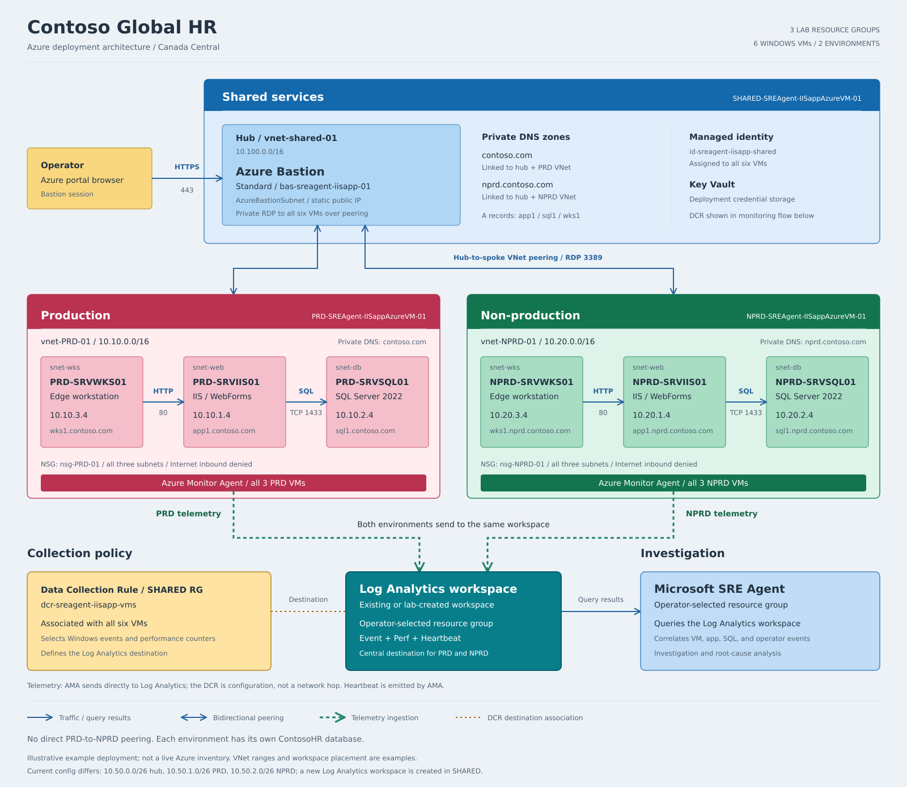

# Demo runbook — Contoso HR silent outage

Complete runbook to access the lab, run the SRE Agent demo, and reset for
the next take.

---

## 1. Access — what you need to know

### Subscription & resource groups

- **Tenant / subscription:** the ones you set in `config/lab.config.jsonc`
  (see the [lab README](../README.md#deploy)). Use a dedicated lab subscription.
- **Region:** `location` in the same file (example: Canada Central)

| Resource group | Role |
|---|---|
| `SHARED-SREAgent-IISappAzureVM-01` | Bastion + DNS zones + UAMI + KV + DCR (+ LAW when `existingLawResourceId` is empty) |
| `PRD-SREAgent-IISappAzureVM-01`    | Production stack (3 VMs) |
| `NPRD-SREAgent-IISappAzureVM-01`   | Non-prod stack (3 VMs) |
| `<sre-agent-resource-group>`       | Your SRE Agent (+ its LAW if reused) — pre-existing, not managed by the lab |

### Deployment architecture

The standalone diagram shows the deployed resource groups, hub-and-spoke
connections, runtime request path, private DNS links, Bastion access, and
telemetry flow into the SRE Agent's Log Analytics workspace.



[Open the standalone SVG](../app-architecture/ContosoGlobalHR-Azure-Deployment.svg)

### VMs

Private IPs below are what Azure typically assigns with the default
`config/lab.config.example.jsonc` CIDRs; `Deploy-Lab.ps1` prints the actual
values at the end of the run.

| VM | Role | Private IP | DNS |
|---|---|---|---|
| `PRD-SRVIIS01`  | IIS + Contoso HR app     | `10.50.1.4`  | `app1.contoso.com` |
| `PRD-SRVSQL01`  | SQL Server 2022 Developer | `10.50.1.20` | `sql1.contoso.com` |
| `PRD-SRVWKS01`  | Windows workstation      | `10.50.1.36` | `wks1.contoso.com` |
| `NPRD-SRVIIS01` | IIS + Contoso HR app     | `10.50.2.4`  | `app1.nprd.contoso.com` |
| `NPRD-SRVSQL01` | SQL Server 2022 Developer | `10.50.2.20` | `sql1.nprd.contoso.com` |
| `NPRD-SRVWKS01` | Windows workstation      | `10.50.2.36` | `wks1.nprd.contoso.com` |

### Credentials

All three accounts get **independent** random passwords generated by
`Deploy-Lab.ps1` and stored locally under `secrets/` (gitignored, ACL
restricted to the current user).

| Account | Where | Password file | Purpose |
|---|---|---|---|
| `azureadmin` | All 6 VMs | `secrets/vm-admin.txt` | Full local admin — daily use |
| `svc-oncall` | Both SQL VMs (`PRD-SRVSQL01`, `NPRD-SRVSQL01`) | `secrets/incident-account.txt` | The "admin who made the mistake" — used ONLY when triggering the incident |
| `hrapp` | SQL login on both DBs | `secrets/sql-app.txt` | Web-app SQL account (in `Web.config`) |

⚠️ `secrets/` is **gitignored** and stays on your machine. The files are
plaintext: never commit or share them, and delete the folder after teardown.

### Bastion

- Name: `bas-sreagent-iisapp-01` (in `SHARED-SREAgent-IISappAzureVM-01`)
- SKU: **Standard** → supports **copy/paste** in the browser session and
  **shareable links** (right-click on a VM in the portal → *Connect via
  Bastion* → *Share*)

### How to connect (once)

1. Azure Portal → search **`PRD-SRVWKS01`** (or any VM).
2. Top menu → **Connect** → **Bastion**.
3. **Username:** `azureadmin` — **Password:** paste from `secrets/vm-admin.txt`.
4. **Authentication type:** Password (leave default).
5. ✅ Enable **Open in new browser tab**.
6. Click **Connect**. Windows session opens.

To share access with a colleague: same VM → **Connect** → **Bastion** → toggle
**Get shareable link** → send them the URL. They authenticate with their own
Entra credentials but land on the same VM (still need the VM local password
to sign in).

### Log Analytics (where the SRE Agent looks)

- Name / RG: the workspace in `existingLawResourceId`, or the one the lab
  creates in `SHARED-SREAgent-IISappAzureVM-01` when that value is empty
- All 6 VMs stream **Windows System / Security (4624/4634/4688) / Application**
  logs + performance counters here via Azure Monitor Agent (IIS log files
  stay on the web VMs and are not collected).

---

## 2. Pre-demo checklist (do 5 min before)

### 2.1 Make sure the VMs are running

**Auto-shutdown fires at 22:00 Eastern time (Toronto)** every night. Start them again:

```powershell
# All 6 VMs, PRD + NPRD, in parallel
foreach ($rg in 'PRD-SREAgent-IISappAzureVM-01','NPRD-SREAgent-IISappAzureVM-01') {
    foreach ($vm in az vm list -g $rg --query "[].name" -o tsv) {
        az vm start -g $rg -n $vm --no-wait
    }
}
# Wait ~90 seconds for all to be reachable
Start-Sleep -Seconds 90
```

Verify:

```powershell
az vm list -d --query "[?contains(resourceGroup,'SREAgent-IISapp')].{name:name, state:powerState}" -o table
```

Expected: every VM in state `VM running`.

### 2.2 Verify the app is up (from your laptop via a run-command probe)

```powershell
foreach ($env in @(@{rg='PRD-SREAgent-IISappAzureVM-01';  vm='PRD-SRVWKS01';  url='http://app1.contoso.com'},
                   @{rg='NPRD-SREAgent-IISappAzureVM-01'; vm='NPRD-SRVWKS01'; url='http://app1.nprd.contoso.com'})) {
    Write-Host "`n=== $($env.vm) -> $($env.url) ===" -ForegroundColor Cyan
    az vm run-command create -g $env.rg --vm-name $env.vm --run-command-name smoke `
        --script "try { (Invoke-WebRequest -UseBasicParsing '$($env.url)' -TimeoutSec 20).StatusCode } catch { 'ERROR: ' + `$_.Exception.Message }" `
        --async-execution false --timeout-in-seconds 60 2>&1 | Out-Null
    az vm run-command show -g $env.rg --vm-name $env.vm --run-command-name smoke --instance-view --query "instanceView.output" -o tsv
    az vm run-command delete -g $env.rg --vm-name $env.vm --run-command-name smoke --yes --no-wait 2>&1 | Out-Null
}
```

Expected output: `200` for both.

### 2.3 Make sure the SQL service is RUNNING on both SQL VMs

If a previous demo left SQL stopped, restart it (from your laptop):

```powershell
az vm run-command invoke -g PRD-SREAgent-IISappAzureVM-01  --name PRD-SRVSQL01  --command-id RunPowerShellScript --scripts "Start-Service MSSQLSERVER" --query "value[0].message" -o tsv
az vm run-command invoke -g NPRD-SREAgent-IISappAzureVM-01 --name NPRD-SRVSQL01 --command-id RunPowerShellScript --scripts "Start-Service MSSQLSERVER" --query "value[0].message" -o tsv
```

---

## 3. Running the demo

### Scene setting (30 seconds, spoken)

> Contoso, a global HR company. Old internal HR portal — nobody remembers who
> wrote it. Two environments, PRD and NPRD, look identical from the inside
> (same server names, same DNS short-names). It's 3:47 PM. Our on-call admin
> `svc-oncall` has been asked to stop the SQL Server service on non-prod for
> a maintenance window.

### Act I — everything green (2 min)

1. Portal → `PRD-SRVWKS01` → **Connect** → **Bastion**, sign in as `azureadmin`.
2. Desktop → double-click **Contoso HR (PRD)** shortcut. Edge opens
   `http://app1.contoso.com`.
3. Walk the tabs:
   - **Dashboard** — 100 employees, 10 departments, 4 countries
   - **Employees** — 100 rows visible (grid populated)
   - **Departments** — 10 rows
   - **Global Presence** — cards for 🇨🇦 🇯🇵 🇩🇪 🇧🇷 with headcount each
   - **Timesheets** — 100 recent submissions
4. (Optional) Bastion → `NPRD-SRVWKS01`, same story, green-badged env.

### Act II — the mistake (30 seconds)

1. Portal → `PRD-SRVSQL01` → **Connect** → **Bastion**.
   Say out loud: *"I'm connecting to the NON-PROD SQL server"* — this is
   what the admin *thought* they were doing.
2. Sign in as **`svc-oncall`** (password in `secrets/incident-account.txt`; this is the deliberate misdirection —
   the account name doesn't tell you which env).
3. Open **Windows PowerShell** in the RDP session and run:
   ```powershell
   Stop-Service MSSQLSERVER -Force
   Get-Service MSSQLSERVER
   ```
4. Point out: no warning, no error. Service `Stopped`. That was actually PROD.

### Act III — silent failure (1 min)

1. Switch back to the `PRD-SRVWKS01` Bastion tab.
2. Refresh the Contoso HR app (F5).
3. Point out:
   - Sidebar loads instantly
   - Dashboard tiles all show `0` — not "error", just zero
   - Employees tab: **"No data available"**
   - Every other tab: same
   - No red banner, no exception page, no HTTP 500
4. Say it out loud: *"Nothing looks broken but nothing works."*

### Act IV — the SRE Agent RCA (2 min)

1. Portal → your SRE Agent resource group → open your **SRE Agent**
   chat.
2. Paste this prompt:
   > *"The Contoso HR portal in production is showing empty data on every
   > page. The site itself loads fine. Investigate the root cause."*
3. Narrate what the agent should find in the lab Log Analytics workspace:
   - **App heartbeat drops** — `Event ID 1001` (healthy) from source
     `ContosoHR-Activity` stops at ~3:47 PM, replaced by `1002` (degraded).
   - **System log 7036** on `PRD-SRVSQL01` — *"The SQL Server (MSSQLSERVER)
     service entered the stopped state."* — same timestamp.
   - **Security log 4688** — process-creation event under user
     `PRD-SRVSQL01\svc-oncall` running `powershell.exe` with command line
     containing `Stop-Service MSSQLSERVER -Force`.
   - **Security log 4624** — Bastion logon of `svc-oncall` a minute before.
4. Expected RCA verdict:
   > *"MSSQLSERVER was stopped on PRD-SRVSQL01 at 15:47 EST by user
   > `svc-oncall`. The web app silently returns empty result sets when the
   > DB is unreachable. Restart the service."*

### Act V — recovery (30 sec)

Two ways.

**From the Bastion RDP** (still logged into `PRD-SRVSQL01`):
```powershell
Start-Service MSSQLSERVER
Get-Service MSSQLSERVER  # Running
```

**Or from your laptop** with `az`:
```powershell
az vm run-command invoke -g PRD-SREAgent-IISappAzureVM-01 --name PRD-SRVSQL01 `
    --command-id RunPowerShellScript --scripts "Start-Service MSSQLSERVER"
```

Refresh the app on `PRD-SRVWKS01` — data reappears in 30-60 seconds
(app-tier connection pool warms up).

---

## 4. Rehearsing without touching PRD

Same steps in NPRD:

- Bastion to `NPRD-SRVSQL01` as `svc-oncall`, `Stop-Service MSSQLSERVER -Force`
- Refresh `http://app1.nprd.contoso.com` from `NPRD-SRVWKS01` → silent failure
- Ask the SRE Agent to investigate the *non-prod* portal
- Recover with `Start-Service MSSQLSERVER`

---

## 5. Reset checklist (after the demo)

```powershell
# 1. Make sure SQL is running on BOTH env
az vm run-command invoke -g PRD-SREAgent-IISappAzureVM-01  --name PRD-SRVSQL01  --command-id RunPowerShellScript --scripts "Start-Service MSSQLSERVER" | Out-Null
az vm run-command invoke -g NPRD-SREAgent-IISappAzureVM-01 --name NPRD-SRVSQL01 --command-id RunPowerShellScript --scripts "Start-Service MSSQLSERVER" | Out-Null

# 2. (Optional) Stop the VMs to save money
foreach ($rg in 'PRD-SREAgent-IISappAzureVM-01','NPRD-SREAgent-IISappAzureVM-01') {
    foreach ($vm in az vm list -g $rg --query "[].name" -o tsv) {
        az vm deallocate -g $rg -n $vm --no-wait
    }
}
```

Auto-shutdown at 22:00 Eastern time (Toronto) does step 2 for you.

---

## 6. Troubleshooting

| Symptom | Fix |
|---|---|
| Bastion can't connect | The VM is probably deallocated. Run the "start" block from §2.1 and wait 90 seconds. |
| App returns HTTP 500 | Check `C:\inetpub\ContosoGlobalHR\Web.config` on the web VM — the connection string should have the real password (not `##DB_PASSWORD##`). If it's still a placeholder, re-run `Deploy-Lab.ps1`. |
| App loads but shows "No data available" without you having stopped SQL | SQL is stopped somehow — `Get-Service MSSQLSERVER` on the SQL VM. If auto-shutdown fired at 22:00, the whole VM is off — start it. |
| SRE Agent doesn't correlate | The 60-second activity generator on the web VMs takes ~2 minutes of runtime after a fresh boot to produce enough heartbeats. Give it time. Verify from the LAW: `Event \| where Source == "ContosoHR-Activity"` |
| SRE Agent or its workspace gone | Someone deleted the SRE Agent or its workspace. The DCR references that LAW — logs will still be collected in whichever LAW is set as the current one, so re-point the DCR. |

---

## 7. Nuke everything

```powershell
pwsh ./scripts/Teardown-Lab.ps1
```

Prompts for confirmation, then `az group delete --no-wait` on the 3 lab
resource groups. Does NOT touch your SRE Agent resource group. Delete the local
`secrets/` folder afterwards.
