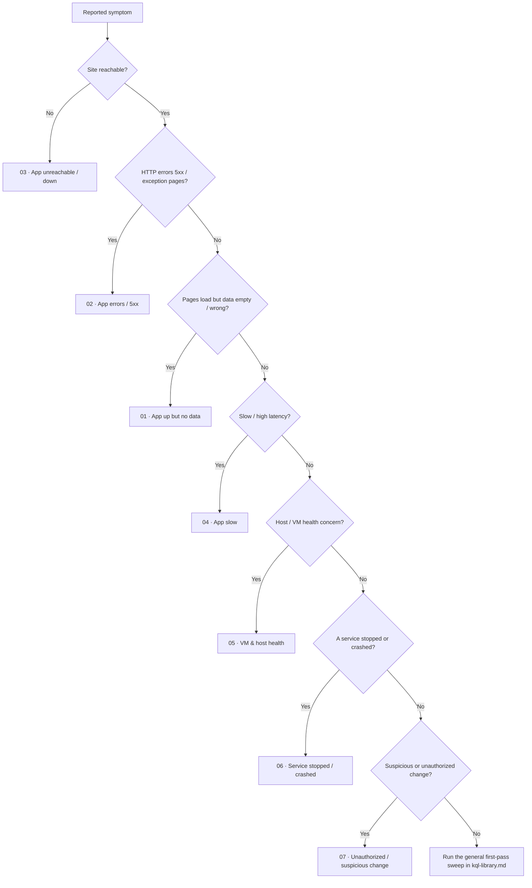

# SRE Agent troubleshooting skills

A library of **symptom-driven runbooks**, a **reusable KQL query library**, and
**report templates** that help the Microsoft Azure SRE Agent (or a human
on-call) investigate and report on the Contoso Global HR lab — and any similar
**IIS + SQL Server on Windows VM** workload.

Each runbook is self-contained: *symptom → hypotheses → queries to run →
how to read the result → remediation → what to write up*. The queries are
grounded in the **actual signals this lab collects** (see
[Data sources](#data-sources) below), so they run as-is against the lab's Log
Analytics workspace.

> These are **general-purpose** runbooks. The signature lab incident
> (SQL stopped on the wrong host → silent empty data) is one worked example
> inside [runbooks/01-app-up-no-data.md](runbooks/01-app-up-no-data.md), but
> every runbook is written to cover the broad failure class, not just the demo.

---

## How the SRE Agent should use these

1. **Start at the triage tree** below — map the reported symptom to a runbook.
2. Open that runbook and run its queries against the LAW
   (the lab Log Analytics workspace), narrowing to the affected
   `Computer` and a time window around the incident.
3. Confirm or reject each hypothesis in order; most runbooks converge on a
   single root cause.
4. Produce the write-up using
   [templates/rca-report.md](templates/rca-report.md) (post-incident) or
   [templates/incident-report.md](templates/incident-report.md) (live status).

All KQL snippets referenced by the runbooks live in one place:
[kql-library.md](kql-library.md).

---

## Data sources

This lab's Data Collection Rule (`dcr-sreagent-iisapp-vms`) streams **only**
the following into the workspace. Ground every query in these — there is **no**
`AzureDiagnostics`, `W3CIISLog`, or `AppTraces` table in this lab.

| Table | What lands here | Key columns |
|---|---|---|
| **`Event`** | Windows **System** + **Application** logs (Level 1–4) and **Security** events `4624` / `4634` / `4688` — all via the `Microsoft-Event` stream | `TimeGenerated`, `Computer`, `EventLog`, `Source`, `EventID`, `EventLevelName`, `RenderedDescription` |
| **`Perf`** | 3 counters, sampled every 60 s | `TimeGenerated`, `Computer`, `ObjectName`, `CounterName`, `CounterValue` |
| **`Heartbeat`** | Azure Monitor Agent liveness (automatic) | `TimeGenerated`, `Computer`, `Category` |

> **Security events land in `Event`, not `SecurityEvent`.** Because they are
> collected through the `windowsEventLogs` / `Microsoft-Event` data source,
> query `4624` / `4688` from the `Event` table (`EventLog == "Security"`), not
> the `SecurityEvent` table.

### Signals that matter (event IDs)

| Signal | Log | Source | Event ID |
|---|---|---|---|
| App heartbeat — healthy | Application | `ContosoHR-Activity` | `1001` |
| App heartbeat — degraded (DB call failed) | Application | `ContosoHR-Activity` | `1002` |
| Service entered running/stopped state | System | `Service Control Manager` | `7036` |
| Service start-type changed (e.g. → Disabled) | System | `Service Control Manager` | `7040` |
| SQL Server error / login failure | Application | `MSSQLSERVER` | `17xxx`, `18456`, etc. |
| Account logon (who connected) | Security | `Microsoft-Windows-Security-Auditing` | `4624` |
| Account logoff | Security | same | `4634` |
| Process created (what command ran) | Security | same | `4688` |

### Perf counters collected

- `\Processor(_Total)\% Processor Time`
- `\Memory\Available MBytes`
- `\LogicalDisk(_Total)\% Free Space`

---

## Lab topology (for scoping `Computer` filters)

| Computer | Role | Env |
|---|---|---|
| `PRD-SRVIIS01`  | IIS + Contoso HR web tier | PRD |
| `PRD-SRVSQL01`  | SQL Server 2022 | PRD |
| `PRD-SRVWKS01`  | Workstation | PRD |
| `NPRD-SRVIIS01` | IIS + Contoso HR web tier | NPRD |
| `NPRD-SRVSQL01` | SQL Server 2022 | NPRD |
| `NPRD-SRVWKS01` | Workstation | NPRD |

Web tier resolves the DB through DNS (`sql1.contoso.com` in PRD,
`sql1.nprd.contoso.com` in NPRD) — identical short names across environments,
which is the root enabler of "wrong host" mistakes.

---

## Triage decision tree

## Runbook index

| # | Runbook | Symptom it starts from |
|---|---|---|
| 01 | [App up but no data](runbooks/01-app-up-no-data.md) | Site + menus render, grids/tiles empty, no error banner |
| 02 | [App errors / 5xx](runbooks/02-app-errors-5xx.md) | HTTP 500 / exception pages / app crashes |
| 03 | [App unreachable / down](runbooks/03-app-unreachable.md) | Site times out or refuses connection |
| 04 | [App slow / high latency](runbooks/04-app-slow.md) | Pages load but sluggish |
| 05 | [VM & host health](runbooks/05-vm-host-health.md) | CPU / memory / disk pressure, agent gaps |
| 06 | [Service stopped / crashed](runbooks/06-service-stopped.md) | A Windows service is down (SQL, IIS, W3SVC…) |
| 07 | [Unauthorized / suspicious change](runbooks/07-unauthorized-change.md) | "Who did what, when" attribution |

## Report templates

- [templates/rca-report.md](templates/rca-report.md) — post-incident root-cause analysis.
- [templates/incident-report.md](templates/incident-report.md) — live/interim status update.
