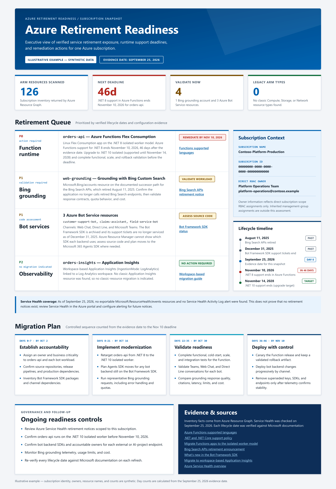

# Azure Retirement Readiness

**Status:** Guidance package — documentation and an illustrative dashboard only

**An evidence-based Azure retirement planning workflow that identifies support deadlines, prioritizes migration work, and produces a communication-ready dashboard without changing Azure resources.**

## What it is

Azure retirement notices, runtime end-of-support dates, and service transitions are easy to miss when they are distributed across inventory, lifecycle documentation, Service Health, and application ownership records. **Azure Retirement Readiness** consolidates those signals into a prioritized assessment so platform and application teams can act before a deadline becomes an incident.

This folder contains documentation and an illustrative dashboard only: the dashboard SVG, its PNG preview, and a standard-library Python script that regenerates them. It deploys nothing, contains no Azure automation or templates, and leaves nothing in Azure to clean up (see [Cleanup](#cleanup)). The workflow runs in an assistant with read-only Azure access, such as Azure SRE Agent.

---

## Who it is for

- Platform and cloud governance teams that track Azure service retirements and runtime end-of-support dates.
- Application and service owners who need a prioritized, evidence-backed migration backlog.
- Operations teams that use Azure SRE Agent or a similar assistant for read-only subscription assessments.

---

## Purpose

This use case evaluates one Azure subscription and produces a retirement-readiness view that separates:

- Confirmed service or runtime retirement deadlines.
- Configuration findings that require workload or source-code validation.
- Retirement candidates that are already on a supported successor path.
- Monitoring and ownership gaps that prevent reliable internal communication.

The workflow is read-only for Azure discovery and analysis. It does not migrate, restart, delete, scale, or change Azure resources.

---

## What it does

- Discovers subscription resources with Azure Resource Graph.
- Prioritizes known retirement-sensitive services and runtime configurations.
- Checks exportable Resource Health events and Service Health alert coverage.
- Validates dated lifecycle claims against current Microsoft documentation.
- Resolves direct subscription-scope RBAC Owner assignments for communication context.
- Creates or refreshes an Azure Retirement Readiness dashboard with:
  - Executive readiness metrics.
  - A prioritized Retirement Queue.
  - A dedicated Subscription Context column with subscription identity and direct Owner assignments.
  - A controlled Migration Plan and follow-up controls.
  - Evidence sources and explicit coverage limitations.
- Optionally schedules a weekly dashboard refresh after explicit user request.

---

## Dashboard illustration



*Illustrative example — synthetic data. Subscription identity, owner information, resource names, and counts are synthetic; the layout demonstrates the intended executive report shape. The lifecycle dates are real and were verified against the Microsoft documentation listed in [References](#references). Day counts are calculated from the September 25, 2026 evidence date shown on the dashboard.*

The editable source is [`assets/azure-retirement-readiness-dashboard.svg`](assets/azure-retirement-readiness-dashboard.svg), generated by [`assets/build_dashboard_example.py`](assets/build_dashboard_example.py); see [Regenerating the dashboard](#regenerating-the-dashboard).

---

## When to use it

Use this workflow when a team needs to:

- Prepare for Azure service retirements, deprecations, and runtime end-of-support dates.
- Create a subscription-level migration backlog.
- Identify who should receive or own retirement communications.
- Validate whether Service Health notice monitoring is configured.
- Maintain a recurring retirement-readiness view for platform governance.

---

## Prerequisites

| Requirement | Why it is needed |
| --- | --- |
| Read access to the target Azure subscription | Enumerates resources and reads configuration. |
| Azure Resource Graph access | Builds the subscription inventory and identifies candidate services. |
| Microsoft Entra ID directory-read access, when available | Resolves direct RBAC Owner object IDs to display names and email addresses. |
| Access to Azure Resource Health and Activity Log alert configuration | Identifies exportable health events and Service Health monitoring coverage. |
| Access to Microsoft Learn | Verifies current lifecycle dates against authoritative documentation. |
| [Microsoft Release Communications MCP Server](https://learn.microsoft.com/microsoft-365/admin/manage/mrc-mcp) (Azure Updates), endpoint `https://www.microsoft.com/releasecommunications/mcp` | Lists announced Azure retirements from [Azure Updates](https://azure.microsoft.com/updates) (`get_recent_azure_updates` filtered on the Retirements tag, `get_azure_update_by_id`). Public, no authentication or license; use is subject to the Microsoft API Terms of Use. |
| Live Report capability, optional | Stores the dashboard for repeated review. |
| Scheduled task capability, optional | Refreshes the report weekly after user approval. |
| [Agent instructions](sre-agent-assets/sre-agent-instructions.md), for Azure SRE Agent | Sets the agent's read-only guardrails, procedure, and dashboard contract. |

If a source is unavailable, the workflow reports the missing coverage rather than treating absence of evidence as evidence of no risk.

---

## Procedure

1. **Establish the assessment scope**
   - Confirm the Azure subscription ID, display name, and intended audience.
   - Limit discovery to the authorized subscription.

2. **Build the inventory**
   - Query Azure Resource Graph for all resources.
   - Inspect retirement-sensitive resource types and configuration, including Bing accounts, Bot Service, App Service and Functions, Logic Apps, Application Insights, classic resource providers, API Management, SQL, and PostgreSQL.

3. **Match announced retirements**
   - Query Azure Updates retirement posts through the Microsoft Release Communications MCP Server.
   - Keep only posts that match resource types or services in the inventory, and record the post ID.

4. **Check Service Health coverage**
   - Query exportable `Microsoft.ResourceHealth/events` resources.
   - List Activity Log alerts to determine whether Service Health notifications are configured.
   - Treat an empty event result as a coverage limitation, not proof that no notices exist.

5. **Verify lifecycle evidence**
   - Use current Microsoft documentation to confirm dates for services or runtimes identified in the inventory and for matched Azure Updates posts.
   - Record the exact deadline, the affected resource, and the evidence source.

6. **Resolve communication ownership**
   - Retrieve direct subscription-scope RBAC Owner assignments.
   - Resolve display names and email addresses only when directory access is authorized.
   - Clearly label direct assignments and do not imply inherited management-group ownership was assessed.

7. **Publish the dashboard**
   - Use an Azure-blue, executive-ready visual system.
   - Present the Retirement Queue with confirmed actions, validation requirements, and no-action findings.
   - Place subscription name, ID, and direct Owner assignments in a dedicated Subscription Context column next to the queue.
   - Include a migration plan, governance controls, evidence sources, and gaps.

8. **Automate only when requested**
   - Schedule a recurring refresh only after the user explicitly requests it.
   - Keep scheduled runs read-only, scoped to the subscription, and idempotent.
   - Preserve the existing report rather than creating duplicate dashboards.

---

## Safety and governance

| Control | Behavior |
| --- | --- |
| Azure mutations | Not performed. The workflow is read-only for Azure resources. |
| Lifecycle assertions | Supported by current Microsoft documentation; uncertain findings are labeled for validation. |
| Service Health interpretation | Empty exportable event results are not presented as proof that no notices exist. |
| Ownership data | Shows direct subscription-scope Owners only and labels scope limitations. |
| Dashboard updates | Update the existing report in place; do not create duplicates. |
| Automation | Requires explicit user request and performs no remediation or notification actions. |
| Migration | Recommends controlled validation, canary deployment, and rollback planning; execution remains a human decision. |

---

## Expected output

The workflow provides:

- A subscription-level Azure Retirement Readiness dashboard.
- Executive metrics for resources scanned, known deadlines, validation items, and legacy resource presence.
- A retirement queue with a priority, affected resource, rationale, action state, and authoritative reference.
- A Subscription Context column for internal communication.
- A phased migration plan covering ownership, implementation, validation, and controlled deployment.
- A Service Health monitoring-gap statement when event export or alert coverage is incomplete.
- An optional weekly scheduled refresh task.

---

## Example prompts

> "Create an Azure retirement-readiness dashboard for my subscription. Include Service Health coverage, direct Owners, migration priorities, and the next deadline."

> "Which services in this subscription should we migrate before their retirement or runtime end-of-support date?"

> "Refresh the Azure Retirement Readiness dashboard every Monday and keep the Subscription Context column current."

---

## Sample output

The illustrative dashboard shows a sample assessment with an evidence date of September 25, 2026. It identifies:

- `orders-api`, an Azure Functions Flex Consumption app on the .NET 8 isolated worker model. Azure Functions support for .NET 8 ends November 10, 2026, 46 days after the evidence date, so the app is a P0 item to move to .NET 10 isolated (supported until November 14, 2028).
- One Grounding with Bing Custom Search resource and three Azure Bot Service resources (four items to validate now). The Bing Search APIs retired on August 11, 2025, and Bot Framework SDK support tickets are no longer serviced as of December 31, 2025, so these need application compatibility and source-code validation rather than immediate platform migration.
- A workspace-based Application Insights resource with no classic-resource migration indicated.
- No exportable Resource Health events and no Service Health Activity Log alert, recorded as a monitoring coverage gap.
- One direct subscription-scope Owner listed in the Subscription Context column for internal communication.

The report distinguishes verified facts from validation work and does not claim that an empty event query proves there are no retirement notices.

---

## Limitations

- Azure Resource Graph cannot determine all application SDK versions, package dependencies, or business criticality.
- Some Service Health data may not be exportable through the available read path.
- Direct RBAC Owner assignments do not include inherited management-group assignments unless explicitly queried and labeled.
- Lifecycle guidance can change; scheduled refreshes must validate current documentation before changing dated claims.
- This workflow does not execute migrations, application upgrades, or production changes.

---

## Regenerating the dashboard

The SVG is generated; edit the Python source, not the SVG output. The generator uses the Python standard library only (Python 3.10 or later), and the PNG preview is rendered at 1.25× the SVG width with Node.js `npx`. From the repository root:

```powershell
python Tools\azure-retirement-readiness\assets\build_dashboard_example.py
npx --yes sharp-cli@6.0.0 --input "Tools/azure-retirement-readiness/assets/azure-retirement-readiness-dashboard.svg" --output "Tools/azure-retirement-readiness/assets" --format png resize 1800
```

The evidence date and lifecycle dates are constants at the top of the script; day counts and plan windows are calculated from them. Re-verify each date against the references below before changing it.

---

## Cleanup

Nothing is deployed to Azure by this package. The only files it can produce are the locally regenerated dashboard SVG and PNG; to return to the committed versions, run from the repository root:

```powershell
git restore Tools/azure-retirement-readiness/assets
```

If you asked the assistant to create a live report or a weekly scheduled refresh, remove them in that assistant platform when they are no longer needed.

---

## References

- [Azure SRE Agent instructions](sre-agent-assets/sre-agent-instructions.md)
- [Azure Resource Graph documentation](https://learn.microsoft.com/azure/governance/resource-graph/overview)
- [Azure Service Health documentation](https://learn.microsoft.com/azure/service-health/overview)
- [Get started with the Microsoft Release Communications MCP Server](https://learn.microsoft.com/microsoft-365/admin/manage/mrc-mcp)
- [Azure Functions supported languages](https://learn.microsoft.com/azure/azure-functions/supported-languages) — .NET 8 support in Azure Functions ends November 10, 2026; .NET 10 is supported until November 14, 2028.
- [Migrate C# apps from the in-process model to the isolated worker model](https://learn.microsoft.com/azure/azure-functions/migrate-dotnet-to-isolated-model) — in-process model support ends November 10, 2026.
- [Azure Functions .NET isolated worker guide](https://learn.microsoft.com/azure/azure-functions/dotnet-isolated-process-guide)
- [.NET releases and support](https://learn.microsoft.com/dotnet/core/releases-and-support) and the [.NET and .NET Core support policy](https://dotnet.microsoft.com/platform/support/policy/dotnet-core) — .NET 8 (LTS) end of support is November 10, 2026.
- [Bing Search APIs retirement announcement](https://learn.microsoft.com/lifecycle/announcements/bing-search-api-retirement) — retired August 11, 2025; successor is Grounding with Bing Search.
- [Grounding with Bing Custom Search](https://learn.microsoft.com/azure/ai-foundry/agents/how-to/tools/bing-custom-search)
- [What's new in the Bot Framework SDK](https://learn.microsoft.com/azure/bot-service/what-is-new) — SDK archived; support tickets no longer serviced as of December 31, 2025.
- [Azure AI Bot Service documentation](https://learn.microsoft.com/azure/bot-service/)
- [Migrate to workspace-based Application Insights resources](https://learn.microsoft.com/azure/azure-monitor/app/convert-classic-resource)
