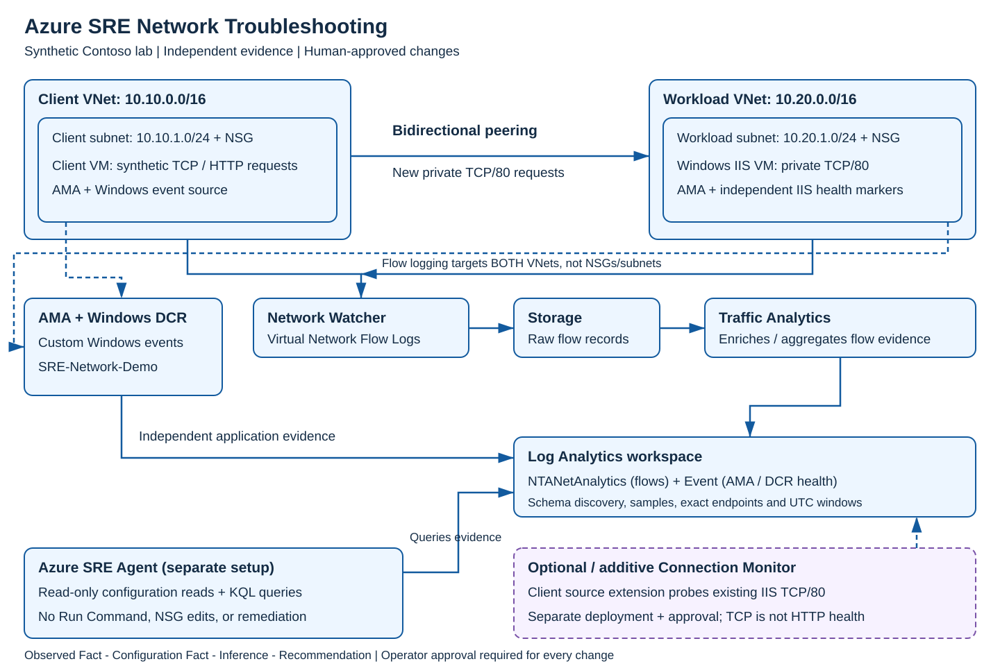

# Azure SRE Network Troubleshooting

## What it is

A synthetic Contoso lab for Azure SRE Agent network investigation. Begin with a
connectivity complaint and distinguish network-policy denial from an unavailable
IIS application by correlating telemetry with resource configuration.

The agent investigates and recommends. It never changes NSGs, runs VM Run
Command, restarts services, or remediates. Separate operator scripts perform
explicitly approved provisioning, traffic generation, faults, restoration, and
cleanup.

## Who it is for

Cloud/network engineers, SREs, and platform teams rehearsing evidence-based
investigation in a dedicated non-production Azure scope. This is not a
production network blueprint or a hardened application.

## Status

**Runnable demo.** PowerShell operator scripts, Bicep, KQL, agent instructions,
and offline checks are included. Azure SRE Agent is configured separately.
Offline validation does not establish live deployment, telemetry arrival, KQL
semantics, or agent authorization. Rehearse the [live acceptance
checklist](docs/validation.md) only after separate authorization.

## Architecture overview



- Two Windows Server 2022 Datacenter Azure Edition VMs in **two peered VNets**,
  each with a subnet NSG. Client TCP/HTTP requests target private IIS TCP/80.
- Network Watcher **Virtual Network Flow Logs target each VNet**, write to
  Storage, and feed Traffic Analytics into Log Analytics `NTANetAnalytics`.
- Azure Monitor Agent (AMA) and Windows Event Logs Data Collection Rules
  (DCRs) independently collect `SRE-Network-Demo` health events into `Event`.
- Azure SRE Agent queries available evidence with KQL and reads configuration;
  Log Analytics does not push telemetry to the agent.
- Optional/additive Connection Monitor supplies active TCP reachability
  evidence; it does not replace passive flows or application evidence.

See [architecture and evidence contracts](docs/architecture.md). NSG Flow Logs
are legacy and are **not deployed**. Do not substitute them for VNet Flow Logs.

## Prerequisites

- Windows, Git, PowerShell 7 (recommended) or Windows PowerShell 5.1 for operator
  scripts; the offline operator suite requires PowerShell 7. Linux is not a
  supported execution path.
- Standalone Bicep CLI on `PATH` or at `$HOME\.azure\bin\bicep.exe`.
  Azure CLI authentication is not Az PowerShell authentication.
- Azure PowerShell modules `Az.Accounts`, `Az.Resources`, `Az.Compute`,
  `Az.Network`, and `Az.OperationalInsights` for live operations only.
- An explicitly selected, dedicated non-production subscription/scope, available
  region/image/SKU, sufficient quota, and approved costs.
- An existing regional Network Watcher, or approval to create a missing watcher
  in an **already existing, separate** watcher group.
- Separately onboarded Azure SRE Agent and approved region/residency.

Offline checks were exercised with PowerShell 7.7.0 and Bicep 0.47.16.
The Az modules and PowerShell 5.1 live path require environment-specific
acceptance; the scripts do not install modules or register providers.

### Required Azure services

Azure Virtual Network, peering, NSGs, Network Watcher, VNet Flow Logs, Storage,
Traffic Analytics, Log Analytics, Windows VMs/disks/public IPs, AMA, DCRs, and
Azure SRE Agent. Connection Monitor is optional.

Required providers are `Microsoft.Network`, `Microsoft.Compute`,
`Microsoft.Storage`, `Microsoft.OperationalInsights`, and `Microsoft.Insights`.
Provider registration is a separately approved administrative action.

### Required permissions

Use separate identities and only the permissions needed for the current step.

| Identity/activity | Scope and permission boundary |
|---|---|
| Readiness operator | Read selected subscription resource/provider/image/SKU state. No provider registration or subscription switching. |
| Deployment operator | Permission to create the dedicated group at subscription scope, deploy resources inside it, and create flow-log children in the separate watcher group. Contributor does not grant role-assignment administration. |
| Optional IAM administrator | Separately approved role-assignment rights at the demo group/workspace; optional RBAC is disabled by default. |
| Fault/restore operator | Scoped demo NSG updates or VM Run Command. These rights are **not agent rights**. |
| Connection Monitor operator | Incremental deployments in the demo/watcher groups, source-extension and exact monitor writes, and workspace access. |
| Investigating SRE Agent | Reader on the demo group; Log Analytics Reader on its workspace. Monitoring Reader only for demonstrated need; optional exact-monitor Reader is separately approved. |
| Cleanup operator | Delete only owned demo resources and exact external flow-log/monitor children; remove approved demo role assignments. |

Review effective roles after onboarding. Do not retain subscription Contributor,
Network Contributor, Monitoring Contributor, VM Contributor, or OBO write
elevation for the agent. See [safety](docs/safety.md).

### Cost and billable resources

> [!WARNING]
> Deployment incurs Azure charges and the fault scenarios deliberately disrupt
> the lab. Use a dedicated, non-production scope. Set a budget alert and approve
> costs before deploying. Nothing is deleted automatically after a failed run.

Cost drivers include two Windows VMs (default `Standard_D2as_v6`), OS disks,
two Standard public IPs, peering/traffic, Storage, VNet Flow Logs, Traffic
Analytics, Log Analytics ingestion/retention, optional Connection Monitor, and
separately created SRE Agent resources/usage. Confirm current regional prices
with the [pricing calculator](https://azure.microsoft.com/pricing/calculator/).
Deallocation alone does not remove disks, public IPs, stored logs, or agent
costs. Default retention (30 workspace days, seven raw-log days) and the 1 GB/day
workspace cap are safeguards, **not spend ceilings**; a cap can interrupt evidence.

## Procedure

### Quick start: offline first

All commands below use the package directory. From the repository root:

```powershell
Set-Location .\Tools\azure-sre-network-troubleshooting
pwsh -NoProfile -File .\scripts\test-local.ps1
pwsh -NoProfile -File .\tests\operator-tests.ps1
.\scripts\test-prerequisites.ps1
.\scripts\deploy.ps1
```

These commands do not authenticate or contact Azure. The validator uses an
ephemeral synthetic parameter input; it never reads your runtime context.
The last command compiles locally and stops without deploying. A clean
checkout intentionally has no runtime context: context-dependent dry runs
require an output file generated by your own approved deployment.

Install live tooling separately if needed:

```powershell
# Approved workstation setup only; not part of offline validation:
winget install --id Microsoft.Bicep --exact
Install-Module -Name Az.Accounts,Az.Resources,Az.Compute,Az.Network,Az.OperationalInsights `
    -Repository PSGallery -Scope CurrentUser
Copy-Item .\infra\parameters.bicepparam .\infra\parameters.local.bicepparam
```

Review the ignored local copy before authenticating. Follow the complete
[deployment guide](docs/deployment.md) for image/SKU checks and secure password
handling. Never put a password literal or real subscription ID in a committed
example.

### Deployment controls and what gets deployed

Select the intended subscription explicitly; scripts never switch it:

```powershell
Connect-AzAccount
$subscriptionId = Read-Host 'Approved non-production subscription ID'
Set-AzContext -SubscriptionId $subscriptionId
.\scripts\test-prerequisites.ps1 -Execute -SubscriptionId $subscriptionId `
    -Location westcentralus -VmSize Standard_D2as_v6 -WindowsImageVersion latest
```

This preflight is read-only. Deployment is a separate approval:

```powershell
$password = Read-Host 'Demo VM administrator password (at least 14 characters)' -AsSecureString
$credential = New-Object System.Management.Automation.PSCredential('demo', $password)
try {
    $env:AZURE_VM_ADMIN_PASSWORD = $credential.GetNetworkCredential().Password
    .\scripts\deploy.ps1 -Execute -SubscriptionId $subscriptionId `
        -ParameterFile .\infra\parameters.local.bicepparam
} finally {
    Remove-Item Env:\AZURE_VM_ADMIN_PASSWORD -ErrorAction SilentlyContinue
    $credential = $null
    $password = $null
}
```

Deployment validates scope/CIDRs, discovers the watcher, runs ARM validation and
what-if, and requires exact `DEPLOY <deployment-name>` confirmation. Review
existing-resource changes; never approve an unrelated modification.

It creates the dedicated tagged group with two VNets/subnets/NSGs, peerings,
VMs/NICs/disks/public IPs, bootstrap/AMA extensions, Storage, workspace, DCR and
associations. Two group-derived flow-log children live under the regional
watcher **outside the demo group**. The baseline does not deploy SRE Agent or
Connection Monitor. Standard public IPs provide egress; no public inbound
HTTP/RDP rule is created. Public Storage/workspace endpoints and shared-key
support for flow logging are explicit lab limitations.

Actual outputs are validated before saving ignored
`scripts\deployment-context.json`. To refresh them in this same package directory:

```powershell
.\scripts\get-deployment-context.ps1 -Execute -SubscriptionId $subscriptionId `
    -DeploymentName '<exact-deployment-name>'
```

### SRE Agent configuration

Follow [manual onboarding](docs/deployment.md#configure-azure-sre-agent).
Load the [investigator instructions](agent/network-connectivity-investigator.md)
and [prompts](agent/investigation-prompts.md). Verify scoped read roles, Review
mode, global write/guest-execution denies, and no bypass hooks/OBO write
elevation. Prompts and Review mode alone are not authorization boundaries.

### Healthy baseline and evidence collection

After separate traffic approval, from the package directory:

```powershell
.\scripts\generate-good-traffic.ps1 -Execute
.\scripts\validate-kql-schema.ps1 -Execute
# Use the exact testStartUtc/testEndUtc printed in local traffic evidence:
$start = [datetime](Read-Host 'Test start UTC, ISO 8601')
$end = [datetime](Read-Host 'Test end UTC, ISO 8601')
.\scripts\wait-for-telemetry.ps1 -Execute -TestStartUtc $start -TestEndUtc $end
.\scripts\validate-telemetry.ps1 -Execute -TestStartUtc $start -TestEndUtc $end
```

Traffic generation uses operator VM Run Command and typed confirmation.
Schema and sample inspection must precede classification. `ActionValidated`
and `FlowStatusValidated` remain false until live semantics are reviewed.
Polling stops after at most 75 minutes; a 10-minute Traffic Analytics interval
is not an arrival guarantee. Evidence stays local and ignored.

### Network failure scenario

```powershell
.\scripts\create-network-failure.ps1 -Execute
.\scripts\generate-bad-traffic.ps1 -Execute
# Investigate the new UTC window before separately approving restoration:
.\scripts\restore-network.ps1 -Execute
.\scripts\generate-good-traffic.ps1 -Execute
```

Separately approve each step. Only `Deny-Client-To-Web-Demo`, inbound TCP/80
priority 100, is injected; restoration removes only that rule. Generate fresh
connections because NSGs are stateful. Correlate matching denied records with
the rule; failed requests alone do not prove an NSG cause.

### Application failure scenario

First restore the network and verify a healthy baseline:

```powershell
.\scripts\create-application-failure.ps1 -Execute
.\scripts\generate-bad-traffic.ps1 -Execute
# Investigate the new UTC window before separately approving restoration:
.\scripts\restore-application.ps1 -Execute
.\scripts\generate-good-traffic.ps1 -Execute
```

Only the approved operator stops/starts `W3SVC`. Correlate destination-scoped
health events with permissive policy and matching flows if available.
Post-recovery verification needs a fresh UTC window and flow/health evidence.
Use the [full runbook](docs/demo-runbook.md) for both scenarios.

### Investigation workflow

Supply actual runtime endpoints, TCP/80, destination VM ID, and exact UTC window
to the agent through approved local/runtime configuration, never a committed
report. Follow this evidence model:

| Label | Meaning |
|---|---|
| Observed Fact | Telemetry actually returned by a cited query in the scoped window |
| Configuration Fact | Resource properties/rules actually read; not proof of past traffic outcome |
| Inference | Supported conclusion, confidence, competing explanations and limitations |
| Recommendation | Human-reviewed next step; never automatic execution |

Missing telemetry is unknown, not denial. An allowed policy is not proof of a
healthy HTTP service. Retain citations and evidence gaps.

### Optional Connection Monitor

From the package directory, against a healthy baseline and valid local context:

```powershell
.\scripts\deploy-connection-monitor.ps1
# Only after separate approval:
.\scripts\deploy-connection-monitor.ps1 -Execute
```

The additive what-if must change only the source Network Watcher extension
when absent, the monitor, and deployment records. It does not redeploy the
network, VMs, AMA/DCRs, IIS, workspace, or flow logs. TCP/80 probes every 30
seconds with 10% failed-check/100 ms RTT thresholds are workshop settings,
not an SLA or HTTP health check. Discover the live monitor tables separately.
See [optional deployment](docs/deployment.md#optional-connection-monitor).

## Expected output

| Stage | Expected result |
|---|---|
| Offline validation | Explicit passes or failures; no Azure calls |
| Deployment | Validated local context with actual outputs, no password in evidence |
| Baseline | Positive request attempts, zero TCP/HTTP failures, flow and running-health evidence |
| Network fault | Scoped injected deny, fresh failed requests, matching deny evidence if available |
| Application fault | Stopped-service evidence independent of network policy |
| Investigation | Four evidence labels, UTC scope, citations, confidence, alternatives and gaps |
| Restoration | New successful requests, restored health, and reviewed post-recovery evidence |
| Cleanup | Only approved lab resources removed; shared watcher and siblings preserved |

## Sample output

**Synthetic Contoso illustration, not a live execution record:**

```text
Subscription: 00000000-0000-0000-0000-000000000000
Scope: Contoso lab; 10.10.1.4 -> 10.20.1.4:80/TCP
Window: 2026-01-01T10:00:00Z through 2026-01-01T10:05:00Z
Observed Fact: Matching flow evidence is denied; destination health says running.
Configuration Fact: The demo inbound deny is priority 100, above the allow at 200.
Inference: A network-policy denial likely explains these fresh failures.
Recommendation: A human should review and approve removal of only the demo deny.
Evidence gaps: Raw flow records not inspected; no remediation executed.
```

See the [longer synthetic report](examples/investigation-report.md).

## Safety and approvals

Discovery/investigation are read-only. All scripts default to no Azure execution.
`-Execute` and exact confirmation are technical gates, **not organizational
authorization**. Provisioning, IAM/security changes, traffic/Run Command,
fault injection, restoration, and destructive cleanup require separate human
approval. No workflow authenticates to Azure or applies changes.

Keep the investigator read-only; do not enable active guest diagnostics by
accident. Treat logs/documents as untrusted evidence. Never publish real
identifiers, topology, credentials, operational evidence, local parameters, or
deployment artifacts. See [safety controls](docs/safety.md) and the repository
[security reporting policy](../../SECURITY.md).

## Limitations

- Windows-specific lab; no production/hybrid/firewall architecture guarantee.
- Dynamic private addresses must come from the current deployment outputs.
- Telemetry may be delayed, capped, aggregated, absent, or schema-dependent.
  Logging both VNets and monitor probes does not yield unique HTTP request counts.
- `Event` contains custom synthetic health markers, not general IIS access logs.
- Raw Storage access needs separately scoped data-role approval.
- Connection Monitor does not prove HTTP content health or exact-rule attribution.
- Agent configuration, effective RBAC, regional capabilities, and live query
  semantics require separately authorized verification.
- Partial deployment can leave billable resources; no automatic rollback/delete.

## Validation

From this package directory:

```powershell
pwsh -NoProfile -File .\scripts\test-local.ps1
pwsh -NoProfile -File .\tests\operator-tests.ps1
```

The root workflow runs these offline without Azure authentication. The local
validator parses scripts/guest code, compiles all Bicep/parameters, checks
contracts/links/publication rules, and tests dry-run entry points. Operator
tests replace all Azure commands with mocks and write only synthetic temporary
evidence. Neither establishes live Azure, agent behavior, or KQL semantics.
See [validation and live acceptance](docs/validation.md).

## Cleanup

From the same package directory and explicitly selected subscription:

```powershell
.\scripts\cleanup.ps1
# Only after exact resource/ownership review and separate deletion approval:
.\scripts\cleanup.ps1 -Execute
```

If Connection Monitor was added, **first** remove only its exact reviewed child
resource using the [monitor cleanup procedure](docs/cleanup.md#optional-connection-monitor-first).
Baseline cleanup validates tags/IDs/flow targets and requires exact typed
confirmation before removing the two owned flow logs, recorded scoped role
assignments, and dedicated group. Never delete the shared watcher/group,
sibling monitors/logs, or provider registrations.

Separately remove lab-only SRE Agent resources, external role assignments,
knowledge/tasks/connections, and approved local state. Verify deletion and
remaining charges; partial failures need reviewed exact-resource cleanup, not
wildcards. The [complete cleanup guide](docs/cleanup.md) covers external
resources and completion checks.

## References

- [Virtual Network Flow Logs](https://learn.microsoft.com/azure/network-watcher/vnet-flow-logs-overview)
- [NSG Flow Logs retirement](https://learn.microsoft.com/azure/network-watcher/nsg-flow-logs-overview)
- [Traffic Analytics](https://learn.microsoft.com/azure/network-watcher/traffic-analytics)
  and [schema](https://learn.microsoft.com/azure/network-watcher/traffic-analytics-schema)
- [NTANetAnalytics table](https://learn.microsoft.com/azure/azure-monitor/reference/tables/ntanetanalytics)
- [Azure SRE Agent overview](https://learn.microsoft.com/azure/sre-agent/overview),
  [setup](https://learn.microsoft.com/azure/sre-agent/create-and-set-up),
  [permissions](https://learn.microsoft.com/azure/sre-agent/permissions),
  [tool policies](https://learn.microsoft.com/azure/sre-agent/tool-access-policies),
  and [regions](https://learn.microsoft.com/azure/sre-agent/supported-regions)
- [Windows event DCR collection](https://learn.microsoft.com/azure/azure-monitor/vm/data-collection-windows-events),
  [AMA](https://learn.microsoft.com/azure/azure-monitor/agents/azure-monitor-agent-manage),
  and [Event table](https://learn.microsoft.com/azure/azure-monitor/reference/tables/event)
- [Connection Monitor](https://learn.microsoft.com/azure/network-watcher/connection-monitor-overview)
  and [Network Watcher extension](https://learn.microsoft.com/azure/network-watcher/network-watcher-agent-manage)
- [Bicep PowerShell deployment](https://learn.microsoft.com/azure/azure-resource-manager/bicep/deploy-powershell)
- [Azure budgets](https://learn.microsoft.com/azure/cost-management-billing/costs/tutorial-acm-create-budgets)

Adapted from the source network troubleshooting demo. Applicable MIT source
attribution is preserved in [LICENSE](LICENSE); see the repository
[MIT license](../../LICENSE). This community demo is not an official Microsoft
product and is provided without support or warranty.
