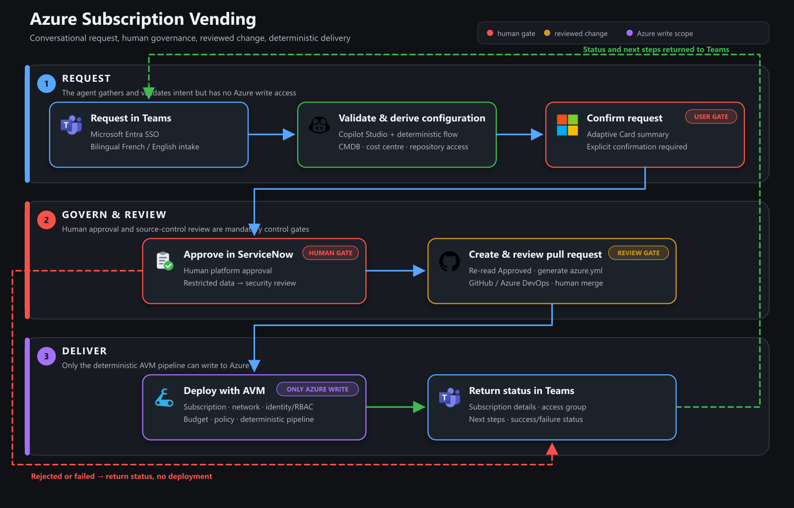

# Azure Vending Machine

**Status:** Design package — documentation and configuration artifacts only

## What it is

Azure Vending Machine guides the design and operation of a Microsoft Copilot
Studio agent surfaced in Microsoft Teams for bilingual Azure subscription
vending intake. The agent validates every field and derives technical
configuration from platform standards before filing a ServiceNow request for
human approval. After approval, Power Automate opens a pull request containing
generated `azure.yml`, which a deterministic pipeline uses with
`avm/ptn/lz/sub-vending:0.4.0`. The agent itself has no Azure write permissions.

This is a design package. It does not include an exportable Copilot Studio
agent or Power Platform solution, Power Automate flows, a ServiceNow table or
catalogue item, or a deployment pipeline implementation. You build those in your
own environment from the specifications in [`assets/`](assets/). All
organizations, people, repositories, and identifiers in the package are
fictional (Contoso).

## Who it is for

- Azure platform and landing-zone teams designing governed subscription
  vending.
- Power Platform and Copilot Studio makers building the conversational intake.
- ServiceNow and DevOps engineers integrating approval and pull-request
  automation.

## Capabilities

The package assumes capabilities for Copilot Studio, Microsoft Teams, Power
Automate, ServiceNow, and GitHub or Azure DevOps source control. These names
describe required integrations; map them to the actual connectors, actions,
credentials, and least-privilege policies configured in the target environment.

## Purpose

Guide an operator through building and operating a governed subscription
vending experience end to end. The agent collects and validates the request,
derives platform-aligned configuration, files the approval record, and produces
a reviewed `azure.yml` pull request only after approval.

## Workflow

[](assets/09-workflow-design.svg)

The diagram highlights human approval and deterministic deployment boundaries;
see [the detailed workflow design](assets/09-workflow-design.md).

## When to use

- Stand up self-service Azure subscription vending with a conversational
  French/English intake.
- Add a conversational front end to an existing ServiceNow approval process.
- Implement `avm/ptn/lz/sub-vending:0.4.0` behind a deterministic,
  human-approved repository workflow.

Do not use this package to bypass platform standards, ServiceNow approval,
repository review, IPAM allocation, or the deterministic deployment pipeline.

## Prerequisites

- A Power Platform environment.
- A Microsoft Copilot Studio licence.
- A ServiceNow instance and dedicated service account.
- A GitHub or Azure DevOps repository with an approved review workflow.
- A Microsoft Entra ID tenant.
- An existing landing-zone management group hierarchy.
- Authoritative CMDB, Finance, repository, identity, networking, and policy
  reference data.
- Only to regenerate the workflow diagram: Python 3.10 or later (standard
  library only) and Node.js with `npx` for `sharp-cli`; see
  [`09-workflow-design.md`](assets/09-workflow-design.md#regenerating).

## Package index

- [`01-agent-instructions.md`](assets/01-agent-instructions.md) — Defines the agent's role, conversation behavior, validation, and safety rules.
- [`02-intake.schema.json`](assets/02-intake.schema.json) — Specifies the structured subscription request intake contract.
- [`03-derivation-rules.md`](assets/03-derivation-rules.md) — Maps validated business inputs to governed technical configuration.
- [`04-topics.md`](assets/04-topics.md) — Organizes Copilot Studio topics and conversation routing.
- [`04b-summary-card.json`](assets/04b-summary-card.json) — Provides the request summary card definition.
- [`05-servicenow-integration.md`](assets/05-servicenow-integration.md) — Describes ServiceNow request creation and approval integration.
- [`06-out-of-scope.md`](assets/06-out-of-scope.md) — Records excluded capabilities and responsibility boundaries.
- [`07-sample-dialogues.md`](assets/07-sample-dialogues.md) — Demonstrates representative French and English conversations.
- [`08-deployment-guide.md`](assets/08-deployment-guide.md) — Guides deployment and configuration of the agent package.
- [`09-workflow-design.md`](assets/09-workflow-design.md) — Documents the end-to-end architecture and approval workflow.
- [`09-workflow-design.svg`](assets/09-workflow-design.svg) — Supplies the editable vector workflow diagram.
- [`09-workflow-design.png`](assets/09-workflow-design.png) — Supplies the rendered workflow diagram.
- [`build_diagram.py`](assets/build_diagram.py) — Regenerates the workflow diagram assets.

## Procedure

1. Configure the agent from
   [`01-agent-instructions.md`](assets/01-agent-instructions.md).
2. Implement and validate the intake contract in
   [`02-intake.schema.json`](assets/02-intake.schema.json).
3. Apply platform-derived defaults and mappings from
   [`03-derivation-rules.md`](assets/03-derivation-rules.md).
4. Build the Copilot Studio topics and confirmation experience from
   [`04-topics.md`](assets/04-topics.md) and
   [`04b-summary-card.json`](assets/04b-summary-card.json).
5. Configure the ServiceNow actions and post-approval trigger from
   [`05-servicenow-integration.md`](assets/05-servicenow-integration.md).
6. Enforce the responsibility boundaries in
   [`06-out-of-scope.md`](assets/06-out-of-scope.md).
7. Test French and English paths with
   [`07-sample-dialogues.md`](assets/07-sample-dialogues.md).
8. Follow [`08-deployment-guide.md`](assets/08-deployment-guide.md) to configure the
   environment, connectors, topics, and tests.
9. Review the end-to-end controls and handoffs in
   [`09-workflow-design.md`](assets/09-workflow-design.md), using the
   [SVG](assets/09-workflow-design.svg) or
   [PNG](assets/09-workflow-design.png) diagram.

## Safety and approvals

- The conversational agent holds no Azure write permission.
- Require explicit user confirmation on the summary card before creating the
  ServiceNow request.
- Require human approval in ServiceNow before generating or submitting a
  deployment pull request.
- The `TriggerDeployment` guard rail must re-read the ServiceNow record and
  abort unless its current state is `Approved`; never trust in-memory state.
- Keep the generated `azure.yml` in a pull request that a human must review and
  merge. The deterministic pipeline, not the agent, invokes the AVM pattern.
- Validate request fields against authoritative CMDB, Finance, repository, and
  platform reference data. Never invent identifiers, cost centres, owners,
  repositories, CIDRs, subscription IDs, or approval state.
- The maximum agent blast radius is a badly filled ServiceNow ticket and a pull
  request that still requires human merge.

## Expected output

- A validated `azure.yml` committed to a dedicated pull-request branch.
- A ServiceNow request containing the intake, derived configuration, approval
  state, pull-request URL, and pipeline state.
- A Teams confirmation and status experience in the requester's language.
- A final handover card returning the subscription ID, managed identity client
  ID, Entra access group, and next steps.
- Audit evidence for user confirmation, ServiceNow approval, the re-read guard
  rail, pull-request review, and deterministic pipeline execution.

## Sample output

Illustrative `azure.yml` header from
[`05-servicenow-integration.md`](assets/05-servicenow-integration.md). The
`apiVersion` and `kind` describe a fictional, example contract between the flow
and your own pipeline; they are not a published Microsoft or AVM schema.

```yaml
# Generated by the Azure Subscription Assistant - RITM0012345
# Module: br/public:avm/ptn/lz/sub-vending:0.4.0
apiVersion: platform.contoso.example/v1
kind: SubscriptionRequest
metadata:
  requestId: RITM0012345
  appId: APP01234
```

Example handover card:

```text
Status: Completed
Subscription ID: <subscription-id>
Managed identity client ID: <client-id>
Entra access group: <group-name>
Next steps: request group membership, review repository protections, and follow
the workload landing-zone onboarding guide.
```

These values are illustrative and must be replaced only with validated outputs
from the approved workflow.

## Accepted exceptions

- Intake records the required address-space size, but the exact CIDR is
  allocated by IPAM at deployment time rather than chosen by the agent.

## Icons

The [`assets/icons/`](assets/icons/) directory contains local SVG assets used by
the diagram. The approval step uses a neutral, generic ticket-and-check icon
(`approval-ticket.svg`) rather than a third-party logo.

## Limitations

- This repository provides the design package only; it contains no exportable
  Copilot Studio or Power Automate solution, ServiceNow schema, or pipeline
  implementation, and it does not provision a Power Platform environment,
  Entra tenant, or landing-zone hierarchy.
- The conversational agent cannot write to Azure or bypass any approval gate.
- A generated pull request is a reviewed artifact, not proof of deployment.

## Cleanup

No Azure resources are created by this design package; it contains only
documentation, configuration specifications, and diagram assets, so there is
nothing to tear down. To revert locally regenerated diagram files, run
`git restore Tools/azure-vending-machine/assets` from the repository root.

Any real implementation built from this package (Copilot Studio agent, Power
Automate flows, ServiceNow configuration, pipeline, and vended subscriptions)
must document its own teardown, including subscription cancellation or
management-group moves, connector and service-account removal, and pipeline
credential revocation.

## References

- [Agent instructions](assets/01-agent-instructions.md)
- [Intake schema](assets/02-intake.schema.json)
- [Derivation rules](assets/03-derivation-rules.md)
- [Topics](assets/04-topics.md)
- [Summary card](assets/04b-summary-card.json)
- [ServiceNow integration](assets/05-servicenow-integration.md)
- [Out-of-scope boundaries](assets/06-out-of-scope.md)
- [Sample dialogues](assets/07-sample-dialogues.md)
- [Deployment guide](assets/08-deployment-guide.md)
- [Workflow design](assets/09-workflow-design.md)
- [Azure Verified Modules subscription vending pattern](https://github.com/Azure/bicep-registry-modules/tree/main/avm/ptn/lz/sub-vending)
- [Microsoft Copilot Studio documentation](https://learn.microsoft.com/microsoft-copilot-studio/)
