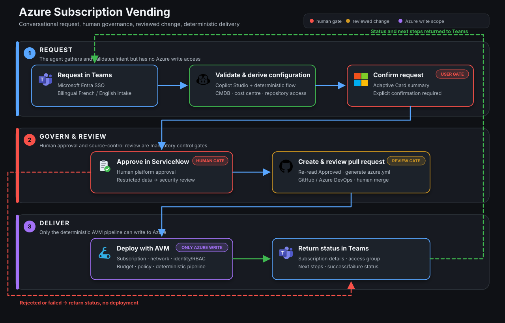

# Workflow Design



Source files:

- `09-workflow-design.svg` — accessible vector with embedded icons
- `09-workflow-design.png` — compact raster for README and slide use
- `build_diagram.py` — source of truth for the SVG
- `icons/` — local icon sources embedded into the generated SVG

## Three stages and seven steps

| Stage | Steps | Security boundary |
| --- | --- | --- |
| Request | Request in Teams → Validate and derive configuration → Confirm request | The agent has no Azure write access; explicit user confirmation is required |
| Govern and review | Approve in ServiceNow → Create and review pull request | Human approval, current-state re-read, and human merge are required |
| Deliver | Deploy with AVM → Return status in Teams | The deterministic AVM pipeline is the only Azure write identity |

The diagram intentionally groups implementation details into seven meaningful
boxes so it remains readable when embedded in GitHub.

## Control gates

1. **User confirmation** — no explicit confirmation on the Adaptive Card means
   no ServiceNow submission.
2. **ServiceNow approval** — a human platform approver decides; restricted data
   adds the conditional security review within this gate.
3. **Reviewed pull request** — the flow re-reads the ServiceNow record, aborts
   unless its current state is `Approved`, generates `azure.yml`, and still
   requires a human merge.

Rejected or failed requests return status to Teams without entering the AVM
deployment step. The conversational agent can be wrong, prompt-injected, or
misused and still cannot change Azure; the deterministic AVM pipeline alone
holds Azure write access.

## Delivery summary

The AVM step groups subscription creation, networking, managed identity and
RBAC, budgets, and policy under one deterministic deployment boundary. The
final Teams response returns subscription details, the access group, status,
and next steps.

## Icon provenance

Microsoft, GitHub, and Bicep icons use their local source files under `icons/`.
The ServiceNow approval step uses `icons/approval-ticket.svg`, a neutral,
original ticket-and-check icon, so the diagram carries no third-party trademark
for that step.

All used icons are embedded as base64 inside the SVG, so it renders standalone
without network access.

## Regenerating

Prerequisites: Python 3.10 or later (standard library only) and Node.js with
`npx`, which downloads `sharp-cli@6.0.0` on first use.

From the repository root:

```powershell
py Tools\azure-vending-machine\assets\build_diagram.py
npx --yes sharp-cli@6.0.0 --input "Tools/azure-vending-machine/assets/09-workflow-design.svg" --output "Tools/azure-vending-machine/assets" --format png resize 1600
```

Edit geometry in `build_diagram.py`; the `stage()`, `box()`, and `arrow()`
helpers contain the compact layout primitives.
