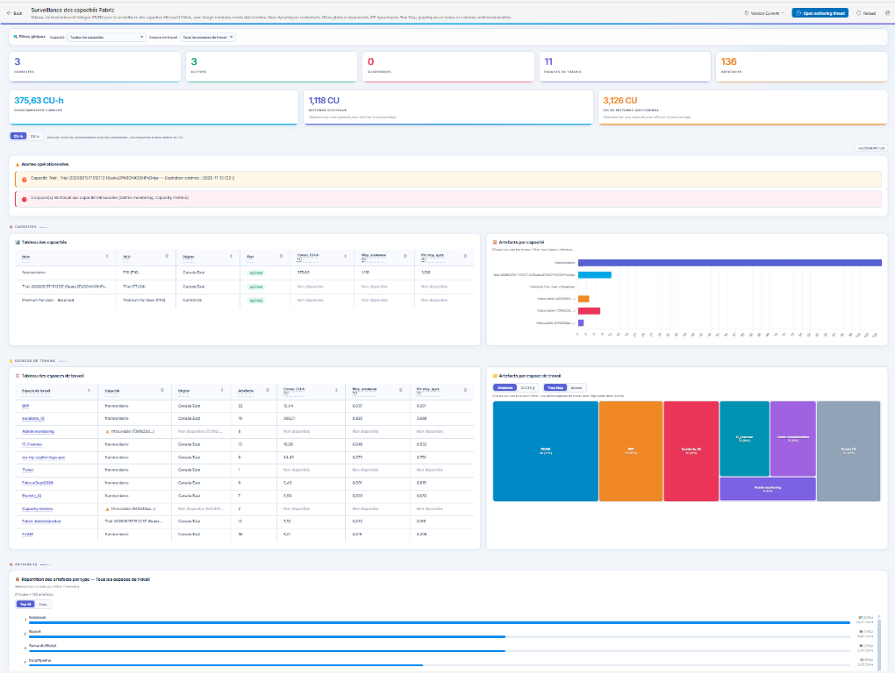

# Fabric SRE Accelerator

> This English README is the canonical version. The French version,
> [README.fr.md](README.fr.md), is its translation.

Reusable solution that retains Microsoft Fabric administration data, feeds
version-controlled PBIP/TMDL Power BI reports, and enriches a `fabricsre` agent
with analysis, anomaly detection, and human-approved actions.

The solution is read-only by default. Any optional write operation requires
explicit opt-in, explicit approval, and produces an audit record.



*Responsive bilingual overview of Fabric capacities, workspaces, items, CU
consumption, and operational alerts.*

## Purpose

Give Fabric administrators and SRE teams a progressive, read-only view of a
Fabric tenant through an Azure SRE Agent (`Microsoft.App/agents`):

1. **Discovery**: create Azure SRE Agent in the portal, connect Fabric Core MCP,
   then ask questions and generate on-demand visuals;
2. **Basic**: add Fabric Admin tenant inventory through a read-only MCP server
   hosted in Azure Container Apps, the bilingual Live Report, and optionally
   recent CU, without a technical Fabric workspace;
3. **Advanced**: add the `Fabric Administration` workspace, Lakehouse, at least
   60 days of history, semantic model, and Power BI reports.

## When to use / Who it is for

Use it when you administer one or more Fabric capacities and need tenant-wide
inventory, capacity CU trends, history beyond the native retention windows, and
an agent that explains anomalies without changing anything.

It is intended for Fabric administrators, platform and SRE engineers, and
Power BI report owners. Basic and Advanced require a Fabric administrator to
enable service-principal access to read-only admin APIs; if that consent is not
possible, stay at Discovery.

## Status

- **Runnable demo** with deployment scripts, notebooks, a pipeline template,
  PBIP/TMDL reports, and unit tests.
- **Uses an existing Fabric capacity**: no script creates or resizes a Fabric
  capacity. Advanced assigns its workspace to a capacity you already own.
- **Community sample**: not an official Microsoft product and not supported by
  Microsoft support. Validate it in a non-production tenant first.
- Continuous integration runs unit tests, Ruff, and report validation only; it
  does not deploy to a live tenant.

## Contents

- `config/`: client parameters with no hard-coded customer IDs;
- `notebooks/` and `pipelines/`: daily collection into Delta;
- `src/fabric_sre/`: REST clients, 429 handling, and approval guard;
- `services/fabric-admin-mcp/`: read-only Fabric Admin MCP server;
- `agent/`: FR/EN instructions, subagents, and routines;
- `powerbi/FabricSRE/`: shared TMDL model and separate FR/EN reports;
- `queries/`: Capacity Metrics DAX adapters;
- `scripts/`: validation, preflight, and deployment scripts;
- `tests/`: Python unit tests;
- `docs/`: architecture, permissions, deployment, customization, and tests.

## Prerequisites

The Discovery level only needs access to the Azure portal and Fabric. To
validate or install Basic or Advanced from this folder, install:

- PowerShell 7 and Azure CLI;
- Python 3.11 or later;
- Node.js 20 or later (22 recommended);
- the project dependencies, from this folder:

```powershell
python -m pip install -e ".[dev]" -r services/fabric-admin-mcp/requirements.txt
npm install -g @microsoft/powerbi-report-authoring-cli@0.5.0
```

`pyproject.toml` declares the runtime and development dependencies;
`services/fabric-admin-mcp/requirements.txt` declares the MCP server container
dependencies, which the tests also use.

### Permissions

Each level includes the requirements of the previous one. The
[deployment guide](docs/deployment.en.md#3-prerequisites) is the detailed
reference.

**Capacity visibility:** the `FabricSRE` connector uses its own identity.
Azure Reader alone does not guarantee that `list_capacities` returns every
capacity. Check the identity's Fabric permissions and all response pages
before changing the report. See the
[capacity permissions procedure](docs/deployment.en.md#capacity-visibility-and-fabric-core-connector-permissions),
including the managed-identity picker error and approval requirements for
privileged assignments.

**Automatic CU discovery:** both the recent-CU MCP and the historical collector
discover dedicated capacities from the admin inventory on every collection and
query the configured Capacity Metrics model separately for each capacity using
`CapacitiesList`. No notebook or capacity-ID list needs editing when a capacity
is added. The collection identity still needs inventory access and Read/Build
on the model, and the source must contain that capacity's metrics. PPU
reservations are excluded. See the
[CU adapter guide](queries/capacity-metrics/README.en.md) for source retention,
coverage, and schema validation.

| Requirement | Discovery | Basic | Advanced |
| --- | :---: | :---: | :---: |
| Azure: Owner, or Contributor with User Access Administrator, to create the agent | Yes | Yes | Yes |
| Network access to `*.azuresre.ai` and an approved Fabric MCP endpoint | Yes | Yes | Yes |
| Read access to the Fabric resources to observe | Yes | Yes | Yes |
| Fabric Administrator: enable **Service principals can use Fabric APIs** and service-principal access to **read-only admin APIs**, scoped to an existing security group; never update admin APIs for the read identity | - | Yes | Yes |
| Microsoft Entra: create an app registration, service principal, and client secret, and add the service principal to that group | - | Yes | Yes |
| Existing user-assigned managed identity (the script does not create it) | - | Yes | Yes |
| Azure: Contributor on the MCP resource group, plus Owner or User Access Administrator for the `AcrPull` role assignment | - | Yes | Yes |
| Container registry: the script creates an Azure Container Registry (Basic SKU) and builds the MCP image with `az acr build` | - | Yes | Yes |
| Read and Build on the Capacity Metrics semantic model, for recent CU | - | Optional | Yes |
| Existing Fabric F or P capacity, and the right to assign the `Fabric Administration` workspace to it | - | - | Yes |
| Workspace roles: workspace identity as Viewer with a `WorkspaceIdentity` SQL cloud connection; Contributor only for the collection identity; Read and Build for report consumers; never Contributor for the agent read identity | - | - | Yes |
| Azure Reader on the subscriptions that contain Fabric capacities, for ARM collection | - | - | Yes |

Approved write actions are optional at any level. They need a separate action
identity with a narrow custom role (capacity read, write, suspend, and resume)
and, only for that identity, any update admin API permission the action needs.

## Procedure

Run commands from `Tools/microsoft-fabric-monitoring`. Read the
[deployment guide](docs/deployment.en.md) before installation. For a detailed
procedure suitable for a non-technical audience, follow the
[step-by-step deployment guide](docs/deployment-step-by-step.en.md).

**Discovery**

1. Create the agent at <https://sre.azure.com>.
2. Add the Fabric connector under **Builder > Connectors**.
3. Test the Discovery prompts from the [prompt catalog](docs/prompts.en.md).

**Basic**

4. Install the [prerequisites](#prerequisites).
5. Copy `config/client.parameters.example.yaml` to
   `config/client.parameters.yaml`. The example uses illustrative placeholders
   only (`Contoso` is fictitious). Replace each `${NAME}` placeholder with a
   literal value or set the matching environment variable, for example
   `AZURE_TENANT_ID`, `AZURE_SUBSCRIPTION_ID`, and the `FABRIC_ADMIN_*` names;
   configuration loading fails when one is missing.
6. Run `./scripts/validate.ps1`.
7. Run `./scripts/preflight-agent.ps1` with `-SubscriptionId`, `-ResourceGroup`,
   `-AgentName`, and `-ExpectedAccount`. It fails explicitly when the active
   account cannot see the target subscription, preventing deployment to the
   wrong environment.
8. Ask a Fabric administrator to enable the tenant settings listed in
   [Permissions](#permissions).
9. Run
   `./scripts/deploy-fabric-admin-mcp.ps1 -ConfigurationPath config/client.parameters.yaml`.
10. Add the `FabricAdmin` connector to the agent with the returned endpoint and
    the `x-api-key` secret, apply the agent instructions and routines, then
    publish the Live Report as defined in the
    [Live Report specification](docs/live-report.en.md).

**Advanced**

11. Preview with
    `./scripts/deploy.ps1 -ConfigurationPath config/client.parameters.yaml -WhatIf`.
12. Run it again with `-CreateWorkspace` to create the workspace and the
    `FabricSRE` Lakehouse, then assign the workspace to your capacity.
13. Complete the steps listed in the `next` output: upload files, create the
    notebooks and pipeline, run the bootstrap, collection, and gold build, then
    publish the semantic model and both reports.
14. Open `powerbi/FabricSRE/en/FabricSRE-en.pbip` for the English report.

Read [the solution guide](docs/solution.en.md) for the architecture, data model,
and operations.

## Safety and approvals

- **Read-only by default.** The Fabric Admin MCP server exposes only read tools
  (`list_workspaces`, `list_items`, `get_cu_metrics`) and requires an
  `x-api-key` header. The read identity only receives read-only admin APIs.
- **Write actions are disabled.** The supported actions are
  `capacity.resume`, `capacity.suspend`, `capacity.resize`, and
  `workspace.reassign`. The example configuration sets
  `approvals.allowedActions: []`, and the schema rejects any other value.
- **Approval guard.** `require_valid_approval` in
  `src/fabric_sre/approvals.py` raises `PermissionError` unless the action is
  supported, listed in `approvals.allowedActions`, not expired, and approved
  with an ID equal to the SHA-256 hash of the exact plan (action, resource,
  current and target state, impact, rollback, and expiry). Any change to the
  plan invalidates the approval.
- **Agent protocol.** The agent instructions require a plan, an approval
  request with a unique ID and expiry, an explicit matching approval,
  revalidation, a single execution, and an audit record in
  `agent_action_audit`. The package does not ship a write executor.

To opt in, list only the actions you accept in
`config/client.parameters.yaml`, and use a separate action identity:

```yaml
approvals:
  provider: "teams"
  timeoutMinutes: 60
  allowedActions:
    - capacity.resume
    - capacity.suspend
```

Never commit client parameters with sensitive values. The deployment script
stores the API key and client secret as Container App secrets.

## Expected output

- **Discovery**: the agent answers the catalog prompts using the Fabric
  connector.
- **Basic**: `deploy-fabric-admin-mcp.ps1` prints the MCP endpoint and health
  URLs; `/health` returns `status: ok`; the agent answers tenant inventory
  questions; the Live Report shows capacities, workspaces, items, and recent CU
  when enabled.
- **Advanced**: `deploy.ps1` prints a JSON plan; the daily pipeline fills the
  Bronze, Silver, and Gold Delta tables; the French and English reports
  refresh from the `Fabric SRE` semantic model.
- **Validation**: `validate.ps1` ends with `Fabric SRE validation succeeded.`

## Sample output

The [report screenshot](docs/assets/live-report-overview.png) shows the Live
Report overview. The PBIP reports in `powerbi/FabricSRE/` open in Power BI
Desktop without a tenant. Illustrative output of
`deploy-fabric-admin-mcp.ps1`, with synthetic values:

```json
{
  "appName": "ca-contoso-fabric-admin-mcp",
  "endpoint": "https://ca-contoso-fabric-admin-mcp.contoso.example/mcp",
  "health": "https://ca-contoso-fabric-admin-mcp.contoso.example/health",
  "apiKeyConfigured": true,
  "apiKeyHeader": "x-api-key",
  "managedIdentityClientId": "00000000-0000-0000-0000-000000000000",
  "fabricAdminServicePrincipalClientId": "00000000-0000-0000-0000-000000000000"
}
```

## Validation

`scripts/validate.ps1` runs the Python tests, Ruff, the deterministic PBIR
generator (`scripts/generate-report.mjs`), the Power BI report validator for
both languages, and JSON parsing of the configuration schema and pipeline
template. It stops with an actionable message when a prerequisite is missing.
`scripts/validate.ps1 -SkipUnavailableTools` skips checks whose tooling is
missing with a warning; real validation errors still fail.

The same validation runs in GitHub Actions through
`.github/workflows/validate-microsoft-fabric-monitoring.yml` at the repository
root.

## Limitations

- Capacity Metrics keeps 14 days of compute data, and Microsoft does not
  publish a stable schema for its model; the DAX adapters are validated against
  the installed app version.
- Activity Events backfill is limited to 27 days.
- The Admin Items API is in preview, and admin APIs commonly allow 200
  requests per hour; the clients retry on HTTP 429.
- `deploy.ps1` only creates the workspace and Lakehouse; notebooks, pipeline,
  semantic model, and reports are deployed manually.
- Notebooks do not get a general Azure Resource Manager token, so ARM capacity
  collection runs from the agent, a function, or an automation identity.
- No complete lineage API is available.
- Where agent extensions and handoffs are limited, the agent runs in a
  compatibility mode with one router carrying the four logical roles.
- The published Live Report is not stored in this repository; only its
  specification and screenshot are.
- See [the solution guide](docs/solution.en.md) for the full list.

## Cost

No prices are listed here; use the Microsoft pricing pages for your region.

- **Fabric capacity CU**: notebooks, the daily pipeline, semantic model
  refreshes, and Capacity Metrics queries consume CU on your existing capacity.
- **OneLake storage**: the Lakehouse retains 400 days of history by default.
- **Azure SRE Agent**: the agent resource is billed according to its pricing
  model.
- **Azure Container Apps**: the MCP server keeps at least one replica running.
- **Azure Container Registry**: Basic SKU registry plus image builds.
- **Azure Monitor**: Log Analytics and Application Insights ingestion.
- **Power BI**: viewer licensing depends on the capacity SKU.

Pricing references: [Microsoft Fabric](https://azure.microsoft.com/en-us/pricing/details/microsoft-fabric/),
[OneLake consumption](https://learn.microsoft.com/en-us/fabric/onelake/onelake-consumption),
[Azure SRE Agent](https://azure.microsoft.com/en-us/pricing/details/sre-agent/),
[Azure Container Apps](https://azure.microsoft.com/en-us/pricing/details/container-apps/),
[Azure Container Registry](https://azure.microsoft.com/en-us/pricing/details/container-registry/),
[Azure Monitor](https://azure.microsoft.com/en-us/pricing/details/monitor/), and
[Power BI](https://www.microsoft.com/en-us/power-platform/products/power-bi/pricing).

## Cleanup

Export any audit data you must keep first, then disable schedules and refreshes.

- **Advanced**: delete the `pl_fabric_sre_daily` pipeline, the six notebooks
  (`00_bootstrap_lakehouse` to `05_build_gold`), the `Fabric SRE` semantic
  model, the French and English reports, the `FabricSRE` Lakehouse, the
  `WorkspaceIdentity` cloud connection, the workspace identity, and the
  `Fabric Administration` workspace. Remove role assignments granted for
  collection.
- **Basic**: delete the routines and the `FabricAdmin` connector in the agent,
  the published Live Report, the Container App, the Container Apps environment
  and any Log Analytics workspace created with it, the container registry and
  its images, the `AcrPull` role assignment, the user-assigned managed identity
  if dedicated, and the Entra app registration, service principal, and secret.
  Remove the service principal from the security group, or delete the group if
  dedicated, and revert Fabric tenant settings enabled only for this solution.
- **Discovery**: remove the Fabric connector, then delete the agent resource
  and the Application Insights and managed identities created with it.
- **Local**: delete `config/client.parameters.yaml` and the environment
  variables you set.
- **Approved actions**: delete the action identity and its custom role.

## References

- [Deployment guide](docs/deployment.en.md)
- [Step-by-step deployment](docs/deployment-step-by-step.en.md)
- [Solution architecture and operations](docs/solution.en.md)
- [Live Report specification](docs/live-report.en.md)
- [Prompt catalog](docs/prompts.en.md)
- [Capacity Metrics queries](queries/capacity-metrics/README.en.md)
- [Azure SRE Agent overview](https://learn.microsoft.com/en-us/azure/sre-agent/overview)
- [Fabric admin API: list workspaces](https://learn.microsoft.com/en-us/rest/api/fabric/admin/workspaces/list-workspaces)
- [Fabric developer tenant settings](https://learn.microsoft.com/en-us/fabric/admin/service-admin-portal-developer)
- [Fabric workspace identity](https://learn.microsoft.com/en-us/fabric/security/workspace-identity)
- [Fabric API throttling](https://learn.microsoft.com/en-us/rest/api/fabric/articles/throttling)
- [Microsoft Fabric Capacity Metrics app](https://learn.microsoft.com/en-us/fabric/enterprise/metrics-app)

## Contributing

See [AGENTS.md](AGENTS.md) for the rules that apply to changes in this folder.
