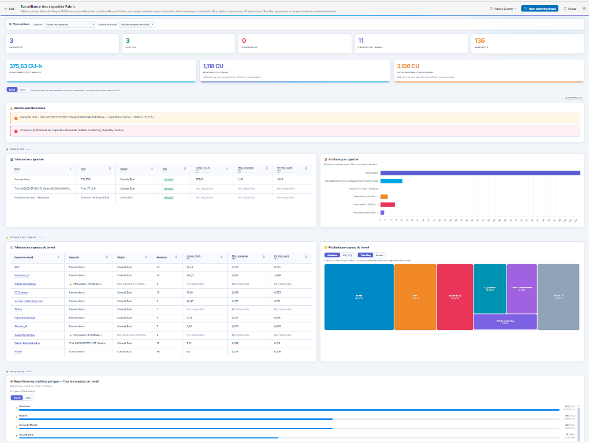

# Accélérateur Fabric SRE

> Ce README français est la traduction de la version canonique anglaise,
> [README.en.md](README.en.md).

Solution réutilisable pour historiser l'administration Microsoft Fabric,
alimenter des rapports Power BI PBIP/TMDL versionnés et enrichir un agent
`fabricsre` avec analyse, détection d'anomalies et actions soumises à
approbation humaine.

La solution fonctionne en lecture seule par défaut. Toute opération d'écriture
optionnelle exige une activation explicite, une approbation explicite et
produit une trace d'audit.



*Vue bilingue et responsive des capacités, espaces de travail, artefacts,
consommations CU et alertes opérationnelles.*

## Objectif

Donner aux administrateurs Fabric et aux équipes SRE une vue progressive et en
lecture seule d'un tenant Fabric au moyen d'un agent Azure SRE
(`Microsoft.App/agents`) :

1. **Découverte** : créer Azure SRE Agent dans le portail, connecter Fabric Core
   MCP, puis poser des questions et générer des visuels à la demande;
2. **Basic** : ajouter l'inventaire tenant Fabric Admin au moyen d'un serveur
   MCP en lecture seule hébergé dans Azure Container Apps, le Live Report
   bilingue et, en option, les CU récentes, sans workspace Fabric technique;
3. **Advanced** : ajouter le workspace `Fabric Administration`, le Lakehouse,
   l'historique d'au moins 60 jours, le modèle sémantique et les rapports Power
   BI.

## Quand l'utiliser / Public visé

À utiliser lorsque vous administrez une ou plusieurs capacités Fabric et avez
besoin d'un inventaire à l'échelle du tenant, des tendances de CU des
capacités, d'un historique au-delà des fenêtres de rétention natives et d'un
agent qui explique les anomalies sans rien modifier.

Elle s'adresse aux administrateurs Fabric, aux ingénieurs plateforme et SRE et
aux propriétaires de rapports Power BI. Basic et Advanced exigent qu'un
administrateur Fabric active l'accès des principaux de service aux API
d'administration en lecture seule; si ce consentement est impossible, rester au
niveau Découverte.

## Statut

- **Démo exécutable** avec scripts de déploiement, notebooks, modèle de
  pipeline, rapports PBIP/TMDL et tests unitaires.
- **Utilise une capacité Fabric existante** : aucun script ne crée ni ne
  redimensionne de capacité Fabric. Advanced affecte son workspace à une
  capacité que vous possédez déjà.
- **Exemple communautaire** : ce n'est pas un produit officiel Microsoft et il
  n'est pas pris en charge par le support Microsoft. Le valider d'abord dans un
  tenant hors production.
- L'intégration continue exécute uniquement les tests unitaires, Ruff et la
  validation des rapports; elle ne déploie pas dans un tenant réel.

## Contenu

- `config/` : paramètres client sans identifiant codé en dur;
- `notebooks/` et `pipelines/` : collecte quotidienne vers Delta;
- `src/fabric_sre/` : clients REST, reprise sur 429 et garde d'approbation;
- `services/fabric-admin-mcp/` : serveur MCP Fabric Admin en lecture seule;
- `agent/` : instructions FR/EN, sous-agents et routines;
- `powerbi/FabricSRE/` : modèle TMDL partagé et rapports FR/EN distincts;
- `queries/` : adaptateurs DAX Capacity Metrics;
- `scripts/` : scripts de validation, de prévol et de déploiement;
- `tests/` : tests unitaires Python;
- `docs/` : architecture, permissions, déploiement, personnalisation et tests.

## Prérequis

Le niveau Découverte nécessite seulement un accès au portail Azure et à Fabric.
Pour valider ou installer Basic ou Advanced depuis ce dossier, installer :

- PowerShell 7 et Azure CLI;
- Python 3.11 ou plus récent;
- Node.js 20 ou plus récent (22 recommandé);
- les dépendances du projet, depuis ce dossier :

```powershell
python -m pip install -e ".[dev]" -r services/fabric-admin-mcp/requirements.txt
npm install -g @microsoft/powerbi-report-authoring-cli@0.5.0
```

`pyproject.toml` déclare les dépendances d'exécution et de développement;
`services/fabric-admin-mcp/requirements.txt` déclare les dépendances du
conteneur du serveur MCP, également utilisées par les tests.

### Permissions

Chaque niveau inclut les exigences du niveau précédent. Le
[guide de déploiement](docs/deployment.fr.md#3-prérequis) est la référence
détaillée.

**Visibilité des capacités :** le connecteur `FabricSRE` utilise sa propre
identité. Reader Azure seul ne garantit pas que `list_capacities` retourne
toutes les capacités. Vérifier les permissions Fabric de l'identité et toutes
les pages de réponse avant de modifier le rapport. Voir la
[procédure de permissions des capacités](docs/deployment.fr.md#visibilité-des-capacités-et-permissions-du-connecteur-fabric-core),
y compris l'erreur du sélecteur d'identité managée et l'approbation requise
pour les attributions privilégiées.

**Découverte automatique des CU :** le MCP de CU récentes et le collecteur
historique découvrent les capacités dédiées dans l'inventaire administrateur
à chaque collecte, puis interrogent séparément le modèle Capacity Metrics
configuré pour chaque capacité avec `CapacitiesList`. Aucun notebook ni liste
d'identifiants de capacités n'est à modifier à l'ajout d'une capacité.
L'identité de collecte doit toujours accéder à l'inventaire et disposer de
Read/Build sur le modèle; la source doit contenir les métriques de la capacité.
Les réservations PPU sont exclues. Voir le
[guide des adaptateurs CU](queries/capacity-metrics/README.fr.md) pour la
rétention source, la couverture et la validation du schéma.

| Exigence | Découverte | Basic | Advanced |
| --- | :---: | :---: | :---: |
| Azure : Owner, ou Contributor avec User Access Administrator, pour créer l'agent | Oui | Oui | Oui |
| Accès réseau à `*.azuresre.ai` et un point de terminaison Fabric MCP approuvé | Oui | Oui | Oui |
| Accès en lecture aux ressources Fabric à observer | Oui | Oui | Oui |
| Administrateur Fabric : activer **Service principals can use Fabric APIs** et l'accès des principaux de service aux **API d'administration en lecture seule**, limités à un groupe de sécurité existant; ne jamais activer les API d'administration en mise à jour pour l'identité de lecture | - | Oui | Oui |
| Microsoft Entra : créer une inscription d'application, un principal de service et un secret client, et ajouter le principal de service à ce groupe | - | Oui | Oui |
| Identité managée affectée par l'utilisateur existante (le script ne la crée pas) | - | Oui | Oui |
| Azure : Contributor sur le groupe de ressources MCP, plus Owner ou User Access Administrator pour l'attribution du rôle `AcrPull` | - | Oui | Oui |
| Registre de conteneurs : le script crée un Azure Container Registry (SKU Basic) et construit l'image MCP avec `az acr build` | - | Oui | Oui |
| Read et Build sur le modèle sémantique Capacity Metrics, pour les CU récentes | - | Optionnel | Oui |
| Capacité Fabric F ou P existante, et le droit d'y affecter le workspace `Fabric Administration` | - | - | Oui |
| Rôles de workspace : identité de workspace en Viewer avec une connexion cloud SQL `WorkspaceIdentity`; Contributor uniquement pour l'identité de collecte; Read et Build pour les consommateurs des rapports; jamais Contributor pour l'identité de lecture de l'agent | - | - | Oui |
| Azure Reader sur les abonnements qui contiennent des capacités Fabric, pour la collecte ARM | - | - | Oui |

Les actions d'écriture approuvées sont optionnelles à tous les niveaux. Elles
exigent une identité d'action distincte avec un rôle personnalisé restreint
(lecture, écriture, suspension et reprise de capacité) et, uniquement pour
cette identité, toute permission d'API d'administration en mise à jour
nécessaire à l'action.

## Procédure

Exécuter les commandes depuis `Tools/microsoft-fabric-monitoring`. Lire le
[guide de déploiement](docs/deployment.fr.md) avant l'installation. Pour une
procédure détaillée adaptée à un public non technique, suivre le
[guide de déploiement pas à pas](docs/deployment-pas-a-pas.fr.md).

**Découverte**

1. Créer l'agent dans <https://sre.azure.com>.
2. Ajouter le connecteur Fabric dans **Builder > Connectors**.
3. Tester les prompts de découverte du
   [catalogue de prompts](docs/prompts.fr.md).

**Basic**

4. Installer les [prérequis](#prérequis).
5. Copier `config/client.parameters.example.yaml` vers
   `config/client.parameters.yaml`. L'exemple contient uniquement des valeurs
   illustratives (`Contoso` est fictif). Remplacer chaque espace réservé
   `${NOM}` par une valeur littérale ou définir la variable d'environnement
   correspondante, par exemple `AZURE_TENANT_ID`, `AZURE_SUBSCRIPTION_ID` et les
   noms `FABRIC_ADMIN_*`; le chargement de la configuration échoue s'il en
   manque une.
6. Exécuter `./scripts/validate.ps1`.
7. Exécuter `./scripts/preflight-agent.ps1` avec `-SubscriptionId`,
   `-ResourceGroup`, `-AgentName` et `-ExpectedAccount`. Il échoue
   explicitement si le compte actif ne voit pas l'abonnement cible, afin
   d'éviter un déploiement dans le mauvais environnement.
8. Demander à un administrateur Fabric d'activer les paramètres de tenant
   listés dans [Permissions](#permissions).
9. Exécuter
   `./scripts/deploy-fabric-admin-mcp.ps1 -ConfigurationPath config/client.parameters.yaml`.
10. Ajouter le connecteur `FabricAdmin` à l'agent avec le point de terminaison
    retourné et le secret `x-api-key`, appliquer les instructions et routines
    de l'agent, puis publier le Live Report tel que défini dans la
    [spécification du Live Report](docs/live-report.fr.md).

**Advanced**

11. Prévisualiser avec
    `./scripts/deploy.ps1 -ConfigurationPath config/client.parameters.yaml -WhatIf`.
12. Le relancer avec `-CreateWorkspace` pour créer le workspace et le Lakehouse
    `FabricSRE`, puis affecter le workspace à votre capacité.
13. Effectuer les étapes listées dans la sortie `next` : téléverser les
    fichiers, créer les notebooks et le pipeline, exécuter l'amorçage, la
    collecte et la construction gold, puis publier le modèle sémantique et les
    deux rapports.
14. Ouvrir `powerbi/FabricSRE/fr/FabricSRE-fr.pbip` pour la version française.

Lire [le guide de la solution](docs/solution.fr.md) pour l'architecture, le
modèle de données et l'exploitation.

## Sécurité et approbations

- **Lecture seule par défaut.** Le serveur MCP Fabric Admin n'expose que des
  outils de lecture (`list_workspaces`, `list_items`, `get_cu_metrics`) et exige
  un en-tête `x-api-key`. L'identité de lecture ne reçoit que les API
  d'administration en lecture seule.
- **Actions d'écriture désactivées.** Les actions prises en charge sont
  `capacity.resume`, `capacity.suspend`, `capacity.resize` et
  `workspace.reassign`. La configuration d'exemple définit
  `approvals.allowedActions: []`, et le schéma rejette toute autre valeur.
- **Garde d'approbation.** `require_valid_approval` dans
  `src/fabric_sre/approvals.py` lève `PermissionError` sauf si l'action est
  prise en charge, listée dans `approvals.allowedActions`, non expirée et
  approuvée avec un identifiant égal au hachage SHA-256 du plan exact (action,
  ressource, état actuel et cible, impact, retour arrière et expiration). Toute
  modification du plan invalide l'approbation.
- **Protocole de l'agent.** Les instructions de l'agent exigent un plan, une
  demande d'approbation avec un identifiant unique et une expiration, une
  approbation explicite correspondante, une revalidation, une exécution unique
  et une trace d'audit dans `agent_action_audit`. Le paquet ne fournit pas
  d'exécuteur d'écriture.

Pour activer des actions, lister uniquement celles que vous acceptez dans
`config/client.parameters.yaml`, et utiliser une identité d'action distincte :

```yaml
approvals:
  provider: "teams"
  timeoutMinutes: 60
  allowedActions:
    - capacity.resume
    - capacity.suspend
```

Ne jamais valider dans Git des paramètres client contenant des valeurs
sensibles. Le script de déploiement stocke la clé d'API et le secret client
comme secrets de la Container App.

## Résultat attendu

- **Découverte** : l'agent répond aux prompts du catalogue au moyen du
  connecteur Fabric.
- **Basic** : `deploy-fabric-admin-mcp.ps1` affiche les URL du point de
  terminaison MCP et de santé; `/health` retourne `status: ok`; l'agent répond
  aux questions d'inventaire du tenant; le Live Report affiche les capacités,
  espaces de travail, artefacts et, si activées, les CU récentes.
- **Advanced** : `deploy.ps1` affiche un plan JSON; le pipeline quotidien
  alimente les tables Delta Bronze, Silver et Gold; les rapports français et
  anglais s'actualisent depuis le modèle sémantique `Fabric SRE`.
- **Validation** : `validate.ps1` se termine par
  `Fabric SRE validation succeeded.`

## Exemple de sortie

La [capture du rapport](docs/assets/live-report-overview.png) montre la vue
d'ensemble du Live Report. Les rapports PBIP de `powerbi/FabricSRE/` s'ouvrent
dans Power BI Desktop sans tenant. Sortie illustrative de
`deploy-fabric-admin-mcp.ps1`, avec des valeurs synthétiques :

```json
{
  "appName": "ca-contoso-fabric-admin-mcp",
  "endpoint": "https://ca-contoso-fabric-admin-mcp.contoso.example/mcp",
  "health": "https://ca-contoso-fabric-admin-mcp.contoso.example/health",
  "apiKeyConfigured": true,
  "apiKeyHeader": "x-api-key",
  "managedIdentityClientId": "00000000-0000-0000-0000-000000000000",
  "fabricAdminServicePrincipalClientId": "00000000-0000-0000-0000-000000000000"
}
```

## Validation

`scripts/validate.ps1` exécute les tests Python, Ruff, le générateur PBIR
déterministe (`scripts/generate-report.mjs`), le validateur de rapports Power BI
pour les deux langues et l'analyse JSON du schéma de configuration et du modèle
de pipeline. Il s'arrête avec un message indiquant quoi installer lorsqu'un
prérequis manque. `scripts/validate.ps1 -SkipUnavailableTools` ignore, avec un
avertissement, les vérifications dont l'outil est absent; les vraies erreurs de
validation échouent toujours.

La même validation s'exécute dans GitHub Actions avec
`.github/workflows/validate-microsoft-fabric-monitoring.yml` à la racine du
dépôt.

## Limites

- Capacity Metrics conserve 14 jours de données de calcul, et Microsoft ne
  publie pas de schéma stable pour son modèle; les adaptateurs DAX sont validés
  contre la version installée de l'application.
- La reprise historique des Activity Events est limitée à 27 jours.
- L'API Admin Items est en préversion, et les API d'administration autorisent
  couramment 200 requêtes par heure; les clients réessaient sur HTTP 429.
- `deploy.ps1` crée uniquement le workspace et le Lakehouse; les notebooks, le
  pipeline, le modèle sémantique et les rapports sont déployés manuellement.
- Les notebooks n'obtiennent pas de jeton Azure Resource Manager général; la
  collecte ARM des capacités s'exécute donc depuis l'agent, une fonction ou une
  identité d'automatisation.
- Aucune API de lignage complet n'est disponible.
- Lorsque les extensions et transferts d'agent sont limités, l'agent fonctionne
  dans un mode de compatibilité avec un routeur unique portant les quatre rôles
  logiques.
- Le Live Report publié n'est pas stocké dans ce dépôt; seuls sa spécification
  et sa capture le sont.
- Voir [le guide de la solution](docs/solution.fr.md) pour la liste complète.

## Coût

Aucun prix n'est indiqué ici; utiliser les pages de tarification Microsoft pour
votre région.

- **CU de capacité Fabric** : les notebooks, le pipeline quotidien, les
  actualisations du modèle sémantique et les requêtes Capacity Metrics
  consomment des CU sur votre capacité existante.
- **Stockage OneLake** : le Lakehouse conserve 400 jours d'historique par
  défaut.
- **Azure SRE Agent** : la ressource d'agent est facturée selon son modèle de
  tarification.
- **Azure Container Apps** : le serveur MCP maintient au moins un réplica en
  exécution.
- **Azure Container Registry** : registre de SKU Basic et constructions
  d'images.
- **Azure Monitor** : ingestion Log Analytics et Application Insights.
- **Power BI** : les licences des lecteurs dépendent du SKU de capacité.

Références de tarification : [Microsoft Fabric](https://azure.microsoft.com/en-us/pricing/details/microsoft-fabric/),
[consommation OneLake](https://learn.microsoft.com/en-us/fabric/onelake/onelake-consumption),
[Azure SRE Agent](https://azure.microsoft.com/en-us/pricing/details/sre-agent/),
[Azure Container Apps](https://azure.microsoft.com/en-us/pricing/details/container-apps/),
[Azure Container Registry](https://azure.microsoft.com/en-us/pricing/details/container-registry/),
[Azure Monitor](https://azure.microsoft.com/en-us/pricing/details/monitor/) et
[Power BI](https://www.microsoft.com/en-us/power-platform/products/power-bi/pricing).

## Nettoyage

Exporter d'abord les données d'audit à conserver, puis désactiver les
planifications et les actualisations.

- **Advanced** : supprimer le pipeline `pl_fabric_sre_daily`, les six notebooks
  (`00_bootstrap_lakehouse` à `05_build_gold`), le modèle sémantique
  `Fabric SRE`, les rapports français et anglais, le Lakehouse `FabricSRE`, la
  connexion cloud `WorkspaceIdentity`, l'identité de workspace et le workspace
  `Fabric Administration`. Retirer les attributions de rôles accordées pour la
  collecte.
- **Basic** : supprimer les routines et le connecteur `FabricAdmin` de l'agent,
  le Live Report publié, la Container App, l'environnement Container Apps et
  tout espace de travail Log Analytics créé avec lui, le registre de conteneurs
  et ses images, l'attribution du rôle `AcrPull`, l'identité managée affectée
  par l'utilisateur si elle est dédiée, ainsi que l'inscription d'application
  Entra, le principal de service et le secret. Retirer le principal de service
  du groupe de sécurité, ou supprimer le groupe s'il est dédié, et rétablir les
  paramètres de tenant Fabric activés uniquement pour cette solution.
- **Découverte** : retirer le connecteur Fabric, puis supprimer la ressource
  d'agent ainsi que l'Application Insights et les identités managées créées
  avec elle.
- **Local** : supprimer `config/client.parameters.yaml` et les variables
  d'environnement définies.
- **Actions approuvées** : supprimer l'identité d'action et son rôle
  personnalisé.

## Références

- [Guide de déploiement](docs/deployment.fr.md)
- [Déploiement pas à pas](docs/deployment-pas-a-pas.fr.md)
- [Architecture et exploitation de la solution](docs/solution.fr.md)
- [Spécification du Live Report](docs/live-report.fr.md)
- [Catalogue de prompts](docs/prompts.fr.md)
- [Requêtes Capacity Metrics](queries/capacity-metrics/README.fr.md)
- [Vue d'ensemble d'Azure SRE Agent](https://learn.microsoft.com/fr-fr/azure/sre-agent/overview)
- [API d'administration Fabric : lister les workspaces](https://learn.microsoft.com/fr-fr/rest/api/fabric/admin/workspaces/list-workspaces)
- [Paramètres de tenant développeur Fabric](https://learn.microsoft.com/fr-fr/fabric/admin/service-admin-portal-developer)
- [Identité de workspace Fabric](https://learn.microsoft.com/fr-fr/fabric/security/workspace-identity)
- [Limitation des API Fabric](https://learn.microsoft.com/fr-fr/rest/api/fabric/articles/throttling)
- [Application Microsoft Fabric Capacity Metrics](https://learn.microsoft.com/fr-fr/fabric/enterprise/metrics-app)

## Contribution

Consulter [AGENTS.md](AGENTS.md) (en anglais) pour les règles applicables aux
modifications de ce dossier.
